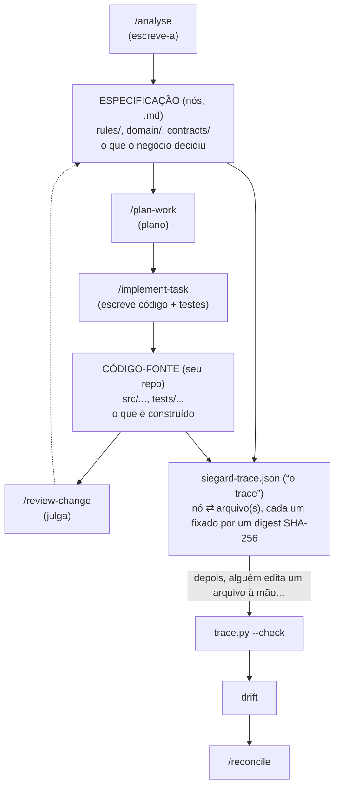

> [← Glossário](../siegard-glossary.pt-BR.md) · Anterior: [Conceitos prévios](01-conceitos-previos.md) · Próximo: [A jornada completa de uma mudança, contada do começo ao fim](03-a-jornada-completa-de-uma-mudanca.md)

## 2. O panorama: que problema o Siegard resolve

### O problema
Em qualquer sistema de software, as **decisões de negócio** (um pedido pode ter no máximo uma
fatura; um chamado só é encerrado com evidência; quem pode ver o quê) acabam espalhadas: um pouco
num documento, um pouco em tickets, um pouco na cabeça das pessoas, e, principalmente, **dentro
do código**. Com o tempo, o código muda — por correções urgentes, merges, refatorações — e
ninguém consegue mais dizer com segurança qual decisão cada trecho de código implementa, nem se
ele ainda a implementa corretamente.

### A resposta do Siegard
O Siegard mantém **uma única fonte escrita da verdade sobre o que o negócio decidiu**, chamada
**especificação**, e faz cada arquivo de código relevante **responder** a ela. Ele registra,
num arquivo chamado **trace**, qual arquivo de código contém qual decisão, com a impressão digital
(digest) de ambos. Quando qualquer um dos dois muda, o Siegard percebe, e oferece o procedimento
certo para restabelecer a correspondência.

### As cinco ideias centrais

| Ideia | Em uma frase | Onde fica |
|---|---|---|
| **Especificação** | Arquivos markdown ("nós") que dizem o que o negócio decidiu. É a autoridade. | a raiz de especificação (`specification_root`), por exemplo `specification/` |
| **Plano** | Tarefas recortadas de um pedido (o "escopo"), cada uma nomeando os nós da especificação que implementa. | `<work_root>/<slug>/`, por exemplo `work/<iniciativa>/` |
| **Entrega** | Registros do que foi escrito para cada tarefa, dos testes que o provam e da revisão. | `<delivery_root>/<slug>/`, por exemplo `delivery/<iniciativa>/` |
| **Trace** | Um arquivo dizendo qual arquivo de código contém o fato de qual nó, com as impressões digitais de ambos. | `siegard-trace.json`, na raiz git do target |
| **Reconciliação** | O procedimento que relê código alterado fora de uma tarefa e refaz o vínculo com a especificação. | `siegard-reconcile/`, ao lado do trace |

Onde fica cada raiz é declarado uma vez, no `siegard.json` do projeto (§4).

### Os princípios que explicam quase todas as regras

Quase toda regra do Siegard que parece estranha à primeira vista decorre de um destes princípios.

1. **A especificação é a autoridade.** Quando o código e um nó discordam, o nó representa o que o
   negócio decidiu. Isso não significa que o nó esteja sempre certo — significa que a
   divergência é tratada como algo a ser decidido explicitamente por uma pessoa, e não resolvida
   silenciosamente no código. Nenhum outro lugar (um comentário, um teste, um prompt, um
   documento) é uma segunda casa para um fato do negócio.

2. **A regra do juiz separado.** Um julgamento nunca é feito pelo mesmo contexto que produziu a
   coisa julgada. Quem escreveu o código não o revisa; quem escreveu os testes não é quem escreveu
   o código; quem escreveu um nó da especificação não julga se o código obedece a esse nó. Por isso
   o Siegard dispara agentes separados (chamados informalmente de **juízes**), cada um num
   contexto limpo. Rodar não é julgar: os comandos do projeto rodam pelo `run.py`, que guarda tudo
   o que imprimiram, então uma entrega pode tentar de novo quantas vezes precisar, e cada tentativa
   fica legível para quem julga depois.

3. **O retorno do juiz é evidência, salva literalmente.** O que um juiz responde é gravado em
   disco exatamente como chegou, sem ajuste. Qualquer pessoa pode, depois, reabrir a resposta e
   conferir o que foi concluído a partir dela.

4. **Evidência, nunca veredito.** Nenhuma skill do Siegard "aprova" nada. Uma revisão produz
   achados (findings) com evidência citada e o custo de cada um; quem decide o que eles significam
   é uma pessoa. Um achado não para nada: ele é relatado, e o valor dele é da pessoa — ou de uma
   política de achados que ela mesma fixou antes, ao armar um goal (§12).

5. **O que a pessoa diz não é inferido; o que ninguém disse é decidido e divulgado.** O conjunto de
   arquivos de uma reconciliação, o escopo de um plano, a tarefa a entregar, a rota de uma mudança,
   o pedido de levar um escopo de ponta a ponta: tudo é declarado por uma pessoa. Uma skill que
   escolhesse o próprio escopo cobriria algo diferente a cada execução. Duas exceções, sempre
   divulgadas no relatório:
   - **uma entrada com uma só resposta possível** — o projeto tem um único target, existe uma
     única iniciativa viva, ou a sessão roda dentro de um repositório cuja raiz git tem
     `siegard.json` (essa raiz é o projeto, como `project.py --here` a resolve): a skill decide;
   - **um fato do negócio que a especificação não diz** e de que o planejamento ou a entrega
     precisam: em vez de parar à espera de uma pessoa, ele é **decidido** por um contexto que não
     viu o recorte de tarefas que o levantou, gravado no nó e registrado no **decision log** dele.
     A pessoa revisa depois, e discordar é uma mudança comum. Uma **contradição** — a especificação
     dizendo o contrário do que o escopo pede — nunca é decidida: só a pessoa a resolve.

6. **O que é mecânico é feito por script.** Validar, comparar digests, dobrar retornos num
   registro, contar pendências, dizer se uma porta seria recusada, dizer se um goal terminou: tudo
   isso é feito por scripts, sempre da mesma forma. Um modelo poderia esquecer uma regra no meio de
   uma lista longa; um script, não.

7. **Parar, entregar a porta e recomendar.** Quando uma skill encontra algo que só uma pessoa pode
   resolver, ela para e entrega, no relatório, a **invocação pronta para colar** da skill que
   resolve o problema (a "porta"). Quando há mais de uma porta, o relatório **recomenda** uma,
   dizendo por quê, o fato que a decide e o fato que mudaria a recomendação. A recomendação é de
   um de dois tipos:
   - **derived** (derivada), quando um fato em disco decide — a outra porta seria recusada pela
     própria skill, quebraria uma regra, já está feita, ou pagaria duas vezes a mesma leitura;
   - **judged** (julgada), quando nenhum fato decide e a escolha é de custo ou de leitura do pedido;
     o relatório diz que é um julgamento.

   Três perguntas nunca recebem recomendação, porque são da pessoa: uma contradição entre escopo e
   especificação, duas leituras de uma mesma evidência, e quanto vale um achado. Uma porta
   recomendada só é **tomada** sem perguntar onde a pessoa já autorizou: uma derived, quando a
   mensagem da pessoa manda seguir (ou numa rota de ponta a ponta que ela pediu) e o `door.py
   --check` aceita a porta; uma judged, só sob um **grant** que a pessoa armou (§12). Cada porta
   tomada vira uma linha `decided:` no log da execução.

8. **Evidência não é sobrescrita.** Uma execução capturada, o retorno de um juiz, um registro de
   reconciliação ou de revisão não são reescritos: uma nova tentativa ganha um nome novo (o
   `run.py --next` numera as execuções repetidas), e um nome já usado é recusado. Assim, todo o histórico de tentativas permanece legível. O que sai da árvore —
   uma iniciativa fechada que o `/siegard-archive` retira — continua no histórico do git.

9. **Cada skill commita o que escreveu, e nada mais.** Uma skill de rota (`/analyse`,
   `/plan-work`, `/implement-task`, `/review-change`, `/reconcile`) termina com um commit restrito
   por pathspec às pastas que ela mesma escreveu, com uma mensagem que nomeia a skill e o slug. Ela
   nunca leva junto uma mudança que não fez, e nunca faz `push`, cria branch ou reescreve histórico:
   isso é só da pessoa, e, com um goal ou um grant armado, um hook o recusa. A pessoa revisa depois,
   lendo o commit.

10. **O framework executa o que o projeto autoriza, e nada que ele mesmo componha.** Instalar,
    compilar e testar rodam de verdade, mas cada comando e cada pacote vêm do registro do próprio
    projeto (o standard, §4). O Siegard não conhece nenhuma tecnologia e não inventa comando; um
    pacote ou um passo novo só passa a valer quando o registro ganha a entrada, por edição da
    pessoa ou por uma sessão que grava exatamente o que as palavras dela nomearam.

---
> [← Glossário](../siegard-glossary.pt-BR.md) · Anterior: [Conceitos prévios](01-conceitos-previos.md) · Próximo: [A jornada completa de uma mudança, contada do começo ao fim](03-a-jornada-completa-de-uma-mudanca.md)
