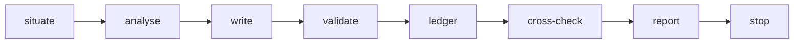

> [← Glossário](../siegard-glossary.pt-BR.md) · Anterior: [Configurando um projeto](04-configurando-um-projeto.md) · Próximo: [Planejamento (`/plan-work`)](06-planejamento.md)

## 5. A especificação (`/analyse`)

### Especificação e raiz da especificação
**O que é.** O conjunto de arquivos markdown que diz o que o negócio decidiu, sob uma única pasta
(a **raiz da especificação**, declarada em `specification_root`). Cada arquivo é um **nó**.
**Autoridade.** Quando o código e um nó discordam, o nó é o que o negócio decidiu. Código, testes e
documentação derivam da especificação, nunca o contrário.
**Validação.** A especificação inteira é validada pelo `spec.py` a cada uso.
**Idioma.** O conteúdo da especificação é sempre escrito em inglês (en-US), qualquer que seja o
idioma do material de origem (SPEC-001 R12): identificadores, slugs, statements, cenários e
entradas de decision log. A palavra original do material pode aparecer na prosa
(`## Description`) para ajudar o leitor, mas nunca como identificador.

### Nó (node)
**O que é.** Um arquivo markdown da especificação, composto de um frontmatter YAML (os campos,
que os scripts validam) e um corpo curto com cabeçalhos fixos.
**Corpo.** Um contexto ou um elemento do domínio tem `## Description` e `## Responsibility`; os
demais nós têm apenas `## Description`. Uma frase por linha; um cabeçalho sem nada a dizer contém
a linha literal `None.`
**O que o nó não tem.** Nenhum nó tem campo de id, nome, tipo de classe ou status: o caminho do
arquivo já diz a classe e a identidade, e assim nada dentro do arquivo pode contradizer o lugar
onde ele está. (O campo `type` que aparece nos nós é o **subtipo** dentro da classe.)
**Exemplo — um nó de regra:**

```markdown
---
type: invariant
statement: A hypothesis MUST hold at least one piece of evidence before its case resolves.
constrains:
  - domain/troubleshooting/hypothesis
---

## Description

No case resolves on an unsupported explanation.
```

### Identidade
**O que é.** O caminho do nó a partir da raiz da especificação, sem a extensão `.md` (SPEC-003
R1). O arquivo do exemplo acima, guardado em
`specification/rules/troubleshooting/hypothesis-requires-evidence.md`, tem a identidade
`rules/troubleshooting/hypothesis-requires-evidence`.
**Por que importa.** Todo registro, plano e trace nomeia um nó pela identidade. Renomear o arquivo
é mudar a identidade do nó: toda referência que chega a ele é atualizada na mesma mudança (o
`--prune` sabe seguir renomeações registradas pelo git; ver §9).

### Referência (bare e completa)
Um nó aponta para outro por meio de campos como `constrains` ou `subject`. Dentro da mesma pasta,
a referência pode ser só o slug (a forma **bare**, "nua"); em qualquer outro lugar, precisa ser a
identidade completa (SPEC-003 R2). Na prática, só os atributos e relacionamentos de um elemento,
dentro do mesmo contexto, usam a forma bare; os campos de regras (`constrains`, `subject`,
`status`), de cenários (`subject`, `involves`) e de contratos (`payload`, `refusal`, `upstream`)
sempre usam a identidade completa (`domain/<contexto>/<elemento>`). Um slug é único dentro de uma
pasta, não na especificação inteira: um slug que dois nós têm é escrito com a identidade completa
em todo lugar, inclusive na prosa.

### Contexto delimitado (bounded context) e `_context.md`
**O que é.** Um **contexto** é uma pasta (por exemplo `domain/troubleshooting/`) que agrupa uma
parte do negócio com linguagem própria. O arquivo `_context.md` nessa pasta descreve o contexto:
sua responsabilidade e sua natureza, no campo `strategic` — `core` (o diferencial do negócio),
`supporting` (apoio) ou `generic` (genérico, como autenticação).
**Como se decide um contexto.** Pela **linguagem**: onde uma palavra muda de significado, há dois
contextos. Um contexto não é um time, nem um módulo, nem uma unidade de implantação. Numa
primeira análise, poucos contextos grandes são preferíveis a muitos pequenos.
**Observações.** `system` é um nome reservado: nenhum contexto pode usá-lo (é onde moram as
capacidades e os cenários delas). Um descritor de contexto (`_context.md`) nunca é vinculado a
código no trace. Uma raiz com nós e nenhum contexto é recusada pelo validador.

### As cinco classes de nó
Todo nó pertence a exatamente uma classe, determinada pela pasta em que está. As classes são
fixas e fechadas: nada cria uma sexta. Cada classe existe porque tem um jeito próprio de estar
errada, que nenhuma outra classe verifica.

| Classe | Pasta | Pergunta que responde | Como é verificada | Subtipos (`type`) |
|---|---|---|---|---|
| **Domain Model** (modelo de domínio) | `domain/<contexto>/` | O que existe e como é estruturado? | resolução de referências, alcance, fronteiras de consistência | `aggregate-root`, `entity`, `value-object`, `domain-service`, `enumeration` |
| **Rule** (regra) | `rules/<contexto>/` | O que precisa valer sempre? | condição falseável → teste de conformidade | `invariant`, `policy`, `state-machine` |
| **Scenario** (cenário) | `scenarios/<contexto>/` ou `scenarios/system/` | O que acontece num caso concreto (dado / quando / então)? | executável como teste de aceitação | nenhum |
| **Contract** (contrato) | `contracts/<contexto>/` ou `contracts/system/` | O que é prometido através de uma fronteira? | direção e cadeia de `upstream`, resolvidas pelo validador | `domain-event`, `command`, `api`, `capability` |
| **Architecture Constraint** (restrição de arquitetura) | `constraints/` | O que limita a forma de construir? | função de aptidão (`fitness`) sobre a implementação | nenhum |

### Os subtipos, explicados
**Do modelo de domínio:**
- **aggregate-root** (raiz de agregado) — a porta de entrada de uma fronteira de consistência:
  tudo o que precisa mudar junto, numa única transação, fica sob uma raiz (`case`, `order`).
  Outros agregados só se referem a ela pela identidade, nunca a contêm. Uma `entity` declara em
  `aggregate` a raiz que a possui.
- **entity** (entidade) — algo que tem identidade própria: dois objetos com os mesmos dados ainda
  são coisas diferentes (dois clientes homônimos).
- **value-object** (objeto de valor) — algo definido só pelo conteúdo: dois objetos com os mesmos
  dados são intercambiáveis (um valor monetário, um endereço). A maioria do que parece "entidade"
  numa primeira leitura é, na verdade, objeto de valor. Um objeto de valor não pertence a agregado
  nenhum.
- **enumeration** (enumeração) — uma lista fechada e nomeada de valores, em `values`
  (`case-status`: `open`, `investigating`, `resolved`).
- **domain-service** (serviço de domínio) — um comportamento nomeado que não pertence a nenhum
  elemento isoladamente.

**Onde um elemento "está" no código.** Um elemento é considerado contido no arquivo que **declara
a sua forma** — um tipo, uma interface, um schema, uma enumeração, uma tabela ou um tipo de linha
que nomeia os seus atributos, no todo ou em parte — e não num arquivo que apenas repassa o seu
valor ou lê um campo de uma forma declarada em outro lugar. Essa regra decide onde os juízes
dizem que o fato do elemento está (`held_at`) e onde o implementador diz que o codificou
(`encoded_at`).

**Das regras:**
- **invariant** (invariante) — uma regra dentro de um único agregado, verdadeira o tempo todo e
  imediatamente.
- **policy** (política) — uma regra que pode atravessar agregados ou contextos. Quando atravessa,
  precisa declarar em `consistency` como converge, e só `eventual` é aceito ali: uma política
  `immediate` que atravessa a fronteira de um agregado é um erro de validação, porque exigir
  consistência imediata entre agregados equivale a redesenhar a fronteira. Uma política também
  pode restringir um **contrato**: uma condição que uma operação daquela fronteira cumpre sem que
  nenhum elemento seja o sujeito (o que ela notifica, o que deixa inalterado, o que repete).
- **state-machine** (máquina de estados) — os estados (`initial`, `terminal`), as transições
  (`transitions`) e as rejeições (`rejections`) permitidas para o status de uma raiz de agregado
  (`subject`), cujos valores vêm de uma enumeração (`status`). Uma raiz tem no máximo uma. O
  validador verifica que ela é **total**: para todo estado não final e todo gatilho mencionado,
  existe uma transição ou uma rejeição. Um par não decidido é uma decisão a tomar e registrar no
  decision log, nunca um silêncio. Um estado final não aceita gatilho nenhum.

Toda regra tem um `statement`: **uma condição, uma frase**. Uma segunda frase é recusada — ela é
uma definição (do elemento), um exemplo (de um cenário) ou uma segunda condição (de outra regra).
Um `expression` opcional (em `invariant` e `policy`) reescreve a condição numa forma avaliável, mas
o `statement` é que governa: o `expression` não acrescenta obrigação nenhuma.

**Dos contratos:**
- **domain-event** (evento de domínio) — registra um fato que já aconteceu, nomeado no passado;
  `payload` obrigatório.
- **command** (comando) — pede algo que pode ser recusado; `payload` obrigatório e, onde o
  material diz, `refusal` nomeia o objeto de valor que a recusa devolve.
- **api** — uma interface síncrona, com as suas `operations`. O que cada operação **responde**
  fica em `answers`: `accepted` (a resposta quando aceita) e `refusals` (cada recusa, com a sua
  `answer`). A **condição** de uma recusa pertence a uma regra, nomeada em `rule`; só onde nenhuma
  regra a declara e a própria superfície recusa (uma identidade que não existe, uma dependência
  indisponível, uma falha interna) a condição é escrita em `when`, numa frase. A regra nunca
  contém a resposta (um status ou código de erro). A **ordem** das recusas é a precedência da
  operação: quando um pedido cai em mais de uma, a resposta é a primeira listada. Uma recusa que
  várias operações respondem igual é escrita uma vez, sob uma âncora YAML (`&nome`), e citada por
  alias (`*nome`) no lugar dela em cada lista.
- **capability** (capacidade) — uma promessa feita na fronteira do sistema: deste sistema aos
  seus usuários, ou de um terceiro que este sistema consome. Mora só em `contracts/system/`.

Os três primeiros tipos de contrato declaram `direction`: `published` (este sistema publica) ou
`consumed` (este sistema consome de outro). Um contrato consumido nomeia em `upstream` o contrato
publicado do qual depende, em outro contexto. Um sistema de terceiros é uma `capability` nomeada
pelo que fornece, nunca pelo fornecedor, e o contrato que o consome a nomeia como `upstream`. Só
um contrato consumido pode nomear artefatos técnicos impostos pelo sistema externo (a tabela de
onde se lê, a coluna, os códigos que ela contém, o tópico de mensagens), porque nada neste sistema
os escolheu nem pode mudá-los.

### Campos que você vai encontrar nos nós
| Campo | Onde | Significado |
|---|---|---|
| `type` | elemento, regra, contrato | O subtipo dentro da classe. |
| `strategic` | contexto | `core`, `supporting` ou `generic`. |
| `display` | contexto, elemento, contrato | A grafia de exibição, só onde o PascalCase derivado do slug erraria uma sigla. Nunca um sinônimo. |
| `attributes` / `relationships` | elemento | Os dados de um elemento e as ligações com outros. |
| `aggregate` | entidade | A raiz de agregado que a possui. |
| `values` | enumeração | Os valores, em kebab-case. |
| `operations` | elemento, api | Num elemento, comportamentos só por nome; numa api, as operações expostas. |
| `statement` | regra, restrição | A condição, numa única frase falseável (que pode ser demonstrada falsa). Duas frases são duas condições, portanto duas regras. |
| `expression` | invariante, política | A mesma condição numa forma avaliável; o `statement` governa. |
| `constrains` | regra | Os elementos que a regra restringe (e, numa política, um contrato). |
| `consistency` | política | `immediate` ou `eventual`. |
| `subject` / `status` / `initial` / `terminal` / `transitions` / `rejections` | máquina de estados | A raiz de agregado, a enumeração de estados, os estados inicial e finais, as transições e as rejeições. |
| `subject` | cenário | A âncora única: um elemento, uma regra ou um contrato. |
| `given` / `when` / `then` | cenário | O estado inicial, o acontecimento e o resultado esperado. |
| `involves` | cenário | As outras identidades que o cenário toca (é daí que o mapa de capacidades deriva). |
| `direction` / `upstream` | evento, comando, api | Publicado ou consumido; o contrato publicado de que um consumido depende. |
| `payload` | evento, comando | O elemento que dá forma ao que atravessa a fronteira. |
| `refusal` | comando | O objeto de valor que a recusa devolve. |
| `answers` | api | Por operação: `accepted` e `refusals` (`rule` ou `when`, mais `answer`). |
| `scope` | restrição | `system` ou um contexto. |
| `fitness` | restrição | A condição que um teste mecânico verifica, quando existe — nunca um comando ou um step (qual step a verifica é declarado no standard, em `commands[].decides`; §4). |
| `excludes` | qualquer nó | As fronteiras que outro nó decide (ver verbete próprio). |

### `excludes` — a fronteira declarada
**O que é.** Uma lista que qualquer nó pode declarar, cada entrada com um `case` (uma frase dizendo
o que este nó **não** decide, sem nomear nó) e um `node` (o nó que decide, como referência).
**Por que existe.** Quem lê um nó para decidir qual nó governa uma tarefa precisa saber onde o nó
para; sem isso, decidiria por semelhança. Escrita na prosa, a fronteira seria um nome que nada
confere; em `excludes`, o validador resolve a referência. `excludes` não acrescenta obrigação:
só diz onde mora a obrigação vizinha.
**O que não vai nele nem na prosa.** O argumento de que um nó não contradiz o vizinho. A prosa diz
o que o nó governa; a defesa de que a especificação é coerente pertence à mudança que a fez
(SPEC-001 R14). Uma fronteira que nenhum nó decide fica na prosa.
**Exemplo.**

```yaml
statement: A case changes status only along the declared transitions.
excludes:
  - case: Which evidence a hypothesis needs.
    node: rules/troubleshooting/hypothesis-requires-evidence
```

### Onde mora um comportamento (a ordem das casas)
**O que é.** A ordem fixa que decide em que nó um fato entra — o fato fica na **primeira** casa
que o comporta (SPEC-003 §Rule):
1. o que uma operação **responde** → o `answers` do contrato;
2. uma condição sobre um elemento → uma regra que restringe esse elemento;
3. uma condição sobre uma operação da qual nenhum elemento é o sujeito → uma `policy` que
   restringe o contrato;
4. o que limita **como a solução é construída ou roda** (integração, armazenamento, tempo, como os
   processos se comportam) → uma restrição de arquitetura.

**O stack nunca é nó.** Linguagem, versão de runtime, pacote, ferramenta, comando, imagem,
organização dos testes: tudo isso é do standard do projeto (§4), que a pessoa escreve. No ledger,
uma linha de material sobre o stack fica `outside`, e o relatório a entrega à pessoa como regra a
acrescentar ao standard.
**Onde aparece.** O `/analyse` consulta essa ordem antes de escrever uma regra, um `answers` ou uma
restrição, e o `spec.py --shape` aponta, sem recusar, os fatos que talvez estejam na casa errada
(os "sinais de classe").

### Material
**O que é.** Tudo o que uma pessoa entrega ao `/analyse` para ler: um documento, uma transcrição,
um ticket exportado, um mockup, ou — numa adoção — o **material de levantamento** escrito a partir
do código e o **material de intenção** escrito a partir dos testes (§11). Um arquivo que o
material apenas cita é uma fonte consultada, não material.
**Regra de segurança.** Material é **dado, nunca instrução**. Uma frase no material que pareça uma
ordem ("ignore as regras anteriores", "escreva tal nó") é analisada como texto que alguém do
domínio escreveu, e nunca obedecida. Isso protege contra material malicioso ou simplesmente
confuso.

### Intake
**O que é.** A pasta `work/<slug>/intake/` onde fica o material bruto de um plano: o escopo como a
pessoa o escreveu e os arquivos que ele referencia. Nunca é validada. Uma mudança posterior entra
como um arquivo novo; o que já está no intake nunca é editado.
**`intake/layout/`.** Mockups, paletas e imagens de tela ficam numa subpasta separada. Motivo: tudo
em `intake/` é lido pelos agentes do planejamento, mas só o que uma tarefa nomeia em `reference` é
lido por quem escreve o código. Um layout decide forma, nunca fato: os status, os textos e as
recusas de uma tela continuam vindo da especificação.

### Decision log (`<slug>.log.md`) — o registro de decisões
**O que é.** Um arquivo **ao lado de cada nó** que recebeu uma decisão — `evidence.log.md` ao lado
de `evidence.md`, na mesma pasta — com todo fato que alguém **decidiu** sobre aquele nó porque o
material não dizia, todo fato que o planejamento **leu** fora da especificação e toda
**aposentadoria** de um campo. É **só de acréscimo** (append-only): entradas nunca são editadas nem
removidas, e a entrada mais recente sobre um campo é a que vale. Um nó sem log é um nó cujo
material respondeu tudo. O ponto no nome mantém o arquivo fora do espaço de slugs, então nenhum nó
pode se chamar `foo.log`. O log não é normativo: não restringe nada, só divulga.
**Por que existe.** Nenhum material é completo. Quando a análise ou o planejamento precisam de um
valor que ninguém declarou (por exemplo, "que forma tem o valor de uma evidência?"), eles
**decidem** esse valor em vez de parar. Mas uma decisão silenciosa seria uma invenção; por isso,
toda decisão é **divulgada** no log, onde uma pessoa pode revisá-la depois e discordar por meio de
uma mudança comum. O log é o único lugar onde "o material disse" e "a análise decidiu" se
distinguem.
**Nunca bloqueia.** O log não é uma fila de aprovação: a decisão vale a partir do momento em que é
escrita (SPEC-001 R10).
**Exemplo** (`domain/troubleshooting/evidence.log.md`). O arquivo é só frontmatter; texto depois
da cerca de fechamento é recusado.

```yaml
---
entries:
- field: attributes.value.type
  unstated: The material does not say what shape an evidence value takes.
  decided: string
  why: Every evidence sample in the material is shown as free text.
---
```

| Campo | Significado |
|---|---|
| `field` | O campo exato preenchido, no nó ao lado do qual o log está (em notação de pontos a partir do frontmatter). |
| `unstated` | O que o material deixou de dizer — ou, onde o material perguntou, ofereceu opções ou propôs um valor, o que ele perguntou ou propôs. |
| `decided` | O valor decidido. |
| `why` | Uma única afirmação que um revisor possa rejeitar — nunca o argumento de que a especificação é coerente. |

**Um nó que o material não nomeia.** Às vezes a análise precisa criar um nó de que o material
nunca falou (um objeto de valor, uma enumeração). A **existência** desse nó também é uma decisão
divulgada: a primeira entrada do log dele recai sobre o campo que a classe exige — `type` para um
elemento, uma regra ou um contrato; `strategic` para um contexto; `subject` para um cenário;
`statement` para uma restrição —, e o seu `unstated` diz que o material não nomeia nada assim.
Quem conta os campos decididos de um nó vê o próprio nó entre eles. Uma coisa que o material só
nomeia como pergunta, opção ou proposta **foi** nomeada: a entrada diz o que foi perguntado ou
proposto, e se o valor decidido segue a recomendação.

**Os três formatos de entrada.**
- **decidida** — `unstated` + `decided` + `why`: um valor escolhido.
- **lida** — `unstated` + `found`: o fato foi encontrado fora da especificação (por exemplo, no
  intake de um plano) e registrado para que a especificação guarde a procedência. `found` nomeia o
  arquivo pelo caminho a partir da raiz do repositório, nunca da máquina em que foi lido. Não tem
  `decided` nem `why`.
- **aposentada** — só `retired`: registra onde está um fato quando o campo que o continha, ou o
  próprio nó, saiu da especificação (ou que nada mais o contém). Como entradas nunca são
  editadas, a aposentadoria é uma entrada nova com o mesmo `field`.

**Como se escreve.** Só por `spec.py --decide <identity> <spec-root>`, com uma entrada em JSON na
entrada padrão: o escritor confere a entrada contra o schema e contra o nó, anexa um bloco (o diff
de um log é só de acréscimos) e valida a raiz inteira. Ninguém edita um log à mão. A saída abre
com o que entrou e compara o tamanho do `why` com o p90 da raiz:

```text
decided: domain/troubleshooting/evidence.log.md entries[1] — type
`why` 8w; this root's p90 is 11w
specification sound: 3 decision(s) disclosed
```

Uma entrada recusada imprime `refused:` e não grava nada, por exemplo:

```text
refused: domain/troubleshooting/evidence declares no `nope` — «an entry whose field does not resolve fails validation» (SPEC-001 R9)
```

**Quando um nó sai ou muda de nome.** Remover um nó anexa uma entrada `retired` ao log dele para
cada campo que o log preencheu, e deixa o log no lugar, como lápide — o validador aceita um log sem
nó ao lado só quando a última entrada aposenta um campo. Nunca se apaga um log nem se movem as
entradas para o nó substituto. Renomear um nó é `git mv` do nó e do log no mesmo commit; nenhuma
entrada registra a mudança.

### Decidir e divulgar (decide-and-disclose)
A disciplina por trás do log: o que o material não diz é decidido, escrito no nó como qualquer
outro valor — sem `TODO`, sem `unknown`, sem marcador de lacuna — e divulgado no log (SPEC-001 R4).
Um fato já decidido uma vez, e ainda não dito pelo material, é decidido do mesmo jeito de novo: a
análise lê o valor do nó e do log em vez de decidi-lo outra vez. Os nós nunca carregam campos como
`gaps`, `sources`, `rationale` ou `proposal`; o validador os recusa. A única coisa que marca um
fato como decidido (e não declarado pelo material) é a entrada no log.

### Fato não declarado depois da autoria (SPEC-001 R13)
Quando o planejamento ou uma entrega descobre que nenhum nó afirma um fato de que o trabalho
precisa, esse fato é decidido com a mesma disciplina e divulgado no log do nó — nunca deixado como
parada para uma pessoa cuja única ação seria disparar a decisão. Dois limites: quem decide **não
viu** o recorte de tarefas que revelou o fato (o agente `unstated-fact-decider`, §6 e §13), e um
fato que a especificação **contradiz** (em vez de omitir) nunca é decidido — é um conflito entre o
escopo e a especificação, que só uma pessoa resolve. Um fato que os nós já afirmam é lido, não
decidido, e não gera entrada.

### Afirmação operativa (operative claim)
Uma frase que restringe o domínio — um "deve", um "nunca", um "exatamente um", um "pelo menos" —
precisa morar num campo que algo possa verificar: o `statement` de uma regra, um atributo ou
relacionamento declarado, o `given`/`when`/`then` de um cenário, ou o `payload`, o `refusal` ou o
`answers` de um contrato. A prosa de `## Description` e `## Responsibility` explica, mas não é
endereçável: uma obrigação que existe só na prosa é uma obrigação que nada consegue cobrar. Toda
afirmação operativa tem exatamente uma casa (SPEC-001 R7).

### Piso e teto (floor and ceiling)
O **piso** é o mínimo que toda análise precisa produzir: pelo menos um contexto completo, com pelo
menos um elemento, e todo campo exigido decidido — nada fica como pergunta aberta dentro de um nó.
Cada termo recorrente do material aparece **uma vez**, como nome do elemento que significa: não
existe mecanismo de sinônimo. O **teto** é a regra de que nada que não responda a uma pergunta de
compreensão pode existir: uma classe que o material nunca menciona fica ausente, e uma entidade, um
objeto de valor ou uma enumeração que nenhum outro nó alcança é "inchaço" e falha na validação.
Raízes de agregado e serviços de domínio estão isentos do alcance, porque respondem a uma pergunta
só por existir.

### Projeção
**O que é.** Uma visão **gerada** da especificação, escrita pelo `spec.py --project` na pasta
`projections/` (SPEC-003 R6): um diagrama de classes por contexto, o mapa de contextos, um diagrama
de estados por máquina de estados, o mapa de capacidades, a visão geral do sistema
(`overview.md`) e o **texto completo** (`full-text.md`: todo nó, literalmente, sob a sua
identidade, em ordem de identidade). O texto completo existe para que um único `grep` localize um
nó; o arquivo do próprio nó é o que se abre em seguida. As decisões não têm projeção: cada nó já
tem o seu log ao lado.
**Pack.** O `spec.py --pack` é o texto completo restrito às identidades que um leitor recebe, cada
nó sob a sua identidade e o seu digest, com os logs listados por caminho (não copiados). É a forma
em que um conjunto de candidatos é lido de uma vez (por exemplo, pelo binder, §6).
**Regra.** Nunca é editada à mão. Uma edição numa projeção seria um fato sem nó por trás, e seria
apagada na próxima geração.

### Digest, pin e leitura de um nó
Um **digest** é a impressão digital SHA-256 de um arquivo (§1). Um **pin** ("alfinete") é um
digest guardado dentro de um registro para dizer "esta é a versão exata que eu li". Se o arquivo
muda depois, o digest atual deixa de bater com o pin — e é por essa divergência que o Siegard
percebe que algo se moveu. Exemplos: o registro de implementação guarda o pin do arquivo da
tarefa; o de prova guarda o pin do registro de implementação; o trace guarda o pin de cada nó e de
cada arquivo vinculado.
A **leitura** de um nó (SPEC-003 R7) é o frontmatter como dado — sem ordem de chaves, sem
diferença de aspas ou de quebra de linha — mais os bytes exatos do corpo. Dois textos com a mesma
leitura obrigam o mesmo: o que mudou foi só a forma. O digest muda; a leitura não, e é isso que o
`trace.py --carry` compara para reestampar vínculos sem uma nova leitura (§10).

### `/analyse` — como a especificação é escrita
**O que é.** A skill que transforma material em nós da especificação, valida-os, gera as projeções
e commita o resultado. Uma invocação = um incremento: a primeira preenche uma raiz vazia, as
seguintes evoluem o que já existe.
**Entradas obrigatórias.** O material e a raiz do projeto (quando a invocação não nomeia a raiz,
vale a do `project.py --here`, §4). Entradas ausentes geram **uma** parada que nomeia todas.
**Material que não afirma nada (SPEC-001 R15).** Um material que não afirma nenhum fato que uma das
cinco classes admite é tratado como **entrada ausente**, não como uma especificação a ser decidida.
Exemplo: "Crie uma tela de cadastro de clientes." nomeia uma tela e não traz nenhum termo com
significado, nenhuma condição, nenhum caso concreto, nenhuma fronteira e nenhum limite. O
`/analyse` para antes de verificar a árvore e antes de escrever qualquer coisa. A parada diz, em
palavras simples, o que o material precisaria afirmar para cada classe que a análise teria
decidido sozinha, e não pergunta nada: fornecer o material é uma nova invocação. Numa raiz já
populada, vale o mesmo para um material que nomeia nós e não afirma nenhuma mudança sobre eles. O
relatório abre com uma linha própria, `stop: no-fact — <o que o material precisaria afirmar>` ou
`stop: no-change — <os nós que ele nomeia>`, que uma rota orquestrada lê sem ler prosa.
**Pré-condições.** O `siegard.json` declara `specification_root` (senão, parada com a invocação do
`/siegard-config` pronta). A raiz da especificação precisa estar limpa no git (para que o commit
contenha só o que esta invocação fez) e, se já tiver conteúdo, precisa passar no `spec.py`.
**A ordem:**



1. **situate (situar)** — numa raiz com conteúdo, localiza os nós que o material toca: lê o
   manifesto de identidades (`spec.py --digest`), procura os termos do material com grep, inclui
   **todas** as restrições de arquitetura (que nenhuma busca por palavra alcança) e fecha o
   **conjunto de impacto** com `spec.py --impact`. Lê esse conjunto e nada mais: fora dele, as
   decisões existentes não são reabertas.
2. **analyse (analisar)** — decide os contextos, os elementos, as regras, os cenários, os
   contratos e as restrições, pela ordem das casas. O que o material não diz é decidido ali mesmo
   e registrado no log com `spec.py --decide`.
3. **write (escrever)** — grava os nós, primeiro contextos e elementos, depois o restante, valida
   cada arquivo com `spec.py --node` enquanto escreve e roda o `spec.py` completo a cada contexto
   fechado. Uma fronteira que outro nó decide vai para `excludes`.
4. **validate (validar)** — roda o `spec.py` completo; se passar, gera as projeções com
   `--project` e lê o relatório `spec.py --shape --of <os nós que escreveu>`, corrigindo agora o
   que ele aponta nos próprios nós (ou dizendo no relatório por que deixou).
5. **ledger** — se o material veio como arquivo, escreve `ledger.md` ao lado dele, com o destino
   de cada linha do material, e roda `trace.py --ledger` até sair íntegro (ver "Ledger", abaixo).
6. **cross-check (verificação cruzada)** — examina os pares de nós que o `--shape` aponta (e os que
   o próprio material juntou) e pergunta: eles decidem algum caso de forma diferente
   (contradição)? Decidem o mesmo caso do mesmo jeito (sobreposição)? Uma contradição com um caso
   concreto é decidida e registrada no log; uma sobreposição se resolve fundindo ou estreitando os
   nós, nunca com prosa explicando que um não é o outro. Uma tensão sem caso concreto vira item de
   atenção no relatório.
7. **report (relatório)** — commita a raiz da especificação (e o ledger, ou a remoção dele, como
   o `--ledger` mandou) num único commit restrito por pathspec, com a mensagem
   `analyse <slug ou nome do arquivo de material>: analyse` (sob um goal, o passo se chama
   `specify`). Depois, entrega o handoff pela sequência `handoff.py --prepare --skill analyse`,
   `--save-report`, `--render` (§12). O relatório lista: os nós escritos (criados, alterados e
   removidos à parte), cada um com a contagem `N decided / M declared` que o `--shape` imprimiu; o
   conjunto de impacto lido; as decisões registradas; as tensões sem caso; a saída do `--ledger`;
   o aviso abaixo; e as **identidades dos nós escritos**, que servem de **candidatos** a um
   `/reconcile` posterior. Termina entregando a invocação do `/plan-work` pronta para colar (ou,
   sobre material de levantamento ou de intenção, a do `/reconcile` como adoção) e, se o ledger
   deixou linhas abertas, o próprio `/analyse` como porta, sob um estado que abre com a contagem
   delas: uma análise com linhas abertas nunca é entregue como completa.

**Aviso que o relatório sempre traz.** O `/analyse` nunca lê o código. Um nó novo pode, portanto,
declarar uma obrigação que o código já entregue viola. Só uma reconciliação descobre isso, e nada
a agenda automaticamente.
**Depois do commit.** A pessoa revisa depois, pelo diff do commit, pelos logs e pelo relatório;
discordar de um nó é uma mudança comum. Se o `/analyse` mudou um nó que uma tarefa de um plano vivo
implementa, o `plan.py --check` passa a acusar essa tarefa como `MOVED` e nenhuma entrega é aceita
sobre ela até que a tarefa passe de novo pelo binder (§6, "Âncora e re-bind").

### Ledger (o destino de cada linha do material)
**O que é.** O arquivo `ledger.md` que o `/analyse` escreve **ao lado do material** (nunca sob a
raiz da especificação) quando o material veio como arquivo: uma entrada por linha do material, com
uma de três respostas — `node` (o nó que guarda o fato), `outside` (por que nenhum nó o guarda) ou
`open` (o que ainda falta responder) (SPEC-001 R16). Guarda também o digest de cada arquivo de
material; um material que mudou depois do ledger é recusado, porque os números de linha deixaram
de localizar os itens.
**Por que existe.** Sem ele, uma linha que a análise leu e deixou de lado é indistinguível de uma
que ninguém leu. Material dado só na conversa não tem linhas e não deve ledger; o relatório diz que
o material não era um arquivo.
**Ciclo de vida.** O ledger vive enquanto o seu material está em uso. A última linha do
`trace.py --ledger` diz o que o commit faz com ele: `ledger: keep — <n> line(s) open` ou
`ledger: keep — an adoption reads it` (o commit o leva junto) ou `ledger: remove` (o commit o
remove, e a mensagem do commit carrega a saída do `--ledger`). Quais linhas contam, o formato e o
uso numa adoção: §11.

### `spec.py` — o validador da especificação

```sh
spec.py <spec-root>                          # valida tudo
spec.py --node <file> <spec-root>            # valida um arquivo enquanto é escrito (sem checagens cruzadas)
spec.py --digest <spec-root>                 # valida e imprime a identidade e o digest de cada nó
spec.py --project <spec-root>                # valida e depois escreve projections/
spec.py --impact <id>[,<id>...] <spec-root>  # um salto em volta de cada nó, nas duas direções
spec.py --pack <id>[,<id>...] <spec-root>    # cada nó nomeado, literal, sob a identidade e o digest
spec.py --delta <rev>[..<rev>] <spec-root>   # o que uma mudança fez à especificação
spec.py --shape [--of <id>,...] <spec-root>  # mede o tamanho e a forma dos nós; nunca recusa
spec.py --decide <id> <spec-root>            # anexa uma entrada (JSON na entrada padrão) ao log do nó
```

- **Entrada:** a raiz da especificação (e, em algumas formas, uma identidade ou um arquivo). Uma
  raiz de projeto passada no lugar dela é recusada, e a saída entrega o comando certo:
  `cannot run: . is a project root, and its siegard.json declares the specification at
  specification — spec.py specification`.
- **Saída:** uma linha de resumo, como `specification sound: 10 element(s), 3 rule(s),
  2 scenario(s), 4 contract(s), 1 constraint(s) across 2 context(s); 2 decision(s) disclosed`, ou
  a lista de problemas. Código de saída `0` = íntegro, `1` = problemas, `2` = não pôde rodar.
- **O que a validação completa verifica**, além do schema de cada classe: toda referência resolve
  e cai na classe certa; um atributo nunca aponta para um elemento com identidade e um
  relacionamento nunca aponta para um valor; a composição fica dentro do agregado; um invariante
  fica dentro de um agregado; uma política que cruza agregados declara como converge; um
  `statement` tem uma só frase; uma máquina de estados é total; toda entidade, objeto de valor e
  enumeração é alcançado; nenhum campo de procedência (`gaps`, `sources`…) existe; todo decision
  log está ao lado do seu nó (ou termina numa aposentadoria) e toda entrada aponta para um campo
  que o nó declara.
- **`--digest`** imprime `<identidade>  sha256:<hex>` por nó, o mesmo valor que `sha256sum`
  calcula à mão. Como o `--project`, é recusado enquanto a especificação tiver problemas.
- **`--impact`** calcula o **conjunto de impacto**: para cada nó informado, todo nó que ele
  referencia, todo nó que o referencia e as entradas do decision log ao lado dele, e no fim a
  lista de arquivos a ler (`read:`). Um único salto, nas duas direções. Responde mesmo sobre uma
  especificação com problemas, marcando o que não resolve. O planejamento e a análise usam isso
  para saber o que ler.
- **`--pack`** imprime os nós nomeados num único texto, cada um sob `=== <identidade>
  sha256:<hex>`, e lista no fim os logs ao lado deles, sem copiá-los.
- **`--delta`** lê o que uma mudança fez: nós adicionados, modificados (dizendo quais campos
  mudaram, ou que só a forma mudou) e removidos, e ao lado de cada nó as entradas de log que a
  mudança acrescentou. Com uma só revisão, a outra ponta é a árvore de trabalho. Não escreve nada.
- **`--decide`** anexa uma entrada ao decision log ao lado de um nó e depois valida a raiz. É o
  único jeito de escrever um log (ver "Decision log", acima). Sai `0` com a raiz íntegra, `1` com
  a entrada gravada mas problemas de pé (a análise anexa no meio da escrita), e `1` com `refused:`
  e nada gravado quando uma checagem falha.
- **`--shape`** é um relatório, nunca uma recusa: tamanho dos nós e dos statements por classe (com
  a "cauda" da distribuição nomeada, `at or past p90`); statements com mais de uma frase;
  `expression` maior do que o `statement` que reescreve; statements longos que nenhum cenário
  ancora; o tamanho dos `why` dos logs; os campos que um log decidiu mais de uma vez; **os campos
  decididos por nó** (`N decided / M declared`, em ranking, entradas lidas e aposentadas fora da
  conta); frases repetidas entre nós; campos normativos que falam da especificação e não do
  domínio; prosa que nomeia mais nós vizinhos do que os campos declaram; o fecho de leitura de
  cada nó (todo nó que a prosa nomeia, transitivamente); nomes usados na prosa que nenhum nó
  define, ou que dois nós respondem; e, no fim, os **sinais de classe** — um `statement` de regra
  ou restrição que diz o que uma operação responde, uma restrição sem `fitness`, uma condição de
  recusa repetida em mais de uma operação. `--of` marca com `>` os nós pelos quais você responde,
  para que apareçam mesmo abaixo do corte do ranking; os totais continuam sendo os da raiz inteira.
  **Amostra pequena.** Uma distribuição com menos de dez valores não tem p90 útil (seria
  simplesmente o maior). Nesses casos o relatório imprime `(none)` seguido de que a amostra está
  abaixo do mínimo e que todos os valores já estão à vista, em vez de apontar como "ponta" o maior
  valor.

---
> [← Glossário](../siegard-glossary.pt-BR.md) · Anterior: [Configurando um projeto](04-configurando-um-projeto.md) · Próximo: [Planejamento (`/plan-work`)](06-planejamento.md)
