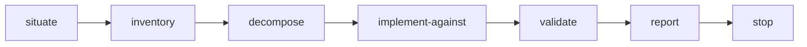

> [← Glossário](../siegard-glossary.pt-BR.md) · Anterior: [A especificação (`/analyse`)](05-a-especificacao.md) · Próximo: [Entrega (`/implement-task`, `/deliver-scope`)](07-entrega.md)

## 6. Planejamento (`/plan-work`)

### `/plan-work`
**O que é.** A skill que transforma um **escopo** declarado e uma especificação válida num
**plano**: inventário, épicos e tarefas, como arquivos markdown em `work/<slug>/`. Cada invocação
é um incremento: a primeira preenche uma raiz de trabalho vazia, e as seguintes evoluem o plano
que ela já tem, com a mesma ordem e a mesma disciplina.
**Modos especiais.** Além do plano comum, tem quatro modos, cada um nomeado explicitamente pela
pessoa (nunca deduzido da árvore): o **fechamento** do plano, o **incremento corretivo**, o
**incremento de fato decidido** e o **incremento de prova**. Cada modo tem a sua referência em
`skills/plan-work/references/`.
**Entradas obrigatórias.** O escopo, a raiz do projeto, o target e o slug da iniciativa. Faltando
alguma, há **uma** parada que nomeia todas juntas. Três delas podem ser decididas e divulgadas em
vez de perguntadas: sem raiz nomeada, vale o toplevel do git do diretório da sessão, desde que
tenha `siegard.json` (`project.py --here`); com um único target declarado, é ele. O standard é
opcional, mas relevante (ver "substrato" na §7).
**Antes de tudo.** Roda `project.py` (as raízes só vêm do `siegard.json`), `spec.py` sobre a raiz
da especificação (qualquer coisa além de passar limpo é parada) e exige que
`git status --porcelain -- <work-root> <specification-root>` não imprima nada: o commit do final
leva essas raízes, e só contém o trabalho desta invocação se elas começaram limpas. Um slug cuja
pasta tem `closure.md` é um plano fechado, e planejar sobre ele é parada.
**A ordem:**



1. **situate** — lista as identidades com `spec.py --digest`, faz grep dos termos do escopo,
   inclui **todo** nó `constraints/` como candidato (uma restrição não declara referências, então
   nenhuma busca chegaria a ela), usa `plan.py --unplanned` para escopos abertos e fecha o conjunto
   de impacto com `spec.py --impact`. Num plano já existente, confere o `plan.json` com
   `plan.py --check`. Com standard, roda `deliver.py --standard --against --specification`.
2. **inventory (inventário)** — grava o escopo em `intake/` (um layout vai para
   `intake/layout/`) e dispara o agente `codebase-surveyor`, que levanta o código existente onde a
   mudança vai cair.
3. **decompose (decompor)** — dispara o agente `backlog-decomposer`, que recebe o conjunto de
   impacto como um único arquivo (`spec.py --pack`) e recorta o escopo em épicos e esqueletos de
   tarefas (sem `implements`).
4. **implement-against (implementar contra)** — dispara um agente `execution-contract-binder` por
   esqueleto, **todos juntos**, cada um decidindo quais nós a tarefa implementa e devolvendo notas.
   Fatos que a especificação não declara vão para o `unstated-fact-decider`. Cada tarefa escrita é
   conferida na hora com `plan.py --node`.
5. **validate** — roda `plan.py --check` mais uma vez (um fato decidido no passo 4 pode ter movido
   tarefas, que voltam ao binder) e depois o `plan.py`, que valida tudo e gera o `plan.json`.
6. **report** — faz o commit (`plan-work <slug>: <modo>` — `plan`, `close` ou o nome do
   incremento) e entrega o relatório pelo `handoff.py` (§12): os nós escritos, o conjunto de
   impacto, as decisões tomadas, as notas, e a invocação do `/implement-task` com a tarefa como o
   único espaço em aberto, ao lado do comando `deliver.py --outstanding` que diz qual tarefa pode
   ser entregue.

Os agentes são disparados pelo nome com prefixo do plugin (`siegard:<agente>`). Só uma tentativa
de disparo que falhou abre a rota inline (a sessão lê o arquivo do agente e aplica a disciplina
dele), e o relatório traz a falha literalmente.

### Escopo
O que a pessoa pede que seja construído, com as palavras dela, gravado em `intake/` e nunca
editado depois (uma mudança vira um arquivo novo em `intake/`). O planejamento nunca o amplia por
conta própria. A única tarefa que o plano pode acrescentar sem que o escopo peça é a que constrói
um **substrato** ausente (ver §7).

### Nós do plano: inventário, épico, tarefa
Todos são markdown com frontmatter; o corpo tem exatamente dois cabeçalhos, `## What it is` e
`## Notes` (uma frase por linha; seção vazia leva a linha literal `None.`). O frontmatter é emitido
com `yaml.safe_dump`, nunca digitado à mão. **O caminho é a identidade**: nenhum nó carrega id,
tipo ou campo de épico; o `kind` é deduzido do caminho pelo validador.

| Tipo | Caminho | O que contém |
|---|---|---|
| **inventory** (inventário) | `inventory/<slug>.md` | Onde o levantamento olhou (`area`, obrigatório mesmo num target vazio) e o que já existe lá: `modules` (módulos), `conventions` (convenções, cada uma com onde foi vista), `must_not_duplicate` (o que não pode ser duplicado), `risks` (riscos) |
| **epic** (épico) | `epic/<slug>.md` | Um grupo de tarefas, os nós pelos quais responde (`covers`) e o que deixa de fora de propósito (`uncovered`, cada item com o porquê) |
| **task** (tarefa) | `task/<epic>/<slug>.md` | Um `objective` falseável, seus `criteria`, os nós que `implements`, suas dependências (`depends_on`) |

**Exemplo de tarefa:**

```markdown
---
title: Record an opened case
summary: The entry point that persists an opened case.
objective: An opened case is persisted and retrievable by its case id.
criteria:
- Opening a case returns its case id.
implements:
- domain/troubleshooting/case
---
## What it is
…
## Notes
None.
```

**Campos de tarefa:**

| Campo | Significado |
|---|---|
| `objective` | O único resultado que a tarefa entrega. Dois resultados são duas tarefas. |
| `criteria` | Condições, cada uma falseável sozinha, que definem quando o objetivo está cumprido. |
| `implements` | Os nós da especificação que a tarefa implementa, por identidade e **sem pin**. Quem decide é o binder, nunca o decompositor. Todo item fica dentro do `covers` do épico. |
| `depends_on` | As tarefas cujo resultado esta usa como base. É dependência, não ordem de execução; o validador recusa ciclos. |
| `produces` | Arquivos que a entrega precisa criar porque o standard os pressupõe (um `package.json`, por exemplo). |
| `stands` | Arquivos (relativos à raiz do target) onde a implementação já existe, ligados no trace aos nós da tarefa. Uma tarefa com `stands` não escreve código: a entrega escreve só a prova. Não convive com `produces`. |
| `reference` | Material que quem escreve o código precisa ler, como um mockup em `intake/layout/`. Decide forma, nunca fato. |
| `rationale` | Por que o planejamento decidiu isto; obrigatório quando a tarefa não implementa nenhum nó (andaime técnico, por exemplo). |
| `sources` | Os arquivos do intake de onde a tarefa foi tirada. |

**O que não existe.** Não há campo de status, prioridade, estimativa ou ordem. O progresso é
derivado dos registros de entrega e do git (ver `--outstanding`, §7).

### `covers` / `uncovered`
O `covers` de um épico lista os nós pelos quais ele responde. Cada nó ali precisa ser implementado
por alguma tarefa do épico **ou** aparecer em `uncovered` com um `why` — uma sobra deliberada e
declarada, nunca uma lacuna esquecida. O validador recusa um nó coberto que não tenha nem uma
coisa nem outra, e também um que tenha as duas.

### Binder (`execution-contract-binder`) e notas
**O que é.** O agente que, para cada tarefa, decide quais nós ela `implements`. Ele recebe o
esqueleto da tarefa (título, resumo, objetivo e critérios — nunca o `rationale`, as dependências
ou o corpo), um arquivo com todos os nós candidatos impressos por `spec.py --pack` (o `covers` do
épico menos o `uncovered`, com o caminho de cada decision log) e a fatia de contrato
`plan.py --contract task --fields implements`.
**Por que é isolado.** Ele chega sem memória de como as tarefas foram recortadas. Assim lê a
especificação pelo que ela diz hoje, e não para "encaixar" numa tarefa já escrita.
**Notas.** O binder nunca reescreve a tarefa. Toda divergência volta como uma **nota**, com uma
de seis **classes**, gravada em `## Notes` da tarefa com uma abertura exata (texto fixo, que os
scripts procuram). O binder pergunta `compound` primeiro e depois as outras na ordem da tabela; a
primeira respondida com "sim" decide, porque as classes se sobrepõem:

| Classe | Pergunta que responde | Efeito | Abertura gravada |
|---|---|---|---|
| `compound` | Um critério afirma duas condições? | O esqueleto volta ao decompositor para ser recortado de novo, uma vez. Nunca é gravada. | — |
| `blocking` | Algum nó **afirma** algo que o objetivo ou um critério contradiz ou excede? | O esqueleto volta ao decompositor com a nota inteira, até duas vezes. Só fica de pé para uma pessoa se o recorte mantiver o critério numa frase que o escopo afirma literalmente, ou se resistir ao segundo recorte. Aí **para a tarefa**. | `BLOCKING, from the specification —` |
| `unstated` | O objetivo ou um critério depende de um fato que nenhum candidato afirma? | Vai para o `unstated-fact-decider`; a especificação ganha o fato. Nunca é gravada numa tarefa (o validador recusa uma abertura `UNSTATED`). | — |
| `underdetermined` | Existe uma implementação que passaria em todos os critérios e que a especificação recusa? | Fica registrada, com a implementação nomeada em `passes`; quem escreve os testes precisa escrever um teste que a exclua. | `UNDERDETERMINED, from the specification —` |
| `remainder` | Uma cláusula de uma regra não chega a nenhum critério desta tarefa? | Registra onde ela pertence (`belongs`). | `REMAINDER, from the specification —` |
| `advisory` | Qualquer outra coisa. | Só informação. | `ADVISORY, from the specification —` |

**Mantida pelo escopo.** Quando o novo recorte mantém um critério `blocking` alegando que o escopo
o afirma, isso aparece numa linha `Kept, the scope states:` com a frase citada, e a skill confere
com `grep -F` nos arquivos do escopo em `intake/`. Frase não encontrada não é frase do escopo, e o
esqueleto volta.
**Nota além do `covers`.** Uma nota que menciona um nó fora do `covers` do épico exige uma de três
ações: ampliar o `covers`, mover a tarefa, ou registrar a decisão de manter, numa linha
`Decision, beyond the covers — stand: <porquê>` logo depois da nota. Sem isso, o validador recusa o
plano.
**Um `covers` que cresce.** Quando uma nota faz um épico ampliar o `covers`, **todos** os
esqueletos daquele épico passam de novo pelo binder, porque o conjunto de candidatos é do épico.

### Fato não declarado (unstated) e `unstated-fact-decider`
**O que é.** Quando o binder descobre que uma tarefa depende de um fato que nenhum nó afirma,
isso **não é uma parada**. Primeiro a skill faz grep dos termos do fato na especificação: um nó
fora dos candidatos que já o afirma é problema de recorte (amplia-se o `covers` ou move-se a
tarefa). O que sobra é silêncio de verdade, e cada fato distinto ganha um agente
`unstated-fact-decider`, que recebe **só o fato** (mais os nós do conjunto de impacto com seus
decision logs, o escopo em `intake/` e os schemas da especificação) — nunca o esqueleto, a nota ou
o raciocínio do binder — e devolve as edições de nó e uma entrada para o decision log.
**Por que "às cegas".** Se o fato fosse decidido por quem vê o recorte da tarefa, a especificação
tenderia a ser dobrada para caber na tarefa. Decidindo às cegas, o fato é decidido pelo que o
domínio pede.
**Disparado, nunca oferecido.** Um fato não declarado não é uma pergunta para a pessoa: perguntar
só a faria apertar o botão de uma decisão que o framework já está autorizado a tomar. A divulgação
é o log e o relatório, depois da escrita; quem discorda reverte a entrada como mudança comum.
**Resultados possíveis.**

| Resultado | O que acontece |
|---|---|
| `stated` | O fato já estava dito (no material em `intake/`, por exemplo). As edições são gravadas. |
| `decided` | O fato foi decidido agora. As edições são gravadas e a entrada do log é anexada por `spec.py --decide`, nunca à mão. |
| `contradicted` | A especificação o contradiz: a nota era `blocking` com a classe errada e segue essa rota. Contradição é sempre de uma pessoa. |
| `standard` | O fato é da stack (linguagem, pacote, ferramenta, comando). Nada vai para a especificação e a tarefa não para: o relatório entrega à pessoa a `rule` devolvida, para ela pôr no standard do projeto. |
| `noticed` | Um item de atenção para o relatório, nunca uma segunda decisão. |

Depois de gravar, a skill roda `spec.py --project`, passa de novo pelo binder todo esqueleto cujos
candidatos incluem um nó tocado, e roda `spec.py --shape --of` sobre os nós tocados (só informa).
**Limite.** Cada fato é decidido uma única vez por invocação. Um re-bind que devolve `unstated`
sobre um fato já decidido aqui, com o nó decidido já entre os candidatos, é uma parada (um
desacordo que só uma pessoa resolve). Um re-bind que devolve fato novo sobre um esqueleto inalterado
é examinado antes: a skill imprime o que já escreveu na especificação (`git status --porcelain`) e
verifica se o fato só existe porque um critério carrega uma condição que um nó decidido aqui diz
não importar — nesse caso o critério é reescrito sem a condição, e nenhum decisor é disparado.

### Âncora, `MOVED` e re-bind
**O que é.** As tarefas não carregam pin: `implements` nomeia os nós por identidade. Quem guarda a
versão é o `plan.json`: quando o `plan.py` deriva o índice, cada aresta `implements` de um plano
vivo leva o digest do nó tal como estava — a **âncora**, ou pin por nó. Se um nó muda depois do
planejamento (um fato decidido, um incremento corretivo), a tarefa passa a **esperar um re-bind**:
o binder precisa ler o nó de novo antes que alguém entregue a tarefa.
**Por que existe.** Sem isso, uma tarefa recortada contra a versão antiga de uma regra seria
entregue contra um texto que ninguém usou para recortá-la.
**Como aparece.** `plan.py --check` mostra linhas `MOVED`; `deliver.py --outstanding` mostra
`waits on a re-bind: <nó> moved since the plan was derived`; e um registro de entrega sobre a
tarefa é recusado. Uma nova derivação **não** limpa o `MOVED`: a tarefa precisa passar pelo binder
(rodar o `plan.py` só para sumir com o aviso seria suprimir o aviso). Um plano fechado não grava
âncoras e nunca mostra `MOVED`.

### Incremento corretivo
**O que é.** Um plano de **uma única tarefa** para **um comportamento errado** em código já
entregue — tipicamente um bug encontrado ao usar o sistema. Não roda levantamento nem
decomposição.
**Por que existe.** Uma correção feita à mão perderia duas garantias: o código e o teste seriam
escritos no mesmo contexto (concordando inclusive no erro), e o trace ficaria com um digest que
não existe mais.
**Como funciona.** A pessoa nomeia o comportamento errado e o arquivo onde ele está. A skill:
(1) grava no intake só o que a pessoa disse — o comportamento, a reprodução e o arquivo — nunca uma
descrição do código (sob um goal cuja política de findings nomeou o finding de antemão, o intake
leva o nó que o finding nomeia, o arquivo e o caminho do registro de revisão); (2) usa
`trace.py --encodes` sobre o arquivo para saber a quais nós ele responde — um arquivo que o trace
não conhece é uma parada — e fecha esse conjunto como o passo 1; (3) escreve a tarefa, com
critérios falseáveis escritos a partir do comportamento observado, nos termos do domínio, e do nó
que o governa (nunca "o bug está corrigido"), sem `produces`; (4) roda o binder normalmente;
(5) cria um **épico novo** só para essa correção, depois do binder (crescer um épico já entregue
reabriria todas as tarefas dele). A tarefa segue para o `/implement-task` como qualquer outra.

### Incremento de fato decidido (decided-fact increment)
**O que é.** O modo para um fato que fez uma **entrega** parar: o implementador encontrou um fato
que nenhum nó afirma, e o relatório do `/implement-task` entregou duas portas — esta e um
`/analyse` (§7). A escolha entre elas é da pessoa; o `/deliver-scope` toma esta.
**Como funciona.** Não há levantamento nem decomposição (a tarefa já existe). O intake guarda o
fato tal como a parada o citou e a identidade da tarefa. O fato é resolvido como no passo 4: grep
primeiro (se um nó já o afirma, basta o re-bind); senão, um `unstated-fact-decider` às cegas,
nunca vendo a tarefa. Um retorno `contradicted` é contradição entre escopo e especificação: nada é
escrito, e a skill para citando o nó. Por fim a tarefa passa de novo pelo binder e é reescrita; o
`/implement-task` a entrega como re-entrega.

### Incremento de prova (proof increment)
**O que é.** Um plano cujas tarefas escrevem **só testes**, uma tarefa por fato. Serve para fatos
que (a) um teste finito consegue decidir, (b) já estão implementados em código entregue e
(c) nenhum teste prova ainda.
**De onde vêm esses fatos.** De certificações recusadas com `remainder: testable` (§10): o auditor
disse "um teste com tal asserção fecharia isto". O `trace.py --owed` lista esses casos e entrega a
invocação pronta. Quais fatos merecem teste é decisão da pessoa.
**Como funciona.** Para cada fato, a pessoa informa o nó, a asserção (literal, como o
`remainder_why` a traz), o registro em `siegard-reconcile/` que a declarou e os arquivos onde o
fato está. Duas paradas: todo arquivo nomeado precisa ser um que o trace liga ao nó
(`trace.py --encodes`; senão a rota é `/reconcile`), e o registro precisa ter o nó com
`remainder: testable`. A tarefa gerada tem um único critério (a asserção), `implements` só com o
nó, `stands` com os arquivos e nenhum `produces`, sob um épico próprio. O `/implement-task` escreve
só o teste; a revisão que lê esse teste **certifica** o nó.
**Os vizinhos do nó.** O binder de cada tarefa de prova recebe como candidatos o nó **e todo nó que
o nomeia**, lidos de `spec.py --impact <nó>`. Um contrato ou uma regra que responde ao mesmo caso é
justamente onde uma asserção pode contradizer a especificação. Uma nota `BLOCKING` aqui é a parada
daquele fato antes de qualquer teste ser escrito.
**Asserção não é fato novo.** Um retorno do decisor que gravaria num nó um fato achado só numa
asserção do `intake/` não é gravado: a tarefa fica fora do plano, e o relatório entrega duas
portas — `/analyse` sobre o nó, com a asserção como material (a recomendada), ou o retorno gravado
como está.

### `stands` num plano comum
Um esqueleto pode chegar com `stands` (a implementação já existe). Antes de a tarefa ser escrita,
o trace precisa ligar cada nó que ela implementa a algum dos arquivos, e cada arquivo a algum nó
dela (`trace.py --encodes`). Se não liga, o esqueleto volta ao decompositor uma vez: onde uma
tarefa deste plano escreve o código que contém o fato, a prova vira critério **dessa** tarefa;
onde o código já contém o fato mas o trace não o liga, nenhuma tarefa é cortada, e o relatório
entrega `/reconcile` sobre esses arquivos como porta.

### Fechando um plano e `closure.md`
**O que é.** Quando a pessoa declara uma iniciativa encerrada (com o motivo) — com as palavras
dela, ou por um grant armado com `close` (§12) —, o `/plan-work` grava o pedido inteiro no intake
(nunca um resumo) e escreve `closure.md` na raiz de trabalho: um marcador em prosa, não um nó. Não
lê a especificação nem o target.
**Sob um grant.** Antes do marcador roda `grant.py --close`, e antes do commit `grant.py --commit`;
uma primeira linha `refuses` para, a menos que a pessoa tenha nomeado aquele fechamento ou aquele
commit na sessão.
**O que o fechamento deixa de pé.** Antes de escrever o marcador, a skill roda três comandos e cita
a saída inteira de cada um no relatório:

```sh
deliver.py --findings <delivery-root>/<slug>/review/<a revisão mais recente>.md
trace.py --owed <target-source-root> --plan <work-root>
plan.py --notes <work-root>
```

São, respectivamente, os findings que ninguém encaminhou, os nós do plano que ainda devem um teste
e as notas classificadas que continuam de pé. Nenhum dos três é parada nem julgamento: fechar
continua sendo ato da pessoa. O relatório abre com essas três contagens, para que "completo" seja
uma palavra lida ao lado delas, e não dita no lugar delas.
**Efeito.** A derivação sem a raiz da especificação sela o fechamento (as âncoras caem, e o diff
mostra). Um plano fechado não aceita mais tarefas nem entregas de código novo, e o commit é
`plan-work <slug>: close`. Continua sendo possível revisar o que ele entregou. O `/siegard-archive`
pode depois retirá-lo da árvore. Um novo trabalho sobre o mesmo tema abre um slug novo, e o código
entregue volta como inventário.

### `plan.json`
O índice derivado de um plano: os nós, as arestas (dependências, `implements`) e as âncoras.
Escrito pelo `plan.py`, **nunca** à mão — o hook `PreToolUse` do plugin recusa um `Write` ou
`Edit` sobre ele (§12).

### `plan.py` — o validador do plano

```sh
plan.py <work-root> [<spec-root>]          # valida e escreve plan.json
plan.py --check <work-root> [<spec-root>]  # valida e compara com o plan.json existente; não escreve
plan.py --node <file> <work-root>          # valida um arquivo (sem checagens entre nós)
plan.py --standard <file> --against DIR <work-root> [<spec-root>]
                                           # também confere o que o standard pressupõe vs. `produces`
plan.py --notes <work-root>                # as notas classificadas de pé: BLOCKING e UNDERDETERMINED
                                           # por tarefa, `uncovered` por épico, totais
                                           # (consulta, vivo ou fechado, saída 0)
plan.py --unplanned <work-root-parent> <spec-root>
                                           # quais nós nenhuma iniciativa jamais nomeou — vivas,
                                           # fechadas ou arquivadas (lidas do git) —, por classe
                                           # (consulta, saída 0)
plan.py --contract <branch> [--fields a,b | --without a,b]
                                           # imprime uma fatia de plan-node.json para um agente
```

A raiz da especificação é obrigatória enquanto o plano está vivo e ignorada depois do
`closure.md`. O que a validação completa verifica: cada nó contra o contrato; o épico de cada
tarefa existe; dependências resolvem e não formam ciclos; todo nó implementado ou coberto existe na
especificação; todo nó coberto chega a uma tarefa ou a um `why`; nota além do `covers` tem a linha
de decisão; nenhuma tarefa guarda uma nota `UNSTATED`; e, com o standard informado, tudo o que ele
pressupõe existe na árvore ou é produzido por alguma tarefa. Saída `0` = íntegro (e, com
`--check`, atual); `1` = problemas, ou `plan.json` desatualizado; `2` = não pôde rodar.

---
> [← Glossário](../siegard-glossary.pt-BR.md) · Anterior: [A especificação (`/analyse`)](05-a-especificacao.md) · Próximo: [Entrega (`/implement-task`, `/deliver-scope`)](07-entrega.md)
