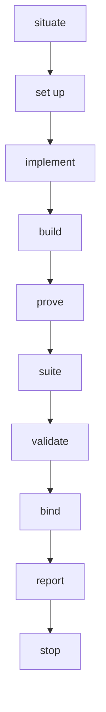
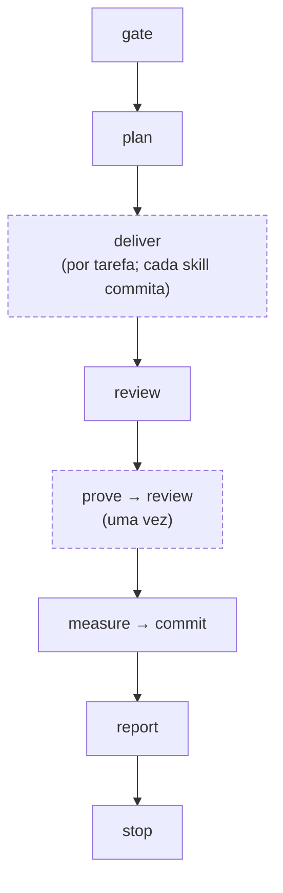

> [← Glossário](../siegard-glossary.pt-BR.md) · Anterior: [Planejamento (`/plan-work`)](06-planejamento.md) · Próximo: [Revisão (`/review-change`)](08-revisao.md)

## 7. Entrega (`/implement-task`, `/deliver-scope`)

### `/implement-task`
**O que é.** A skill que entrega **uma tarefa**: escreve o código e os testes por dois agentes
separados, instala pacotes permitidos, roda os comandos do projeto até compilar e a suíte passar,
grava os registros, valida-os, vincula o trace e faz o commit. Uma invocação = uma tarefa.
**Entradas.** A tarefa, a raiz do projeto, o target e o slug. A tarefa pode ser decidida (e
divulgada) quando o conjunto entregável tem uma só; o slug, quando há uma só iniciativa viva; a
raiz e o target, como no `/plan-work` (§6). Um plano fechado não recebe código novo.
**Antes de tudo.** `plan.py --check` limpo; `git status --porcelain` vazio sobre a raiz de
entrega, a raiz do target, o arquivo da tarefa e o trace (uma mudança pendente em outro lugar da
raiz de trabalho não atrapalha); as fatias de contrato `implementation`, `proof` e `finding`
impressas por `deliver.py --contract`.
**A ordem:**



1. **situate** — roda `deliver.py --outstanding` para confirmar que a tarefa pode ser entregue
   (dependências entregues, substrato presente, nenhum re-bind pendente) e lê o `## Notes` da
   tarefa: uma nota `BLOCKING` é parada (ver abaixo). Um registro já existente torna isto uma
   re-entrega; uma tarefa com `stands` não escreve código; só a pessoa nomeia uma re-entrega só de
   prova. Com standard, `deliver.py --standard --against --specification` imprime as três linhas de
   fase — `setup:`, `build:`, `suite:` — já compostas para o `run.py`, que os passos seguintes
   colam literalmente.
2. **set up (preparar)** — roda o step de `role: install`
   (`run.py --run <epic>-<slug>-setup --next`), para que o implementador leia os tipos das
   dependências reais. Não roda se a tarefa produz o manifesto, se o registro não declara
   instalação ou se não há standard. Setup vermelho é parada.
3. **implement (implementar)** — dispara o agente `task-implementer` com um bloco fixo (ver
   "O que os produtores recebem"), que escreve o código e devolve o conteúdo do registro de
   implementação.
4. **build (compilar)** — roda todos os steps do standard, exceto a suíte
   (`run.py --run <epic>-<slug>-build --next`). Se falhar, a saída volta ao implementador; cada
   tentativa ganha o número seguinte (`-build-2`, `-build-3`). Verde, o registro é gravado por
   `deliver.py --write-implementation`.
5. **prove (provar)** — dispara o agente `test-author`, que escreve os testes e devolve o
   conteúdo do registro de prova. Para cada nó cujo fato um teste finito decide, a prova traz um
   teste que falha se o fato deixar de valer e nomeia o nó nesse teste.
6. **suite (suíte)** — roda todos os steps, terminando na suíte
   (`run.py --run <epic>-<slug>-suite --next`). Se a suíte falhar, o agente `failure-diagnostician`
   diz por quê, e a causa decide a saída (ver "Suíte vermelha"). Verde, a prova é gravada por
   `deliver.py --write-proof`.
7. **validate** — verifica com `deliver.py --unrecorded` que todo arquivo alterado está nomeado
   num registro, e roda o `deliver.py` completo.
8. **bind (vincular)** — `trace.py --bind-record` grava no trace os nós que o registro diz ter
   codificado. Depois, o commit `implement-task <slug>: deliver <task>`, precedido de
   `door.py --check commit` (§12).
9. **report** — entrega o relatório pelo `handoff.py` (§12): arquivos, critérios, inferências,
   desvios, execuções e a invocação do `/review-change` (e, se o bind imprimiu um recibo de
   vínculos desatualizados, uma do `/reconcile` para o caso de nenhuma revisão vir depois).

**Por que dois agentes.** Código e testes escritos no mesmo contexto concordam "por construção",
inclusive onde ambos estão errados. Separados, um pode discordar do outro — e essa discordância é
um sinal valioso. Os produtores não têm shell: **quem roda é a sessão**, sempre pelo `run.py`.
**Proibição importante.** Um teste nunca é enfraquecido, apagado, estreitado ou reescrito para a
suíte passar.

### O que os produtores recebem
Cada produtor recebe um bloco de linhas fixas, com caminhos absolutos e a fatia de contrato colada
inteira. Algumas linhas que vale conhecer:

| Linha | Para quem | O que leva |
|---|---|---|
| `inventory` | implementador | Só os nós de inventário cuja `area` alcança onde a tarefa cai — o inventário de outro território traz convenções que a tarefa não deve seguir. |
| `recurring` | ambos | O que `deliver.py --recurring` imprime: as regras do standard que as revisões anteriores deste target mais citaram, para serem conferidas primeiro. |
| `authorized packages` | implementador | A lista inteira de pacotes que o registro autoriza, ou nenhuma linha — nunca uma seleção. |
| `reference` | implementador | Os arquivos que a tarefa nomeia em `reference` (um mockup). Nada além disso do `intake/`. |
| `earlier record` | implementador | O registro de implementação que esta re-entrega substitui. |
| `red to answer` | implementador | O teste vermelho (`<file>::<name>`), o diagnóstico e a linha `tests` do target — só quando uma re-entrega só de prova virou re-entrega (ver abaixo). |
| `underdetermined` | autor dos testes | Toda nota `UNDERDETERMINED` da tarefa, citada inteira. |
| `remainder` | autor dos testes | O nó, a asserção literal e os arquivos de prova, numa re-entrega só de prova sobre certificação recusada ou numa tarefa com `stands`. |
| `red build` | autor dos testes | A execução e os caminhos, quando um build vermelho só um teste resolve (ver abaixo). |

Os produtores são disparados pelo nome com prefixo (`siegard:<agente>`). Um produtor que voltou é
**reentrado** quando uma execução volta vermelha (ele ainda tem a tarefa e os arquivos na
cabeça), e devolve o mapeamento **inteiro**, revisado, nunca só a parte que mudou. Um produtor que
travou nunca é retomado: dispara-se outro, dizendo o que a tentativa anterior deixou na árvore.

### Build vermelho
- **Não é parada.** O que o `run.py` imprimiu (`--excerpt 40`) volta ao implementador, e o mesmo
  comando roda de novo com `--next`. Desistir é parada, sem registro.
- **Um step `fix` resolve forma.** Onde o registro declara um step de `role: fix` (um formatador
  que escreve), ele roda antes de toda checagem; o que um formatador resolveria nunca volta à mão.
- **Vermelho que só um teste resolve.** Quando o conserto está só em arquivos que o projeto
  declara como testes (um teste que o registro exige ao lado de um arquivo novo, ou um teste antigo
  que não compila mais), quem responde é o **autor dos testes, antes do registro**. O implementador
  nomeia os arquivos, `project.py --declared-tests` diz quais são testes, e a etapa de prova roda
  adiantada; o registro é gravado sobre o build que então passa.
- **Vermelho fora da tarefa.** Quando nenhuma mudança nos arquivos da própria tarefa resolve — a
  árvore sob o target não mudou e mesmo assim falha, ou o conserto está só em arquivos que nenhum
  registro desta tarefa nomeia —, é uma parada própria, nunca uma nova tentativa: nenhum registro é
  gravado, e a porta é o `/plan-work` sobre o slug (incremento corretivo ou comum, à escolha da
  pessoa). O `/deliver-scope` registra isto como `outside-task`.

### Suíte vermelha e suas causas
Uma suíte vermelha é parada até que uma saída se aplique, e a saída é **diagnosticada**, nunca
adivinhada: o `failure-diagnostician` lê a execução inteira (a sessão não sonda o log por conta
própria). Ele devolve uma de quatro causas (`cause`); `test` se divide por quem é dono do teste:

| `cause` | Dono do teste | O que acontece | Espera uma pessoa? |
|---|---|---|---|
| `code` | — | Volta ao implementador, reentrado; a suíte roda de novo. | não |
| `build` | — | A compilação feita pela própria suíte falhou; volta ao produtor do arquivo que o compilador apontou. | não |
| `test` | esta entrega | O autor dos testes, reentrado uma vez, reescreve o teste inteiro. | num segundo vermelho (`producers`) |
| `test` | uma tarefa anterior | A saída que `deliver.py --test-owner` imprime (abaixo). | em `re-deliver` |
| `setup` | — | O ambiente não subiu (banco, serviço externo). Roda de novo uma vez, sem mudar nada. | num segundo `setup` seguido |

**`deliver.py --test-owner`.** Para um teste de outra tarefa, a saída é impressa, nunca deduzida
da asserção:
- `adopt` — todo plano dono do teste está fechado: esta entrega adota o teste.
- `rewrite` — todo dono vivo compartilha um arquivo com esta tarefa (que moveu o que ele ligava).
- `re-deliver` — um dono vivo não compartilha arquivo nenhum: o teste não é tocado, a entrega para
  e entrega a re-entrega só de prova daquele dono, pronta para colar.

Em `adopt` e `rewrite`, o autor dos testes reescreve o teste inteiro, que passa a fazer parte desta
prova. Se ele o deixa sob `contested` porque um nó ainda afirma a condição, é contradição: parada,
com porta para o `/analyse`.
Quando nada na especificação decide entre `code` e `test`, a causa é `code` — a leitura que
restringe mais, porque impede que uma implementação errada seja "consertada" editando o teste.

### Uma nota `BLOCKING` na tarefa
Uma entrada `BLOCKING, from the specification —` no `## Notes` é parada, concorde a sessão ou
não. O relatório cita a nota inteira e entrega duas portas — `/plan-work` (a nota como conflito que
o escopo precisa resolver) e `/analyse` (a nota como afirmação que a especificação precisa
emendar) — como decisão da própria pessoa, sem recomendar nenhuma. Qualquer das duas resolve
passando a tarefa de novo pelo binder. O `deliver.py` mantém a mesma parada: recusa um registro
sobre uma tarefa que ainda carrega a nota.

### Quando o implementador para
- **Por um silêncio** (a especificação não afirma um fato de que o trabalho precisa): nenhum
  registro, e duas portas — `/analyse`, com o fato como pergunta para o material da pessoa, e o
  incremento de fato decidido do `/plan-work` (§6), em que o fato é decidido às cegas. A escolha é
  da pessoa; o `/deliver-scope` toma a segunda.
- **Porque já está feito** (já atendido, *already met*): se o implementador encontra todos os
  critérios já atendidos por código que a árvore tem, ele não escreve nada e devolve o mapeamento
  com `stands` sobre os arquivos que contêm o fato. A entrega segue como a de uma tarefa com
  `stands` (abaixo), com a nota `Found met by source the tree holds; no source written.`. Se o
  trace não liga esses arquivos aos nós, o escritor recusa o registro com uma linha `door:` — um
  `/reconcile` (de adoção, ou comum quando um vínculo mudou), slug `<epic>-<slug>-stands` —, que é
  a única porta, recomendada como derivada. O `/deliver-scope` registra essa parada como
  `already-met` quando não toma a porta ele mesmo.
- Numa re-entrega cujos próprios arquivos da tarefa já contêm o fato, não há `stands`: o registro
  é reescrito sobre esses arquivos.

### Raiz de entrega e registros de entrega
A pasta `delivery/<slug>/` contém três tipos de registro, todos markdown com frontmatter:

| Registro | Caminho | Escrito por | Contém |
|---|---|---|---|
| **implementation** (implementação) | `implementation/<epic>/<task>.md` | `/implement-task`, via `deliver.py --write-implementation` | os arquivos escritos, cada critério respondido, cada nó respondido |
| **proof** (prova) | `proof/<epic>/<task>.md` | `/implement-task`, via `deliver.py --write-proof` | cada teste, o que prova e o que o faria falhar |
| **review** (revisão) | `review/<name>.md` | `/review-change` | os passes que rodaram, os findings, a cobertura (§8) |

Ao lado deles: `run/` (as execuções capturadas), `orchestration.md` (o log do `/deliver-scope`) e
o `delivery.json` derivado.
O caminho **é** a identidade: o registro de implementação da tarefa `task/abertura/registrar-caso`
é `implementation/abertura/registrar-caso.md`. Nenhum campo diz a qual tarefa ele responde.

**Exemplo de registro de implementação:**

```yaml
target: backend
title: Record an opened case
summary: The entry point that persists an opened case.
task: sha256:fd8b6fdb…          # pin do arquivo da tarefa, como foi lido
standard:
  at: standard.yaml
  pin: sha256:…
run: run/abertura-registrar-caso-build
files:
- path: src/troubleshooting/case.ts
  effect: holds the case aggregate and its status vocabulary
criteria:
- criterion: Opening a case returns its case id.
  met: true
  how: the constructor takes the id and the module answers with it
nodes:
- node: domain/troubleshooting/case
  encoded_at:
  - src/troubleshooting/case.ts
  how: the case's identity and status vocabulary are the shape this module holds
```

**Campos que vale conhecer:**

| Campo | Significado |
|---|---|
| `target` | A chave do target; todo caminho do registro é escrito a partir da raiz dele. |
| `task` | O pin do arquivo da tarefa como foi lido. Se a tarefa mudar depois, o registro fica desatualizado. |
| `standard` | O caminho do registro de regras (`at`) e o pin do texto lido (`pin`). |
| `run` | A execução que passou: o build na implementação, a suíte na prova. |
| `files[].effect` | O que o arquivo passou a fazer. |
| `stands` | Arquivos onde a implementação já existia (tarefa com `stands`, ou já atendida); aí `files` fica vazio. |
| `criteria[].met` / `how` | Se o código escrito satisfaz o critério tal como lido, e como — algo que o leitor pode ir conferir. Demonstrar é papel da prova e da revisão. |
| `encoded_at` | O(s) arquivo(s) onde o fato de um nó agora mora. **É isso que vai para o trace.** Ausente significa que o nó orientou o trabalho sem que um fato próprio chegasse ao código ("honrado, não codificado"). |
| `inferences` | O que o implementador decidiu sem que nada dissesse, e a partir de quê. |
| `divergences` | Onde o código se afasta da tarefa, do inventário ou do standard, e por quê (citando a regra, quando é do standard). |
| `deferred` | O que foi encontrado e deliberadamente não mudado. |
| `preserved` | O que precisava continuar funcionando, declarado antes da mudança. |
| `installed` | Dependências diretas adicionadas (cada uma precisa estar entre as que o standard autoriza; as transitivas ninguém aprovou, e o lockfile no diff mostra o que chegou). |
| `tests[].proves` / `fails_when` | (registro de prova) O que o teste demonstra / o que teria de quebrar para ele falhar. |
| `tests[].demonstrates` | Um nó que o teste alega provar. É uma **alegação**, que a revisão certifica ou não. |
| `implementation` | (registro de prova) O pin do registro de implementação contra o qual os testes foram escritos. |
| `untested` | Comportamento ou nó deixado sem prova, declarado com o porquê. |
| `contested` | Onde o autor dos testes acredita que a implementação está errada. Fica registrado, e a revisão o repassa à pessoa (§8). |
| `not_applicable` | Casos-limite que a tarefa não levanta, cada um com o porquê. |

### Os escritores de registro (`--write-implementation`, `--write-proof`)
**O que são.** Os dois registros de uma entrega são escritos por um script, a partir da resposta do
agente produtor, nunca à mão:

```sh
deliver.py --write-implementation <delivery-root> task/<epic>/<slug> --target <chave> \
    --task-file <arquivo da tarefa> [--run run/<nome>] [--standard <caminho> --standard-file <arquivo>] \
    (--from <transcrição> | --from-text <arquivo>) [--what "…"]... [--note "…"]... [--replace]
deliver.py --write-proof <delivery-root> task/<epic>/<slug> --target <chave> \
    [--run run/<nome>] [--standard <caminho> --standard-file <arquivo>] \
    (--from <transcrição> | --from-text <arquivo>) [--what "…"]... [--note "…"]... [--replace]
```

**Por que existem.** Com o escritor, o registro é **uma função** de quatro coisas: a resposta do
produtor, o arquivo da tarefa, o standard e a execução. Um registro composto à mão variaria de uma
sessão para outra.
**Como funciona.**
- A resposta é a última mensagem do agente, lida da **transcrição** (`--from`), ou de um arquivo
  com o mapeamento (`--from-text`, quando o passo rodou inline ou a sessão compôs o mapeamento de
  uma tarefa com `stands`).
- O escritor **carimba** o que a invocação sabe: o `target`, o pin do arquivo da tarefa (na
  implementação) ou o pin do registro de implementação (na prova), o caminho e o pin do standard e
  a execução. Uma resposta que traga uma dessas chaves é recusada, com o nome da chave: o produtor
  responde pelo que decidiu, e a invocação, pelo que sabe.
- O corpo também é do escritor: `## What it is` vem das linhas `--what` (ou do `summary` da
  resposta) e `## Notes` das linhas `--note` (ou a linha literal `None.`).
- Valida tudo como o `--node` valida antes de gravar um único byte, e recusa um registro que já
  existe sem `--replace`. Uma prova é recusada enquanto uma tentativa de suíte vermelha anterior à
  execução que ela cita não estiver nomeada nas linhas `--note` (com o `cause` do diagnóstico).
- Numa tarefa com `stands`, recusa o registro se um vínculo de um nó da própria tarefa estiver
  desatualizado, ou se um nó ou arquivo não estiver ligado a nenhum do outro lado.
- Quando uma implementação é reescrita com `--replace` e uma prova fixava o texto anterior, o
  escritor imprime um **recibo** nomeando a prova; reescrevê-la (`--write-proof --replace`, com as
  mesmas linhas `--note`) é o passo seguinte.

### Re-entrega, re-entrega só de prova e tarefa com `stands`
- **Re-entrega.** Se já existe um registro para a tarefa, a entrega é uma re-entrega: os dois
  registros são reescritos por inteiro (nunca emendados), e as execuções ganham números novos via
  `--next`. Um caminho inalterado que o registro novo nomeia e o anterior não nomeava aparece em
  `--unrecorded` como `uncarried:` e volta ao implementador.
- **Re-entrega só de prova.** Nomeada pela pessoa, quando a implementação continua válida e só a
  prova precisa mudar — porque a entrega de outra tarefa falsificou uma asserção que afirmava mais
  do que os critérios desta tarefa exigiam, ou porque uma certificação foi recusada com um
  `remainder: testable`. Os passos de implementação e compilação não rodam; um novo `test-author`
  reescreve a prova inteira. Antes, `trace.py --check --all` precisa não mostrar drift de nenhum nó
  da tarefa nos arquivos dela (drift de outro nó nesses arquivos vira só uma `--note`, deixada para
  a revisão).
- **Quando a re-entrega só de prova descobre código errado.** Se a suíte fica vermelha num teste
  que o próprio autor desta re-entrega escreveu, e o diagnóstico diz `code`, a implementação não
  está de pé: a mesma invocação continua como re-entrega da tarefa, uma vez. Um implementador novo
  recebe a linha `red to answer`; antes dele, `deliver.py --red-guard hold` registra a árvore, e
  depois de cada retorno `deliver.py --red-guard check` confere que ele não mexeu em nenhum teste
  declarado além dos que o autor já escreveu. Um `refuses` é parada: `--red-guard restore` devolve
  esses testes ao estado registrado. Um `accepts` segue para o build e a suíte com novos números, e
  os dois registros são reescritos. O teste não é editado.
- **Tarefa com `stands`.** Entregue da mesma forma desde a primeira vez, porque o plano diz que a
  implementação já existe. Não há implementador: a sessão compõe o mapeamento a partir do plano e
  do registro que as `sources` nomeiam (nunca lendo o código) e o grava com `--from-text`, com
  `files` vazio e sem `encoded_at`. O build roda sobre a árvore como está; o autor dos testes recebe
  cada critério como asserção; a revisão que lê a prova certifica o nó. Drift de um nó da tarefa nos
  arquivos de `stands` impede a entrega, com porta para o `/reconcile`.

### Execução capturada e `run.py`
**O que é.** O **único** jeito de o Siegard executar um comando. O `run.py` roda os comandos
declarados pelo projeto (sem shell intermediário), guarda tudo o que eles imprimiram e registra o
resultado de cada step.
**Por que existe.** Nada que julga uma execução a realiza. Uma sessão capaz de rodar a suíte
poderia tentar várias vezes, em silêncio, até ela passar — e o que falhou no caminho não existiria
em lugar nenhum. O `run.py` **recusa um nome de execução que já existe**: quatro tentativas deixam
quatro pastas com quatro logs. Iterar é permitido; esconder, não. "Uma execução narrada em vez de
capturada não aconteceu."

```sh
run.py <delivery-root> --run <slug> [--next] --cwd <target-source-root> --timeout-seconds 600 \
    --step install="npm ci" --step test="npm test" [--excerpt 40]
```

- **Entrada:** onde gravar, um nome para a execução, a pasta onde rodar, um tempo máximo (sem
  padrão) e um ou mais steps (`nome="comando"`). O comando é dividido com `shlex` e executado
  direto: `&&`, `|`, `>`, `$VAR` e globs não são expandidos.
- **`--next`:** o número da tentativa é do script, nunca de quem chama. Com ele, `--run` é uma base:
  a execução cai na base se ela está livre, ou em `<base>-<N>`, um a mais que o maior número já
  usado (nunca menos que 2).
- **Saída:** `run/<slug>/run.json`, um log por step (`<step>.log`) e um log combinado (`run.log`).
  Código `0` = todos os steps passaram; `1` = um step falhou, estourou o tempo ou não foi
  encontrado; `2` = não pôde rodar.
- Um step que falha interrompe a execução; os seguintes são registrados como `not_run`.
- Cada step tentado registra quando começou e quando terminou.
- O registro guarda a **árvore** que a execução viu (`tree`): o toplevel do git, o commit de `HEAD`
  e o digest de cada caminho alterado. É contra isso que o `trace.py --bind-record` confere os
  arquivos de um registro: um arquivo cujos bytes nenhuma execução da tarefa viu não é vinculado.
- `--excerpt N` imprime na tela as últimas N linhas (até 500 caracteres cada) do step que falhou;
  o log completo continua gravado, e é ele que o diagnóstico lê.

Resultados possíveis de um step: `passed` (passou), `failed` (falhou), `timed_out` (estourou o
tempo), `not_found` (comando não encontrado), `not_run` (não rodou porque um anterior falhou). O
hook `PreToolUse` do plugin recusa escrever à mão qualquer coisa sob `run/` (§12).

### `delivery.json`
O índice derivado de uma raiz de entrega. Escrito pelo `deliver.py`, **nunca** à mão (o mesmo
hook o protege).

### Substrato, `presupposes` e `produces`
**O que é.** O **substrato** é o que precisa existir antes de uma tarefa poder ser entregue: os
arquivos que o standard declara em `presupposes` (um `package.json`, um `tsconfig.json`) ou que uma
tarefa anterior declara em `produces`.
**Por que existe.** Uma regra do standard é uma condição sobre um arquivo existente; ela não pode
"pedir" que o arquivo exista. Se o `package.json` não existe, nenhum comando do projeto roda, e
todo código escrito seria escrito contra regras que nunca estiveram em vigor.
**Como funciona.** Uma entrega sobre substrato ausente é recusada antes de escrever qualquer
coisa, e a saída aponta o caminho: uma tarefa com `produces` declarando o arquivo, planejada pelo
`/plan-work` e entregue primeiro. Para essa tarefa, `deliver.py --standard --reach --for` decide o
quanto roda: se nenhuma regra alcança o que ela escreveu, roda só o step de instalação; se alguma
alcança, roda o build inteiro. A tarefa entregue **só como substrato** (declara `produces` e nada
que escreveu é alcançado por regra) não tem prova — o `--outstanding` a nomeia
`implemented as the substrate alone, which owes no proof` e a conta como entregue. Toda outra
tarefa deve prova, inclusive a que construiu substrato e também escreveu um arquivo que uma regra
alcança.

### Conjunto entregável e `--outstanding`
**O que é.** As tarefas que podem ser entregues **agora**: ainda sem registro, com as dependências
entregues e provadas, com o substrato presente, sem nota `BLOCKING` pendente e sem re-bind
pendente.

```sh
deliver.py --outstanding <delivery-root> <work-root> <target-source-root> [<spec-root>] [--scope <id>]...
```

Imprime cada tarefa sem registro, o que cada uma espera (`waits on …`), e o conjunto entregável. É
assim que o Siegard responde "o que falta?" — não existe campo de status em lugar nenhum, e a
resposta é recalculada a partir dos arquivos toda vez. Também imprime:
- as tarefas entregues como substrato apenas;
- `owed a review` (nenhuma revisão responde por ela como está agora) e `never reviewed` (nenhuma
  revisão a nomeia) — informações, nunca recusas;
- os registros que não fixam o standard que o projeto declara para o target, ou fixam outro, ou uma
  versão anterior dele (ver "O standard lido de volta", §4).

Cada `--scope` (um `epic/<nome>` ou `task/<epic>/<nome>`) restringe a resposta àquelas tarefas e a
tudo de que elas dependem, transitivamente.

### `--unrecorded`
**O que é.** Antes de validar, uma entrega verifica que **todo arquivo alterado** sob o target
(contra `HEAD`, incluindo não rastreados) é nomeado por um de seus registros.
**Por que existe.** Um arquivo alterado que nenhum registro menciona (por exemplo, um teste
ajustado de passagem) seria uma mudança que nenhuma revisão jamais leria, porque a revisão lê
exatamente os arquivos dos registros. Um caminho que nenhum produtor reivindica é relatado, nunca
revertido.

```sh
deliver.py --unrecorded <target-source-root> <record> [<record> ...]
```

### Commit da entrega
Depois do bind, a própria skill faz um commit restrito por pathspec à raiz de entrega, à raiz do
target e ao trace, com a mensagem `implement-task <slug>: deliver <task>`, depois de
`door.py --check commit` (§12). Uma entrega que parou não commita nada; suas execuções ficam para
quem tomar a porta.

### Lote em worktrees (worktree batch)
Quando o conjunto entregável tem várias tarefas independentes, elas podem ser entregues em
paralelo, uma por git worktree, cada uma pelo `/implement-task` comum (o `deliver.py --help`
descreve o procedimento). Pré-condições: o plano commitado, as tarefas tiradas do conjunto
entregável e uma tarefa que vá instalar pacote entregue sozinha (o manifesto é de todos). Um step
`role: prepare` do registro roda uma vez por worktree, antes do `install` (para provisionar, por
exemplo, um schema de banco de testes próprio). Depois do merge, `delivery.json` e
`siegard-trace.json` são **re-derivados** pelos scripts em vez de mesclados à mão, e uma
`/review-change` sobre a união dos conjuntos de arquivos é o portão de integração.
`deliver.py --worktreeinclude` lista (ou grava, com `--write`) as linhas de `.worktreeinclude` para
os arquivos pressupostos que o git ignora e que um worktree novo não traria (um `.env`, por
exemplo).

### `/deliver-scope` e `orchestration.md`
**O que é.** A skill que leva um escopo **de ponta a ponta**: plano, cada tarefa, revisão, uma
rodada de prova e a medição. Ela não julga nada: cada julgamento é da skill que o detém, invocada
inteira. O que ela acrescenta é tomar as portas que os relatórios já entregam e os commits entre
elas.
**Autorização.** Só roda quando a mensagem da própria pessoa pede a rota inteira (citada
literalmente), ou quando um goal condition que a pessoa armou nomeia esta skill (§12). Uma
intenção deduzida é parada. Depois de uma compactação, a autorização é relida com `ask.py --read`,
nunca de um resumo.
**Entradas.** O pedido, a raiz do projeto, o target, o slug e o **alcance**: o plano inteiro, a
menos que o pedido nomeie um épico ou tarefas de um plano vivo (aí vão junto todas as dependências
sem registro). Um slug com plano vivo é uma **retomada**: continua do conjunto entregável como
está.
**Antes de tudo.** A especificação precisa passar no `spec.py` e estar **commitada** (uma
especificação não commitada é uma que ninguém revisou); a árvore precisa estar limpa nas raízes, no
`siegard-trace.json` e em `siegard-reconcile/`; o commit é feito onde `HEAD` já aponta.
**Os passos:**
1. **plan** — `/plan-work` com o pedido como escopo (pulado quando o pedido nomeia um alcance, ou
   numa retomada em que o plano já responde ao pedido).
2. O `/plan-work` commita o plano ele mesmo; a skill registra a linha no log.
3. **deliver** — enquanto o conjunto entregável (`deliver.py --outstanding`, rodado de novo antes
   de cada entrega) não estiver vazio: `/implement-task` sobre uma tarefa dele. Cada entrega
   commita os próprios registros.
4. **review** — com o conjunto vazio, `/review-change` sobre todas as tarefas entregues, com o nome
   igual ao slug, ou `<slug>-<N>` com o menor N a partir de 2 que deixe livres `review/<nome>.md`,
   `run/<nome>`, `siegard-reconcile/<nome>.md` e `siegard-reconcile/<nome>.returns/`. Os findings
   são repassados inteiros, abertos pelas contagens, e nunca tratados aqui.
5. **prove** — uma vez por execução: para cada certificação recusada com `remainder: testable`
   sobre um nó que uma tarefa desta execução implementa, uma re-entrega só de prova (uma por vez,
   cada uma commitada como `deliver-scope <slug>: prove <task>`), e depois mais uma revisão.
6. **measure** — `telemetry.py --probe` e depois `telemetry.py` sobre o período da execução, e o
   commit da raiz de telemetria (`deliver-scope <slug>: measure`). Roda **sempre**, inclusive
   depois de uma parada: o custo de uma execução se perde quando as transcrições somem. Uma sonda
   que não consegue ler vira uma linha no relatório, nunca uma parada.

**Regras.** "Cole, nunca componha": cada invocação é a que o relatório anterior entregou, com só os
espaços em aberto preenchidos. Toda decisão de roteamento é a resposta de um script. A skill nunca
invoca `/analyse`, com uma exceção: sob um goal cuja condição pede para especificar um objetivo em
prosa, uma vez, antes do plano. Um fato não declarado no meio da rota vai para o incremento de fato
decidido do `/plan-work`. Sob um goal cuja política de findings nomeia um `kind`, cada finding de
conformidade desse tipo vira um incremento corretivo sobre o arquivo que ele nomeia, entregue e
revisado na mesma execução, uma vez — a única invocação que a skill compõe, e só a partir do
registro de revisão.
**Commits.** Cada skill invocada commita o que escreveu, com o próprio nome. O `/deliver-scope`
commita só o que é dele, sempre por pathspec, com mensagem `deliver-scope <slug>: <passo>`: o log
(sozinho, `deliver-scope <slug>: log`, antes de cada invocação, para a próxima skill achar as
raízes limpas), a medição, as execuções de uma entrega parada que ele precise levar
(`deliver-scope <slug>: runs <task>`). Nunca cria branch, faz push, stash ou reescreve histórico.
**Portas que ela toma.** O pedido é o "pode seguir": a skill toma sozinha uma porta que o relatório
recomendou como **derivada** (§12, "O handoff"), cuja skill seja `/plan-work`, `/implement-task`,
`/review-change` ou `/reconcile`, que `door.py --check` aceite e que nenhuma linha `decided:` desta
execução já tenha tomado sobre a mesma tarefa — por exemplo, o `/reconcile` de uma tarefa já
atendida, o `/plan-work` de um re-bind ou o incremento de fato decidido. Uma porta **julgada** só é
tomada sob um grant armado pela pessoa (`grant.py --decide`, e o agente `door-decider` às cegas;
§12–13). As três questões reservadas — contradição, duas leituras de uma mesma evidência, o valor
de um finding — nunca são tomadas.
**Log.** `orchestration.md` na raiz de entrega da iniciativa (`<delivery_root>/<slug>/`): uma
linha por passo, com o que foi invocado, o commit e o resultado, além das decisões da própria
execução (slug derivado, target decidido). Linhas com forma fixa:
- `decided: <porta> — <critério> — <fato que decide>` — cada porta tomada;
- `recommended: <porta> — <critério> — <fato que decide>` — a recomendação do relatório que parou a
  execução, copiada dele;
- `stop: <classe> — <fato>` — a última linha de uma execução que parou. Nada é anexado depois dela
  (o commit da medição a leva). Uma retomada anexa depois dela, sem apagá-la.

Depois de uma parada, a execução não commita mais nada além da medição: a raiz de telemetria, o
log com a linha de stop e as execuções da iniciativa que terminaram `passed`.
**Classes de parada.** A classe vai em backticks no log e é de onde um goal lê o estado B:

| Classe | Quando |
|---|---|
| `blocking` | uma nota `BLOCKING` de pé em toda tarefa que o conjunto deixou |
| `silence` | um silêncio sobre uma tarefa que o incremento de fato decidido já respondeu nesta execução |
| `rebind` | uma tarefa esperando re-bind pela segunda vez |
| `producers` | um teste da própria prova ainda vermelho depois da reescrita do autor, ou deixado sob `contested` |
| `gave-up` | uma entrega que desistiu, com um vermelho que os arquivos da tarefa ainda resolveriam |
| `infrastructure` | falha de infraestrutura diagnosticada duas vezes |
| `project-file` | um campo que o `siegard.json` não declara, ou standard que não resolve |
| `pending-change` | uma mudança pendente que a execução não fez |
| `specification` | especificação que não passa no portão |
| `contradiction` | um fato que o incremento de fato decidido devolve como contradito |
| `stands` | um `stands` planejado que o escritor recusa de novo depois da reconciliação |
| `analyse` | sob goal que pede especificar, uma parada do `/analyse` diferente de "nada a especificar" |
| `outside-task` | vermelho que nenhuma mudança nos arquivos da tarefa resolve |
| `already-met` | tarefa já atendida que o escritor recusa de novo, ou cuja porta `door.py --check` recusa |
| `unclassified` | qualquer outra parada; o fato são as palavras do próprio relatório |

**Relatório.** Pelo `handoff.py` (§12): onde `HEAD` estava, todos os commits e o intervalo de
`git log`, as entradas decididas, cada passo com o resultado, as linhas do `--outstanding` sobre
standard, os findings e as discordâncias (`contested`) repassados inteiros, os nós decididos por
teste, o relatório de telemetria, o que encerrou a execução com as portas do relatório que parou e
o que a skill nunca fez. "Um finding não para nada": só para o que um arquivo de skill nomeia como
parada.



### `deliver.py` — o validador da entrega

```sh
deliver.py <delivery-root> <work-root> <target-source-root> [<spec-root>]  # valida e escreve delivery.json
deliver.py --check ...                                    # valida e compara; não escreve
deliver.py [--check] --review <nome> ...                  # o mesmo, segurando a revisão em escrita a todos os arquivos e critérios das suas tarefas
deliver.py --outstanding ... [--scope <id>]...            # o que falta, e por quê
deliver.py --node <file> <delivery-root>                  # valida um registro
deliver.py --write-implementation ... | --write-proof ... # grava um registro a partir da resposta do produtor
deliver.py --standard <file> [--against DIR] [--specification DIR]   # valida um standard; imprime as linhas de fase
deliver.py --standard <file> --reading [--for <path> ...]            # só as regras decididas por leitura
deliver.py --standard <file> --reach --for <path> ...                # as regras que alcançam cada caminho, e os caminhos que nenhuma alcança
deliver.py --findings <review>                            # os findings de uma revisão, contados (e as discordâncias das provas)
deliver.py --recurring <delivery-root> <target> <standard>           # regras do standard mais citadas nas revisões do target
deliver.py --standing <delivery-root> <target> <target-source-root> [--rule <id>]... [--file <path>]...
                                                          # findings de standard de revisões passadas cujo trecho citado ainda está no arquivo
deliver.py --test-owner <delivery-root> <task> <test> ... # dono de um teste vermelho e a saída: adopt, rewrite ou re-deliver
deliver.py --red-guard hold|check|restore <target-source-root>       # prende uma re-entrega aos testes que já existem
deliver.py --check-record <record> <target-source-root>   # valida um registro do /check-source
deliver.py --unrecorded <target-source-root> <record> ... # caminhos alterados que nenhum registro nomeia
deliver.py --worktreeinclude <file> <target-source-root> [--write]  # linhas do .worktreeinclude
deliver.py --contract <branch>                            # uma fatia de delivery-node.json para um agente
```

O que a validação completa verifica: a tarefa existe; há uma prova ao lado de cada implementação
(exceto o substrato apenas); todo critério foi respondido exatamente uma vez; todo nó implementado
foi respondido; nenhuma tarefa foi entregue antes das suas dependências; os pins batem; nenhuma
tarefa esperando re-bind ou com nota `BLOCKING` ganhou registro; todo desvio declarado cita uma
regra do standard num arquivo que o registro diz ter escrito; e cada execução apontada rodou
exatamente os comandos que o standard declara, na pasta certa. Sobre um plano fechado, algumas
dessas checagens viram avisos impressos com o índice, em vez de recusas. Saída `0` = íntegro;
`1` = problemas (ou `delivery.json` desatualizado com `--check`); `2` = não pôde rodar.

---
> [← Glossário](../siegard-glossary.pt-BR.md) · Anterior: [Planejamento (`/plan-work`)](06-planejamento.md) · Próximo: [Revisão (`/review-change`)](08-revisao.md)
