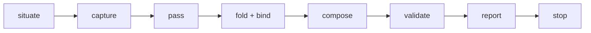

> [← Glossário](../siegard-glossary.pt-BR.md) · Anterior: [Entrega (`/implement-task`, `/deliver-scope`)](07-entrega.md) · Próximo: [O trace](09-o-trace.md)

## 8. Revisão (`/review-change`)

### `/review-change`
**O que é.** A skill que revisa uma mudança entregue por julgamentos independentes, roda os
comandos do projeto sobre a mudança inteira, revincula no trace o que o julgamento de conformidade
liberou e grava um **registro de revisão**.
**Produz evidência, nunca aprovação.** Não há veredito, severidade, ranking nem decisão. Um
revisor que calculasse "bloquear" ou "aprovar" seria, na prática, um portão automático — e um
achado com o qual ninguém pode discordar é uma decisão disfarçada de achado. Nenhum revisor tem
permissão de escrita: quem pudesse editar o que apontou não deixaria nada para alguém discordar.
**Entradas obrigatórias.**
1. As tarefas revisadas, cada uma já com registro de implementação.
2. O conjunto de arquivos: lido dos registros de entrega (inclusive os caminhos de `stands`),
   **nunca descoberto**, e escrito a partir da raiz do target. Um caminho que o registro nomeia mas
   que a raiz do target não tem mais (um arquivo que a entrega apagou), ou que fica fora dela, não
   entra no conjunto: o relatório o nomeia como não lido.
3. A raiz do projeto, 4. o target e 5. o slug — os três podem ser decididos e divulgados como nas
   outras skills (§6).
6. O **nome desta revisão**: nomeia `review/<nome>.md`, a execução `run/<nome>` e o registro de
   reconciliação `siegard-reconcile/<nome>.md`. Sem nome, vale o slug. Um nome já usado em qualquer
   dos três lugares é parada, nunca sufixo automático (o `/deliver-scope` escolhe o nome pela regra
   dele, §7).

Duas entradas opcionais: o standard do projeto e steps extras (ou uma execução já capturada). Elas
decidem se os passes standard e failures rodam.
**Antes de tudo.** `plan.py --check` e `deliver.py --check` limpos (são as únicas paradas da revisão
antes do próprio validador) e `git status --porcelain` vazio sobre a raiz de entrega e o trace. A
raiz do target, que contém a mudança, não precisa estar limpa.
**Sem pin.** Uma revisão responde pelos critérios das tarefas como estão hoje. Uma revisão anterior
sobre uma tarefa que mudou depois nunca é recusada por isso; o `deliver.py --outstanding` só aponta
a tarefa como `owed a review` (§7).
**A ordem:**

1. **situate** — lê os critérios das tarefas (a partir do `plan.json` e dos arquivos de tarefa) e
   os registros (a partir do `delivery.json`); com standard, roda
   `deliver.py --standard --against --specification`; roda `trace.py --check` (o drift é relatado,
   mas não é parada nem finding); e **prepara** o passe de conformidade com
   `trace.py --stage --review`, num diretório de trabalho temporário que ninguém commita, passando
   cada arquivo do conjunto, `--node` para cada nó que as tarefas implementam e `--demonstrated`
   para cada registro de prova.
2. **capture (capturar)** — roda todos os steps do standard exceto os de `role: fix` (a linha
   `review:` que o `--standard` imprime), seguidos dos que a invocação acrescentou, via `run.py`,
   numa execução com o nome da revisão. Isso acontece mesmo que o `/implement-task` já tenha rodado
   tudo verde: duas tarefas que passam separadas não são necessariamente uma mudança que passa
   junta.
3. **pass** — dispara os passes (tabela abaixo), independentes entre si.
4. **fold e bind** — salva cada retorno de conformidade literalmente em
   `siegard-reconcile/<nome>.returns/`, dobra-os num registro de reconciliação (`trace.py --fold`,
   validado com `--reconciliation`), roda a segunda leitura que uma liberação exige
   (`--stage-release` e seus juízes, nunca pulada) e revincula com `--bind-record --workspace` só o
   que o julgamento liberou (como o `/reconcile`, §10). Sem arquivo de trace, este passo não roda.
5. **compose** — escreve `review/<nome>.md` (frontmatter por `yaml.safe_dump`) e o confere com
   `deliver.py --node`.
6. **validate** — roda `deliver.py --review <nome> …`.
7. **report** — faz o commit `review-change <slug>: review <nome>` (raiz de entrega, trace e
   `siegard-reconcile/<nome>.*`) e entrega o relatório pelo `handoff.py` (§12). O relatório **abre
   com as contagens** que `deliver.py --findings <revisão>` imprime (ver abaixo), e depois traz os
   findings por passe, os passes que não rodaram e por quê, os caminhos não lidos, a cobertura, os
   nós sem teste, o standard (regras em escopo, regras deixadas a ferramentas, caminhos que nenhuma
   regra alcança), a execução, o drift do trace, o que o passe de conformidade revinculou e o que
   deixou devido, e onde cada reparo moraria — sem escolher. Esta skill **não entrega invocação
   nenhuma**: qual rota um finding merece, ou se merece alguma, é decisão da pessoa.

### Passes
Os julgamentos independentes de uma revisão. Cada um é feito por um agente separado, disparado com
prefixo (`siegard:<agente>`); nenhum lê o resultado do outro.

| Pass | Agente | Pergunta |
|---|---|---|
| **coverage** (cobertura) | `coverage-auditor` | Os testes falhariam se um critério deixasse de valer? |
| **conformance** (conformidade com a especificação) | `specification-conformance-reviewer`, **um por arquivo** | O código afirma só o que a especificação contém? |
| **standard** (conformidade com o standard) | `standard-conformance-reviewer` | O código segue as regras de leitura do próprio projeto? |
| **failures** (falhas) | `failure-diagnostician` | Por que uma execução capturada falhou? |
| certificação | `coverage-auditor`, um por nó | Um teste que alega provar um nó realmente o prova? |

Os quatro primeiros são os valores de `pass` no registro. A **certificação** não é um quinto
`pass`: é devida por toda alegação `demonstrates` de uma prova revisada, montada pelo
`trace.py --stage --review --demonstrated` a partir dos registros de prova (nunca da leitura da
sessão) e gravada pelo fold no registro de reconciliação. Só um `covered` do auditor, com o nó
também liberado pela conformidade, torna o vínculo **decidido por teste**; abaixo disso, o fold
registra se o que falta é `testable` ou `untestable`, e o `trace.py --owed` passa a listá-lo (§10).
A rota para fechar é a re-entrega só de prova (§7), que a revisão nomeia sem preencher.
**Conformidade: um juiz por arquivo, em ondas.** Um juiz sobre o conjunto inteiro satura: responde
centenas de pares nó–arquivo numa leitura e declara limpos pares que nunca pesou. Por isso cada
arquivo ganha o seu, recebendo o caminho do seu pacote de nós (a lista do manifesto do stage), o
índice de candidatos e o contrato `conformance-return.json`. Os juízes são disparados pelas
**ondas** que o recibo do stage lista (ver "Ondas de delegação", §10): uma onda inteira numa única
mensagem, e todos os retornos dela salvos (`trace.py --save-return`, ou `--save-returns` para a
onda toda) antes de disparar a seguinte. Uma onda termina quando o save informa `0 pending`, lido
do disco. Um disparo que o harness recusa é uma onda larga demais: o relatório devolve
`--stage --concurrency <menos>` pronto para rodar de novo.
**Standard.** O juiz recebe só o que `deliver.py --standard --reading --for <cada arquivo>`
imprime: as regras decididas por leitura que alcançam os arquivos. Nunca vê os desvios que o
registro de implementação declarou — um passe avisado do que já foi admitido seria um passe moldado
pelo produtor.
**Passe que não rodou.** É registrado com `missing: <o que faltou>`. Por exemplo, sem standard, o
passe standard não roda (com `null` no `siegard.json`, o registro diz que o projeto não escreveu
nenhum); com a execução toda verde, o passe failures registra
`missing: run/<nome> passed; there was no failure to read`. Isso impede que uma revisão seja
relatada como "limpa" sobre um passe que nunca aconteceu.

**Divisão entre os dois passes de conformidade.** A especificação contém o que o negócio decidiu
(o que o sistema responde, qual recusa, quem vê o quê). O standard contém como o projeto é
organizado (camadas, nomes, fiação). Um fato de negócio no código sem nó é finding do passe de
conformidade; uma violação de arquitetura interna é finding do passe standard. Uma regra do
standard que afirme o que o sistema responde é defeito do standard, não finding.
**Leitura × ferramenta.** O que um compilador, um linter ou um scanner decide exatamente vira step
da execução capturada, e chega pelo passe failures com a mensagem da própria ferramenta. Os passes
de leitura ficam com o resto. O framework não fornece regra, limiar nem perfil de segurança
nenhum: um projeto sem standard e sem ferramentas recebe uma revisão honestamente estreita, e o
relatório diz isso.

### Finding (achado)
**O que é.** Uma coisa que um julgamento encontrou, sempre com evidência citada.

| Campo | Significado |
|---|---|
| `pass` | O passe que o encontrou — carimbado pela sessão, nunca pelo agente, para que um finding não alegue um passe que não rodou. |
| `file` | Onde foi visto, na grafia da raiz do target; nos passes que varrem o conjunto, precisa estar nele. No passe failures é o arquivo que a execução apontou, que pode estar fora do conjunto (ou ausente, se nenhum arquivo foi apontado). |
| `where` | A linha ou o trecho (ou, sem arquivo, o step da execução). |
| `evidence` | **Citada** do código ou do que a execução imprimiu, nunca parafraseada; um corte entre trechos é marcado. |
| `cost` | A consequência, em termos que o leitor possa pesar — não apenas "viola a regra X". |
| `correction` | O que teria de mudar (opcional; não é uma decisão). |
| `cites` | A única regra do standard violada (só no passe standard). O validador confere que a regra existe, é decidida por leitura e alcança o arquivo. |
| `cause` | `code`, `test`, `setup` ou `build` (só no passe failures; ver §7). |
| `kind` | `contradicts`, `unstated` ou `restates` (só no passe de conformidade; ver §10), copiado do retorno do juiz. Um finding de conformidade sem `kind` (registro antigo) é contado à parte. |

**Não há severidade nem veredito.** O finding diz quanto custa; a pessoa decide o que isso
significa.

### `deliver.py --findings` — as contagens
Imprime os findings de uma revisão como contagens — por passe; os de conformidade por `kind`; os
do standard pela regra citada; os de falhas por `cause`; e por arquivo —, para que se veja quantos
vão para onde antes de ler qualquer um. Também imprime, inteira e por tarefa, cada discordância que
as provas revisadas registraram em `contested`; o relatório da revisão (e o do `/deliver-scope`) as
repassa como questões da pessoa, sem resolvê-las nem ordená-las. O script só conta: qual rota cada
grupo merece continua sendo decisão sua.

### Registro de revisão
`review/<nome>.md` na raiz de entrega. Campos principais: `target`; `tasks` (as tarefas que
responde); `reviewed` (o conjunto de arquivos); `passes` (uma entrada por passe, com `missing`
quando não rodou); `coverage` e `unpaired`; `standard` (caminho e pin, quando o passe rodou);
`failures_counted` (quando o passe failures rodou); `run` (a execução, verde ou vermelha);
`reconciliation` (`siegard-reconcile/<nome>.md`, o registro que o passe de conformidade dobrou); e
`findings`. O registro não guarda a lista de regras em escopo: o caminho e o pin do standard já a
determinam. O que os passes deixaram de lado, e o que o framework não revisa, vai em `## Notes`.
O `deliver.py --review` confere: toda tarefa nomeada está entregue; a cobertura responde por todo
critério e só por eles; `reviewed` lista todo arquivo que os registros nomeiam; os failures
contados batem com os findings; a execução existe; todo finding está num arquivo do conjunto.

### Estados de cobertura
Usados para cada critério de uma tarefa numa revisão, e para um nó numa certificação:

| Estado | Significado |
|---|---|
| `covered` (coberto) | Os testes nomeados falhariam se aquilo deixasse de valer. É o teste completo de um teste. |
| `partial` (parcial) | Uma parte declarada fica sem exercício. |
| `uncovered` (descoberto) | Nada exercita. |
| `unauditable` (inauditável) | Não é possível ler o critério bem o bastante para procurar — um fato sobre o critério, não sobre os testes. |

### `unpaired` (testes sem par)
Testes do conjunto que não se relacionam com **nenhum** critério de nenhuma tarefa revisada, cada
um com o que afirma (`test`, `asserts`). É uma leitura na direção inversa da cobertura (um critério
sem teste é um fato sem prova; um teste sem critério prova algo que nenhuma tarefa declarou).
**Nunca** é uma recomendação para apagar o teste — ele pode provar o critério de outra tarefa.

### Palavras da disciplina de testes
- **Obrigação** — algo a que uma prova deve evidência: um critério, o fato de um nó, ou uma nota
  `underdetermined`.
- **Evidência** — um teste que falha quando a obrigação é violada.
- **Teste finito** — um teste que decide um fato por inteiro: uma entrada contra um resultado
  esperado, ou todos os pares de um conjunto finito (por exemplo, todo estado × gatilho de uma
  máquina de estados).
- **Classe de equivalência e fronteira** — entradas que uma obrigação trata do mesmo jeito; a
  fronteira é a entrada em que a obrigação muda o que exige.
- **Teste redundante** — um teste cuja remoção deixaria todas as obrigações ainda protegidas. Não
  é escrito.
- **Preferência pelo teste.** Um teste finito é preferível a uma leitura (um juiz) e à decisão de
  um step do standard, sempre que existir. Por isso o Siegard empurra os nós para serem
  **decididos por teste** (certificação, §10), e um nó deixado decidido por leitura onde um teste
  caberia passa a dever esse teste (incremento de prova, §6).

### `/check-source` e `siegard-check/`
**O que é.** Uma skill que lê arquivos **que nenhuma tarefa entregou** (por exemplo, editados
livremente num target `edits_freely`, ou os que um recibo de drift contou como suprimidos) contra
as regras de leitura do standard, e grava um registro em `siegard-check/<slug>.md`, ao lado do
trace. Aqui o standard é obrigatório (sem ele não há contra o que ler). O conjunto de arquivos é
nomeado pela pessoa, nunca descoberto — tipicamente o que `trace.py --check --all` listou;
`trace.py --encodes --changed` ajuda a ver o que uma mudança tocou antes de nomear. Não executa
nada (as regras de ferramenta ficam com a suíte do projeto) e nunca escreve código. É validado por
`deliver.py --check-record`, e o relatório nomeia os caminhos lidos que nenhuma regra do standard
alcança (`--reach`, §4).

---
> [← Glossário](../siegard-glossary.pt-BR.md) · Anterior: [Entrega (`/implement-task`, `/deliver-scope`)](07-entrega.md) · Próximo: [O trace](09-o-trace.md)
