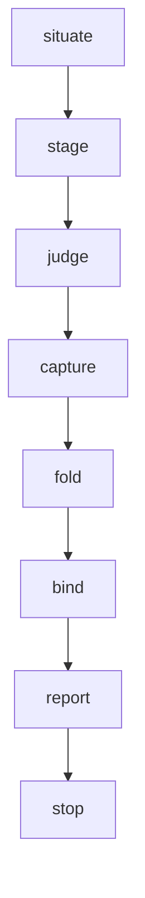

> [← Glossário](../siegard-glossary.pt-BR.md) · Anterior: [O trace](09-o-trace.md) · Próximo: [Adoção e levantamento (`/survey`)](11-adocao-e-levantamento.md)

## 10. Reconciliação (`/reconcile`)

É aqui que se concentram as palavras mais estranhas. Na primeira leitura, siga os verbetes na
ordem: eles acompanham o procedimento do início ao fim. A skill tem um checklist curto no
`SKILL.md` e os detalhes de cada passo em `references/` (`stage.md`, `judge.md`, `certify.md`,
`capture.md`, `fold.md`, `bind.md`, `report.md`, `adoption.md`).

### Para que serve a reconciliação
**O problema.** Todo bind normal sai de uma entrega: o registro de implementação diz quais nós o
código codifica e onde. Mas o código também muda por outros caminhos:
- uma correção digitada durante um incidente;
- um conflito de merge resolvido à mão;
- uma entrega que reescreveu um arquivo que **outros** nós também reivindicam (o bind só
  recarimba os nós da própria tarefa).

Em todos esses casos, o arquivo muda e o trace continua afirmando o digest antigo. Só o
`--check` revela isso (§9).

**A resposta.** O `/reconcile` pega um **conjunto de arquivos que você nomeia**, faz **juízes
independentes** lerem cada arquivo contra **todo nó que o trace vincula a ele**, grava a resposta
num **registro de reconciliação** e **revincula apenas o que os juízes liberaram**.

**O que ele nunca faz.** Nunca escreve código e nunca escreve um nó da especificação. Quando o
código afirma algo que o nó não contém, ele não "conserta" nada: entrega à pessoa as duas leituras
possíveis (corrigir a especificação ou corrigir o código), e escolher entre elas é decisão da
pessoa.

**Não confundir com a revisão.** A revisão (`/review-change`) examina uma entrega: cobertura dos
testes, standard, falhas e conformidade. A reconciliação examina **só** a conformidade de arquivos
com os nós que o trace já liga a eles, e não exige plano, tarefa nem entrega.

### Os modos
| Modo | Quando usar | Como é pedido | Flag no `--stage` |
|---|---|---|---|
| **ordinário** | Arquivos mudaram sem rebind (edição à mão, merge). | invocação comum | *(nenhuma)* |
| **auditoria** (audit) | Vínculos que **nunca** tiveram drift, mas podem estar errados desde o início (largos demais). Como nunca mudam, nada baseado em mudança os reexamina. | a pessoa diz "audit" | `--audit` |
| **adoção** (adoption) | Código que nenhuma entrega escreveu — adotando o Siegard num projeto existente (§11). | a pessoa diz "adoption" e nomeia os candidatos (ou o ledger) | `--adopt --ledger …` ou `--adopt --node …` |

A skill nunca escolhe o modo sozinha. A auditoria e a adoção também não combinam com uma
**reescrita declarada** (`--rewrite`, abaixo). `--stage --review` é a mesma preparação usada de
dentro do `/review-change` (§8).

### A ordem



Em uma frase cada:
1. **situate** — confere que a especificação e o trace são válidos e que tudo está commitado.
2. **stage** — `--carry`, `--check` e `--stage`: um script prepara, para cada arquivo, o pacote de
   nós que o juiz vai ler.
3. **judge** — um juiz por arquivo, em ondas; os retornos são salvos literalmente por script.
4. **capture** — se algum par é decidido por um comando (e não por leitura), ou carregado por uma
   reescrita declarada, os steps rodam uma vez, capturados.
5. **fold** — a skill escreve a premissa, e um script combina os retornos e a premissa no registro.
6. **bind** — a segunda leitura dos pares lidos `nowhere` (`--stage-release`) e depois um script
   revincula só o que o registro diz ter sido liberado.
7. **report** — commit `reconcile <slug>`, relatório pelo `handoff.py`, e para.

### Entradas obrigatórias
Faltando alguma, a skill para **uma vez**, nomeando tudo o que falta.
1. **O conjunto de arquivos** — cada caminho, relativo à raiz de código do target. Nomeado pela
   pessoa, **nunca descoberto**: uma reconciliação que escolhesse o próprio escopo cobriria um
   conjunto diferente a cada vez. (O `trace.py --check --reconcile-set` sugere um, §9; a pessoa é
   quem o nomeia.)
2. **A raiz do projeto.** Se a invocação não nomeia nenhuma, é o topo do git do diretório da
   sessão, como o `project.py --here` a resolve, e só se ali houver um `siegard.json`.
3. **O target** (decidido e informado no relatório quando o `siegard.json` declara um só).
4. **O slug** — o nome do registro em `siegard-reconcile/`. Um slug já usado é uma parada, porque
   o registro existente é a justificativa de vínculos que ainda estão no trace.

**Opcionais, sempre nomeados pela pessoa e nunca deduzidos:**
- **certificações** — testes que a pessoa oferece como prova de um nó (ver "Certificações e
  `--certify`");
- **uma reescrita** — a afirmação da pessoa de que os arquivos mudaram por uma única reescrita
  mecânica e mais nada (ver "Reescrita declarada");
- **adoção** — com os candidatos (ou o ledger) e, opcionalmente, arquivos "outside" (§11);
- **nós escritos desde o último bind** — que entram como candidatos (ver "Candidato").

**Não pede:** raiz de trabalho, raiz de entrega, tarefa nem plano. É exatamente isso que ela
acrescenta ao framework: o julgamento que ela roda já existia, mas só era alcançável por uma
entrega, que uma edição à mão não tem.

### Situate (situar)
Antes de tudo, `project.py` resolve a raiz da especificação e os targets — só a partir do
`siegard.json`; um campo ausente é uma parada com a invocação do `/siegard-config` pronta. Depois,
verifica:
- que os arquivos nomeados, as provas oferecidas **e a raiz da especificação inteira** estão
  **commitados** (`git status --porcelain -- …` não imprime nada), que o `siegard-trace.json` está
  limpo e que o target está sob git;
- que a especificação é válida (`spec.py`) — um julgamento contra uma especificação quebrada é um
  julgamento sobre nada;
- que o trace é válido (`trace.py <target>`) — se não existe trace, a resposta é uma entrega ou,
  para código antigo, uma adoção (a única invocação que começa sem trace);
- que o caminho do registro `siegard-reconcile/<slug>.md` está livre.

**Por que commitados.** O bind grava um digest dos dois lados. O digest de uma edição não
commitada aponta para um conteúdo que o próximo checkout pode apagar, e um nó estampado a partir
de um texto que ninguém commitou é um vínculo com uma especificação que pode nunca ter existido.
Commitar ou descartar é decisão da pessoa.

### Workspace (área de trabalho)
Uma pasta temporária e descartável (normalmente criada com `mktemp -d`) onde o `--stage` grava o
material dos juízes. Nunca é commitada: ela contém cópias de texto de nós, e uma cópia commitada
seria uma segunda casa para esses textos.

### `--stage` — preparando o material dos juízes
**O que faz.** Calcula, mecanicamente, **todo nó** a que cada arquivo nomeado está vinculado no
trace e prepara, no workspace, tudo de que os juízes precisam. Antes dele, o passo roda
`trace.py --carry` (recarimba pares cujo nó mudou só na forma, §9) e `trace.py --check`.
**Por que é um script.** Montar à mão a lista de nós de cada arquivo, lendo o
`siegard-trace.json`, é arriscado: um nó esquecido faz um juiz receber um conjunto incompleto, e
a resposta desse juiz parece exatamente igual a uma completa. O script não esquece.

```sh
trace.py --stage <target-root> <spec-root> <slug> <workspace> <file> [<file> ...] \
    [--audit | [--node <n> ...] | --review [--node <n> ...] [--demonstrated <proof-record> ...] \
     | --adopt (--node <candidate> ... [--outside <file> ...] | --ledger <ledger.md>)] \
    [--certify <certifications.yaml>] [--rewrite <rewrite.yaml>] [--concurrency <n>]
```

**Saída, no workspace:**

| Item | O que é |
|---|---|
| `manifest.json` | O "índice" da preparação: o conjunto de nós e o digest de cada arquivo, os digests dos nós, as listas `unbound`, `omitted`, `orphaned`, `mechanical`, `rewritten`, `certify` e `candidates`, e as `waves` (ondas). |
| `packs/<arquivo com cada / trocado por __>.md` | Um **pacote de nós** (node pack) por arquivo: o texto completo de todo nó que o juiz daquele arquivo precisa ler, cada um com o caminho de origem e o digest. É uma cópia de leitura, nunca uma casa: na dúvida, o juiz abre a fonte que o cabeçalho nomeia. |
| `packs/certify__<nó>.md` | Um **pacote de certificação** por nó a certificar. |
| `candidates.txt` | O **índice de candidatos** do lote inteiro (ver verbete próprio). Ausente numa auditoria. |

Também cria, no topo do git, a pasta vazia `siegard-reconcile/<slug>.returns/`, onde os retornos
dos juízes serão salvos, e recusa um slug cujo registro ou pasta de retornos já exista. Recusa
também rodar enquanto houver em `siegard-reconcile/` um registro que não consegue ler: ele pode
conter um finding aberto que a guarda de omissão precisaria considerar.

**Dois "pontos de origem".** O que o `trace.py` *imprime* (`--check`, o trace) é escrito a partir do
topo do git; tudo o que se *escreve* (o conjunto de arquivos, a premissa, o `file` de cada finding)
é escrito a partir da raiz de código do target. O `--stage` recusa a outra grafia e diz a correção.

**Exemplo de nome de pacote.** O arquivo `src/billing/raise.ts` recebe o pacote
`packs/src__billing__raise.ts.md`. Se dois caminhos do conjunto resultarem no mesmo nome
(`src/x/b__c.ts` e `src/x__b/c.ts`), o stage recusa o conjunto: um arquivo seria vinculado pela
leitura do outro.

### O que o stage separa
Cada arquivo e cada nó do conjunto cai numa destas situações:

| Situação | O que acontece |
|---|---|
| Um arquivo com nós no manifesto | É o assunto: recebe um juiz. |
| Um arquivo a que o trace não vincula nada (**`unbound`**) | É só relatado. Decidir a qual nó um arquivo sem vínculo responde é trabalho de uma entrega ou de uma análise, não de uma reconciliação. (Exceção: numa adoção, os candidatos são lidos contra ele.) |
| Um arquivo cujos pares foram todos omitidos | Nada a julgar; o registro o contabiliza em `pairs_omitted`. |
| Um nó da classe `orphaned` | Parada para esse nó: nenhum juiz o recebe, e a rota é `--prune`, seguido do que levou o fato para outro lugar. |
| Um par decidido por uma execução | Vai para a camada `mechanical` (ver abaixo). |
| Um par que a reescrita declarada reproduz | Vai para `rewritten` (ver "Reescrita declarada"). |

**O que é julgado é todo nó que o trace vincula ao conjunto**, nunca um subconjunto escolhido.

### `pairs_omitted` (a guarda de omissão)
**O que é.** A lista de pares que o stage decidiu **não** rejulgar, cada um com o motivo.
**Quando um par é omitido.** Quando rejulgá-lo não acrescentaria nada: o vínculo ainda bate com os
bytes atuais do arquivo **e** nenhum registro em `siegard-reconcile/` tem um finding aberto contra
ele. Em outras palavras: o par já foi julgado sobre exatamente este conteúdo.
**Segurança.** No bind, as duas condições são recalculadas; se alguma deixou de valer (o arquivo
mudou entre o stage e o bind, por exemplo), o registro inteiro é recusado, e a rota é uma nova
invocação com slug novo.
**Na auditoria.** `--audit` desliga a omissão: toda afirmação existente é julgada.
**Na revisão.** `--review` só omite pares que uma **reconciliação** já liberou (marcados `judged`)
sobre os mesmos bytes; pares carimbados por uma entrega sempre vão a um juiz.

### Camada mecânica (`mechanical`)
**O que é.** Pares que uma **execução** pode decidir, e que por isso não vão para um juiz. São de
dois tipos: (a) uma restrição que um step do registro declara em `commands[].decides`; (b) um nó
que um **teste certificado** decide.
**Por que.** Um juiz leria o arquivo inteiro e "adivinharia" o que o comando decide com exatidão —
e custaria uma delegação inteira. Rodar o comando é mais barato e mais exato.
**Duas guardas.** O par volta para um juiz se o texto do teste certificado mudou (a certificação
deixou de valer) ou se o texto do próprio nó mudou (o teste nunca foi avaliado contra a frase
nova). Um par atual e sem nada devido é omitido antes de chegar a qualquer das camadas.
**Como é respondida.** O comando roda uma vez, capturado, na pasta de retornos (o `run.py` é o
único caminho de execução, §7):

```sh
run.py siegard-reconcile/<slug>.returns --run <slug> --cwd <target-source-root> \
    --timeout-seconds <limite do registro> --step test="<comando do registro>"
```

e a pasta da execução é passada ao fold com `--run`. Os comandos e limites vêm do registro do
projeto, nunca compostos pela skill. **Um step vermelho é um resultado, não uma parada**: o fold
registra que aquele nó não foi liberado, e o finding segue a rota normal. Não se roda de novo para
obter verde. Steps de papel `fix` (formatadores) nunca rodam numa reconciliação.

### Reescrita declarada (`--rewrite`)
**O que é.** Uma afirmação **da pessoa** de que os arquivos mudaram por uma única reescrita
mecânica — um especificador de módulo ganhando sufixo, um caminho de import seguindo uma mudança
de pasta — e por mais nada, com os steps do registro cuja execução mostra que a árvore reescrita
compila e passa.
**Como é escrita.** Um pequeno YAML no workspace, com `pattern` e `replacement` (como o `re.sub`
do Python os lê) e `steps`. A skill transcreve o que a pessoa disse; nunca lê uma reescrita num
diff para propô-la.
**Como funciona.** Para cada par com drift, o stage recupera do git o texto que o vínculo fixou,
aplica a reescrita e compara: se reproduz o arquivo atual byte a byte, o par **não vai para juiz
nenhum** e é carregado sob `rewritten`. Um par cujo nó mudou, com finding aberto, sem texto fixado
no git, ou que a reescrita não reproduz, é julgado normalmente, e o recibo diz o motivo.
**A execução decide.** Os steps nomeados rodam no passo de captura. Aqui, ao contrário da camada
mecânica, um step vermelho **para**: um par carregado só tem a execução como resposta, e o fold não
escreve registro.
**Se a reescrita não reproduz nada**, a skill para e mostra a transcrição à pessoa antes de
qualquer juiz: ou ela diz outra coisa, ou a mudança não foi só aquela reescrita.
**O que não é.** Um par carregado não foi lido por juiz nenhum: o `--owed` não o conta nem como
liberação nem como finding.

### Candidato, índice de candidatos e camada de candidatos
**O problema que resolve.** Um juiz lê um arquivo contra os nós **vinculados** a ele. Mas o
arquivo pode conter um fato que pertence a **outro** nó (vinculado a outro arquivo, ou recém-escrito
e ainda sem vínculo). Sem acesso a esse outro nó, o juiz diria "nenhum nó contém isto" — um falso
finding `unstated`. Com acesso, ele pode dizer "este fato pertence àquele nó".
**Candidato.** Um nó que um juiz **pode abrir**, sob demanda, quando o seu arquivo afirma um fato
que os nós do seu próprio pacote não resolvem. Abrir para atribuir, nunca para ampliar: um
candidato nunca é revisado.
**Índice de candidatos (`candidates.txt`).** A lista, para o lote inteiro, de todo nó pelo qual o
lote responde, com os arquivos de cada um. Um único índice serve todos os juízes, e é passado
**pelo caminho**, nunca colado no prompt (colar custaria o mesmo texto repetido por juiz).
**Nós escritos desde o último bind.** Numa reconciliação ordinária, a pessoa pode nomear os nós que
o `/analyse` acabou de escrever (o relatório do `/analyse` os lista), passados com
`--stage --node <nó>`. Entram no índice, o manifesto os registra com o digest, e nunca são
vinculados aqui (vincular um nó novo é ato de uma entrega). Assim, um fato que o código contém e
que um nó novo passou a declarar é atribuído a esse nó.
**Na auditoria.** Não há camada de candidatos: a pergunta da auditoria é mais estreita ("este
arquivo ainda contém o fato deste nó?"), e as duas respostas que um candidato separaria terminam no
mesmo ato sobre o par.
**Na adoção.** "Candidato" tem um sentido mais forte: são os nós que o `/analyse` escreveu a partir
do código. A leitura deles pelo juiz **decide se serão vinculados**. Com um ledger, cada arquivo
recebe no seu pacote os candidatos em que os fatos **daquele arquivo** foram parar, marcados
`(beside)` (§11).

### Certificações e `--certify`
**O que é.** Uma oferta, feita pela pessoa, de que certos testes provam o fato de um nó. É escrita
num pequeno arquivo YAML no workspace e passada ao stage:

```yaml
- node: rules/sales/invoice-immutable
  proof:
    - tests/billing/raise.spec.ts
  step: test
```

O stage recusa, antes de escrever qualquer coisa: um nó que nenhum dos arquivos nomeados codifica
(nomeando os arquivos a que o trace o vincula), um arquivo de prova inexistente, ou um step que o
registro não declara. Um nó sendo certificado nunca tem pares omitidos: a certificação acompanha
uma leitura nova do nó. O julgamento da certificação é descrito mais abaixo ("Certificação e
`decided_by: test`").

### Ondas de delegação (`waves`) e `--concurrency`
**O que é.** O ambiente do Claude Code limita quantos agentes podem rodar ao mesmo tempo. O
`--stage` corta as delegações — um juiz por arquivo e um auditor por certificação — em **ondas** de
no máximo `n` delegações. O padrão é vinte, o teto do próprio ambiente. As ondas ficam gravadas no
manifesto e aparecem no recibo do stage.
**Como funciona.**
1. Uma onda é disparada **inteira, numa única mensagem**.
2. Os retornos da onda são salvos pelo script (ver "Salvar os retornos literalmente").
3. A onda termina quando o script informa **`0 pending`** para ela, lido dos retornos que estão em
   disco. Nunca por uma contagem de notificações feita de cabeça pela sessão: várias notificações
   chegam num mesmo turno, algumas dentro do próprio turno que disparou a onda, e a contagem
   mantida no contexto fica abaixo do real.
4. Só então a próxima onda é disparada.

A sessão espera a notificação de cada agente e nada mais — nunca um `sleep`, um despertar agendado
ou uma mensagem ao agente.
**Disparo recusado.** Se o ambiente recusa um disparo, nenhum juiz rodou: a onda foi cortada larga
demais. O relatório entrega `--stage --concurrency <menos>` pronto para rodar de novo. Nunca se
reenvia um juiz avulso por conta própria. O `/survey` usa a mesma regra, com ondas de no máximo
vinte agentes de levantamento.

### Juiz — o julgamento de conformidade
**Quem.** Um agente `siegard:specification-conformance-reviewer` **por arquivo** que o manifesto
contém, disparados pelas ondas que o recibo do stage lista. Sempre pelo nome com o prefixo do
plugin, para que um agente homônimo do projeto não o substitua.
**O que cada um recebe.** O caminho absoluto do seu único arquivo; o caminho do seu pacote de nós;
o caminho do índice de candidatos; a raiz da especificação; o caminho do contrato
`schemas/conformance-return.json`; e a forma da resposta, nas palavras do próprio agente. Todos os
caminhos já resolvidos e absolutos — nunca "junte esta raiz com aquele caminho", que obrigaria o
juiz a adivinhar.
**O que o juiz cita.** A evidência cita **a linha que contém o fato**, nunca a função ou o bloco
inteiro em volta dela. Uma citação curta e exata é o que permite, depois, conferir no disco se
aquele texto ainda está no arquivo (ver `--owed`). Um fato é contido por **código**; um comentário
nunca é evidência de que o nó está contido.
**Por que um juiz por arquivo.** Um único contexto lendo todos os arquivos e todos os nós de uma
vez "satura": responde centenas de pares numa só leitura e declara limpos pares que nunca pesou.
Um juiz com um só arquivo lê menos e erra menos.
**Certificações.** Para cada nó a certificar, um agente `siegard:coverage-auditor` recebe o
pacote de certificação e a raiz do target, e nada mais.
**A sessão não julga.** A sessão que orquestra **nunca lê os arquivos para decidir ela mesma**. Ela
aceitou a premissa da pessoa de que o código está certo, e estaria julgando a partir dessa
premissa. Só quando não consegue disparar agentes ela aplica a disciplina do agente "inline",
arquivo por arquivo, e diz isso no relatório — e **nem então** se ela própria escreveu algum dos
nós julgados: estaria corrigindo a própria redação; aí ela para e espera.
**Uma resposta por juiz.** Um juiz responde uma vez. Se o retorno for inutilizável (campo
faltando, nó sem resposta), o prompt estava errado: faz-se uma **delegação nova** com o prompt
corrigido. Nunca se faz uma pergunta complementar ao mesmo juiz, porque ele já carrega a primeira
leitura. Duas respostas divergentes do mesmo juiz anulam uma à outra, e o arquivo é julgado de
novo num contexto limpo. Uma pergunta devolvida pelo juiz ("o que devo fazer?") não é um retorno.

### O retorno (conformance return)
**O que é.** O que um juiz responde: YAML puro, com **só cinco chaves permitidas, em qualquer
profundidade** — `findings`, `read`, `nowhere`, `looked_past` e `candidates_opened`. Uma sexta
chave (um `notes` com um parágrafo de conclusão, um resumo para humanos) faz o fold recusar o
retorno, e uma mesma chave dada duas vezes também. **Sem cerca de código** (```` ```yaml ````) em
volta: a resposta começa na primeira chave e termina na última linha do mapeamento, e uma resposta
cercada é recusada pelo fold, nomeando a delegação. Por isso a forma esperada é mostrada ao agente
como bloco recuado, nunca dentro de uma cerca.
**Exemplo:**

```yaml
findings:
  - where: the guard added to raise(), line 12
    evidence: |-
      if (order.invoices.length >= 1) return existing
    cost: |-
      the at-most-one-invoice rule lives only here, so the next reader looks
      for it in the specification and does not find it
    node: rules/sales/invoice-immutable
    kind: contradicts
read:
  - node: rules/sales/invoice-immutable
    held_at: nowhere
    evidence: |-
      the rule the file cites governs modification of a raised invoice;
      `if (order.invoices.length >= 1)` states a cap no node holds
candidates_opened:
  - rules/sales/invoice-immutable
```

**As chaves, uma a uma:**

| Chave | Significado |
|---|---|
| **`findings`** | O que o juiz encontrou contra, cada item com `where`, `evidence`, `cost`, `kind` e, opcionalmente, `file`, `node` e `correction`. **Ausente, ou uma lista vazia (`findings: []`), significa "nada encontrado"** — e isso é um resultado real e uma afirmação: sobre este arquivo e estes nós, o código afirma o que a especificação contém e nada além. |
| **`read`** | **Obrigatório.** Uma entrada por nó do pacote do próprio juiz, na ordem do pacote — nunca um subconjunto, nunca um candidato —, exceto os que `nowhere` nomeia. Diz, nó a nó, onde o fato dele está agora. É daqui que se escreve o `how` de um nó liberado. |
| `read[].node` | A identidade do nó. |
| `read[].held_at` | Onde no arquivo o fato do nó está agora (`the return statement of place(), line 41`), **ou a palavra `nowhere`** ("em lugar nenhum"). A resposta é lida pela primeira palavra: `nowhere. The file does no ranking.` continua significando "em lugar nenhum". Um arquivo que não contém fato algum é respondido `nowhere` para cada nó. |
| `read[].evidence` | Código citado que sustenta a resposta. Quando `held_at` é `nowhere`, cita o que foi examinado. |
| **`nowhere`** | Lista de identidades: nós lidos **ao lado** dos vínculos do arquivo (marcados `(beside)` no pacote — os nós do plano numa revisão, os candidatos numa adoção, a segunda leitura de uma liberação) que o arquivo não contém. Respondidos só pela identidade, sem `held_at` nem evidência. Um nó vinculado ao arquivo nunca vai aqui: a liberação dele depende da evidência do `read`. |
| **`looked_past`** | Uma frase nomeando o que foi visto e não relatado porque pertence a outro julgamento (por exemplo, um problema de estilo, que é do standard, ou um fato que só um comentário afirma). |
| **`candidates_opened`** | Todo candidato que o juiz de fato abriu, tenha ou não resultado em finding. Ausente significa que não abriu nenhum. Serve para medir se vale a pena oferecer a camada de candidatos. |

**`node` num finding.** Quando o finding é sobre um nó específico, nomeia-o (pode ser um
candidato). Quando não nomeia nó nenhum, o fold, por precaução, aplica o finding a **todos** os nós
que o juiz daquele arquivo recebeu (ver `collateral`).

### `kind` — os três tipos de finding
Um julgamento responde a perguntas diferentes, e o `kind` diz a qual delas o finding responde:

| `kind` | Significa | Bloqueia o vínculo do nó? | Rota |
|---|---|---|---|
| **`contradicts`** (contradiz) | O código diz o que o nó nega, ou não carrega mais o fato do nó, ou virou uma segunda casa para ele. | **Sim** — o nó não é vinculado. | `/analyse` (a especificação está atrasada) ou corretivo do `/plan-work` (o código está errado) |
| **`unstated`** (não declarado) | O **código** (ou texto que o sistema emite) afirma um fato que **nenhum nó contém**. | Não — nenhum rebind poderia resolvê-lo, então ele não impede o vínculo que a leitura do nó liberou. | `/analyse` |
| **`restates`** (repete) | Um **comentário** ou uma **docstring** — prosa que nenhum sistema em execução emite — repete o fato de um nó, **enquanto algum código também contém esse fato** (neste arquivo ou noutro que o finding nomeia). | Não — o par está conforme e é vinculado onde o código está. | Remover a prosa (rota de comentários), depois `/reconcile` sobre o arquivo de novo |

**Casos de fronteira:**
- Se **nenhum código** contém o fato de um nó, um comentário que o afirma é `contradicts`, não
  `restates`.
- **Um fato que só um comentário ou uma docstring afirma** — e que nenhum nó contém, nenhum
  código e nenhum texto emitido carrega — **não é finding** de tipo nenhum, nem `unstated`: prosa é
  o que alguém acreditava. O juiz o nomeia em `looked_past`, e a rota de comentários o remove.
- **Texto que o sistema em execução emite é comportamento, nunca `restates`** — a descrição de
  uma ferramenta, uma mensagem de erro, um prompt enviado a um modelo, uma linha de log. Se afirma
  corretamente o fato de um nó, **não é finding**; se afirma algo diferente do nó, é `contradicts`.
- **Exceção: texto que só nomeia um controle, e o ajuste que um cliente faz das suas
  requisições.** O rótulo de um botão, de uma coluna, de uma aba ou de um menu, um nome acessível,
  um placeholder, o tempo de cache ou o número de tentativas de uma requisição são escolhas da
  implementação, nunca fatos do domínio: um deles que nenhum nó contém **não é finding** de tipo
  nenhum. Já o texto que muda o que uma pessoa pode saber ou fazer — uma mensagem de recusa ou de
  falha, o rótulo de um vocabulário fechado, um aviso de resultado — continua sendo fato.
- Se duas coisas são verdadeiras sobre um mesmo arquivo, são dois findings, porque são devidos a
  pessoas diferentes.

### Salvar os retornos literalmente
**O que é.** Cada retorno é salvo como cópia e nada mais, em:

```
siegard-reconcile/<slug>.returns/<caminho do arquivo com cada '/' trocado por '__'>.yaml
siegard-reconcile/<slug>.returns/certify__<nó com cada '/' trocado por '__'>.yaml
siegard-reconcile/<slug>.returns/release__<caminho do arquivo>.yaml     # segunda leitura (ver --stage-release)
```

**Por que literalmente.** Os retornos são a **evidência** a partir da qual o registro é dobrado, e
sobrevivem à sessão. Um retorno "ajustado" por quem o salvou carregaria um julgamento que o juiz
nunca fez. Por isso: nunca reformate, corte ou conserte um retorno. O que o juiz disse fora das
cinco chaves vai para o relatório à pessoa, nunca para o arquivo que o fold lê.
**Quem copia é um script**, a partir da **transcrição** de cada agente (o arquivo de saída que o
ambiente nomeia para o agente disparado):

```sh
trace.py --save-returns <target-root> <workspace> <pasta-das-transcrições>   # a onda inteira
trace.py --save-return  <target-root> <workspace> <arquivo> <transcrição>    # um retorno
```

O `--save-returns` salva de uma vez todo retorno pendente, achando cada um pela transcrição cujo
prompt nomeia o pacote daquele arquivo (se um pacote aparece em várias, vale a que respondeu por
último). O `--save-return` salva um: `<arquivo>` é o caminho preparado, como o manifesto o lista, ou
`certify__<nó>` para uma certificação. O script grava a última mensagem do agente byte a byte — ou,
se o agente respondeu por uma devolução (hand-back) que o ambiente confirmou entregue, o `message`
dela.
**O recibo do salvamento.** Depois de gravar, o script imprime:
- **O que a onda ainda espera**, lido dos retornos em disco: `wave 2: 17 of 20 saved, 3 pending: …`,
  ou `wave 2: 20 of 20 saved, 0 pending` quando a onda está completa. Essa linha, e não uma
  contagem mantida na conversa, é o sinal de que a onda terminou.
- **Se o fold vai recusar o que acabou de ser salvo**, pela mesma leitura que o fold aplicará. Os
  bytes ficam como chegaram (a recusa continua sendo do fold), mas o defeito aparece enquanto a onda
  ainda está aberta, e a delegação pode ser refeita com o prompt corrigido.

**Nunca redigite um retorno a partir da notificação** que o repassa: esse texto é reformatado para
exibição, e um caractere escapado (`&gt;` no lugar de `>`) quebra o YAML ou corrompe a evidência. O
script recusa uma transcrição que termina numa chamada de ferramenta (o agente ainda não respondeu)
e um arquivo que o stage não preparou. Nada é retirado: uma resposta cercada continua cercada, e o
fold a recusa. Só quando a transcrição não pode ser lida o retorno é salvo à mão, sob a mesma
disciplina.

### Premissa
**O que é.** A **única parte do registro que pertence à pessoa**: um pequeno arquivo YAML no
workspace, escrito pela skill com as palavras da pessoa.

```yaml
title: Hand correction to invoicing
summary: The nightly run raised two invoices for one order; the guard was added by
  hand and the behavior is correct.
said: "reconcile src/billing/raise.ts — I added the guard by hand last night"
target: backend
files:
  - path: src/billing/raise.ts
    change: refuses a second invoice for an order that already has one
```

| Campo | Significado |
|---|---|
| `title` | Um título para o registro. |
| `summary` | O que mudou e **por que a pessoa afirma que o código está certo** — como afirmação da pessoa, nunca como finding da skill. Numa auditoria, diz que o código não mudou e que as afirmações existentes estão sendo relidas; numa adoção, que o código é adotado como está. |
| `said` | As palavras da pessoa que pediram esta reconciliação, **citadas literalmente** da mensagem dela — nunca uma paráfrase (sob o `/deliver-scope`, o pedido que o log dele cita). O fold recusa uma premissa sem ela. Um registro dobrado por uma revisão carrega `delivered` no lugar. |
| `target` | O target. |
| `files[].change` | Uma linha por arquivo nomeado: o que o arquivo agora **faz** de diferente, não o que foi digitado nele. |

**Por que a premissa é separada.** Nenhum fold pode escrevê-la: ela é uma afirmação humana. E ela
não é o que decide o resultado — os juízes decidem; a premissa só registra o que a pessoa
afirmou, para que um leitor futuro saiba o contexto.

### `--fold` — a "dobra": transformando os retornos no registro
**Em que momento acontece.** Depois que todos os juízes responderam, todos os retornos foram
salvos, a premissa foi escrita e, se havia camada mecânica ou reescrita, os steps foram
capturados.

**O que é a "dobra".** "Dobrar" (fold) é um termo de programação que significa **combinar muitos
itens num único resultado, aplicando a mesma regra a cada um**. Aqui, os itens são os retornos de
vários juízes (um por arquivo) e, possivelmente, de vários auditores de certificação; o resultado é
**um único registro**, que diz, **nó por nó**, se o nó está conforme e onde o fato dele está. É
necessário porque um mesmo nó pode estar vinculado a vários arquivos e, portanto, ter sido lido por
vários juízes.

**Por que é mecânico.** Todas as regras de combinação são fixas e implementadas no `trace.py`,
testadas, aplicadas sempre do mesmo jeito. Nenhum julgamento acontece aqui. **Nunca aplique essas
regras à mão.**

```sh
trace.py --fold <target-root> <workspace> <premise.yaml> siegard-reconcile/<slug>.md \
    [--run siegard-reconcile/<slug>.returns/run/<slug>]
```

**Entradas:** o workspace (o `manifest.json` diz o que foi preparado); os retornos salvos; a
premissa; o caminho do registro; e `--run`, **exatamente** quando o stage separou uma camada
mecânica ou carregou pares pela reescrita (e recusado quando não: uma execução que nada lê é
evidência para uma pergunta que ninguém fez).
**Saída:** o registro `siegard-reconcile/<slug>.md`, validado antes de ser gravado, e uma linha de
resumo (`folded <slug>.md: N node(s) cleared, M not — K of those collateral, … P pair(s) omitted
as current and unowed`).

**As regras que aplica, com exemplos.**
1. **Validação dos retornos.** Cada retorno é conferido contra `conformance-return.json` (e os de
   certificação contra `certification-return.json`). Um retorno faltando, um nó sem resposta, uma
   chave a mais, uma chave repetida ou uma cerca de código faz o fold recusar — e recusar o lote
   inteiro.
2. **Um nó está conforme apenas onde todo juiz que leu um de seus arquivos o liberou.** *Exemplo:*
   o nó `rules/sales/invoice-immutable` está vinculado a `raise.ts` e a `cancel.ts`. O juiz de
   `raise.ts` o libera; o de `cancel.ts` registra um `contradicts` contra ele. Resultado: o nó
   **não** está conforme.
3. **Um finding que nomeia um nó cai nesse nó**, qualquer que seja o arquivo do juiz que o
   registrou.
4. **Um finding que não nomeia nó cai em todos os nós que aquele juiz recebeu.** É uma regra
   conservadora. Os nós que só ficaram bloqueados por isso (sem nenhum finding próprio) são marcados
   **`collateral`** (colateral). Um par decidido por execução não chegou a juiz nenhum e não é
   atingido.
5. **Um fato que saiu de parte dos arquivos.** Se o nó ainda está em `a.ts`, o juiz de `b.ts`
   respondeu `nowhere` e nada foi achado contra o nó, o nó fica **não liberado**, mas o registro
   põe em `encoded_at` os arquivos que ainda o contêm (que o bind vincula), e todos os arquivos
   lidos, `b.ts` inclusive, em `observed_at`. Liberar `b.ts` depende de uma segunda leitura (ver `--stage-release`).
6. **Findings `unstated` e `restates` vão para listas próprias** do registro (`unstated` por
   arquivo, `restates` por ocorrência) e não bloqueiam o vínculo.
7. **Um finding que nomeia um nó que nenhum arquivo do conjunto vincula** vai para `notes`, com a
   frase final "owed a route of its own" ("deve uma rota própria"). Ele não bloqueia nada aqui, e o
   relatório precisa repassá-lo.
8. **Camada mecânica:** um step que passou libera os seus nós; um step que falhou não libera
   nada. **Reescrita:** se algum step que ela nomeia falhou, o fold não escreve registro.
9. **Certificação:** `decided_by: test` só é gravado onde o auditor respondeu `covered` **e** a
   leitura do próprio nó o liberou.
10. **Liberado ⇒ `encoded_at`.** Para cada nó liberado, o fold grava `encoded_at` (os arquivos
    onde o fato está) e escreve o `how` a partir do `read` dos juízes. Um nó não liberado recebe
    `observed_at`. Essa diferença é o que o bind lê depois.
11. **O fold escreve o registro qualquer que seja o resultado** (salvo a falha de reescrita acima).
    Uma reconciliação que não liberou nada é justamente a mais importante de guardar: sem ela, a
    próxima invocação redescobriria a mesma divergência do zero.

**Regra de ouro: nunca edite o que o fold escreveu.** Um registro ajustado depois do fold carrega
um julgamento que os retornos por trás dele não contêm.

**Quando o fold recusa.** Há dois tipos de recusa:
- **recusa que nomeia uma delegação** (retorno faltando, nó sem resposta, forma fora do contrato):
  faz-se uma **delegação nova** com o prompt corrigido, a partir do passo de julgamento — nunca uma
  pergunta ao mesmo juiz, nunca uma edição do retorno;
- **recusa sobre a premissa**: corrige-se a premissa e roda-se o fold de novo.

Recusas do `--run`: execução feita sobre outra árvore, sem um step que a camada exige, ou sobre um
conteúdo que mudou desde o stage. Nesse último caso, a rota é uma nova invocação com slug novo.

**Redobrar (refold).** Como os retornos são guardados literalmente e o fold é mecânico, é possível
rodar o `--fold` de novo sobre os **mesmos retornos** antes de o registro ser commitado — o fold
recusa um caminho de registro que já existe, então o registro não commitado sai primeiro. Ver §14.

### O registro de reconciliação (`siegard-reconcile/<slug>.md`)
**O que é.** O documento que o fold escreve (frontmatter YAML seguido de uma seção `## Folded`):
para cada nó que o trace vincula a um arquivo nomeado, se ele está conforme, por quê e onde o fato
dele está.
**Onde fica e por quanto tempo.** No topo do git, ao lado do trace, e **nunca é apagado** (nem pelo
`/siegard-archive`): é a justificativa de vínculos que ainda estão no trace. Os retornos que o
geraram ficam ao lado, em `<slug>.returns/`.
**Contrato.** `schemas/reconciliation.json`, versão atual `siegard-reconcile/11`. Registros de
versões anteriores continuam sendo lidos como foram escritos; nunca são reescritos.
**Exemplo:**

```yaml
contract_version: siegard-reconcile/11
title: Hand correction to invoicing
summary: The nightly run raised two invoices for one order; the guard was added by
  hand and the behavior is correct.
said: "reconcile src/billing/raise.ts — I added the guard by hand last night"
target: backend
files:
  - path: src/billing/raise.ts
    change: refuses a second invoice for an order that already has one
nodes:
  - node: rules/sales/invoice-immutable
    conforms: false
    how: the source now states `if (order.invoices.length >= 1) return existing`, and
      no node holds that an order carries at most one invoice
    observed_at:
      - src/billing/raise.ts
notes: The behavior is right and the specification is behind it; the fact belongs
  in a node before anything is bound.
```

**Campos:**

| Campo | Significado |
|---|---|
| `title`, `summary`, `said` / `delivered`, `target` | A premissa (ver acima). |
| `files` | O conjunto de arquivos que a pessoa nomeou, cada um com o seu `change`. |
| `nodes[]` | Todo nó que o trace vincula a um arquivo nomeado, com a resposta. |
| `conforms` | `true` = o julgamento liberou o nó; `false` = há um finding de pé contra ele, ou o fato saiu de parte dos arquivos. |
| `how` | Por quê, com o que foi lido citado. |
| `encoded_at` | Num nó liberado: os arquivos que contêm o fato dele. Num nó cujo fato saiu de parte dos arquivos, sem nada contra ele: os arquivos que ainda o contêm. **É exatamente isso que o bind vincula.** |
| `observed_at` | Num nó não liberado: os arquivos que foram lidos para ele, sem afirmar nada sobre eles. |
| `collateral` | Num nó não liberado: nada foi encontrado contra a substância **dele**; ele apenas divide o arquivo com um finding que não nomeou nó. Resolva esse finding e o nó é liberado junto. |
| `decided_by`, `step`, `proof` | Uma certificação pedida: `test` quando se sustentou (o `proof` são os testes que o auditor citou), `reading` quando não. |
| `remainder`, `remainder_why` | Uma certificação que não se sustentou: se um teste **poderia** fechar a lacuna (`testable`) ou não (`untestable`), e a asserção que a fecharia. |
| `read_at` | Numa certificação recusada: o digest do nó e o de cada arquivo de prova oferecido, como o stage os leu. Permite que um stage posterior diga que nada mudou desde então. |
| `unstated` | Fatos que o código afirma e nenhum nó contém, agrupados por arquivo. |
| `restates` | Lugares em que um comentário ou docstring repete o fato de um nó que o código já contém. |
| `unbound` | Arquivos nomeados a que o trace não vincula nada. |
| `adopted` | Presente (`true`) num registro de adoção. |
| `unheld` | Só em adoção: candidatos que **nenhum arquivo do conjunto contém** e contra os quais nada foi encontrado. Não reivindicam arquivo nenhum. |
| `outside` | Só em adoção: arquivos que a pessoa deixou fora do julgamento. |
| `rewritten` | Os pares que a reescrita declarada carregou sem julgamento: `pattern`, `replacement`, `steps`, a execução (`run`) e os pares, cada um com o commit em que o texto fixado foi lido. |
| `pairs_omitted` | Pares não rejulgados, cada um com o motivo. |
| `notes` | Prosa de que um leitor futuro precisa; nunca uma decisão. Uma nota terminando em "owed a route of its own" precisa ser levada ao relatório. |

### `--reconciliation` — validando o registro

```sh
trace.py --reconciliation siegard-reconcile/<slug>.md
```

Não escreve nada. Confere o registro contra o contrato e a contabilidade: todo caminho reivindicado
está em `files`, e todo arquivo nomeado é reivindicado ou declarado `unbound`. Como o fold já valida
o que escreve, uma recusa aqui indica defeito no stage, na premissa ou no próprio fold, não num
julgamento. Qualquer coisa diferente de uma passagem limpa é uma parada.

### Segunda leitura (`--stage-release`)
**O problema.** Um par lido `nowhere` (o arquivo não contém mais o fato do nó) deveria sair do
vínculo. Mas uma única leitura `nowhere` às vezes erra, e liberar o par apaga o único registro de
que aquele código respondia ao nó.
**A resposta.** Antes do bind, sempre que o registro lê algum par `nowhere`, a skill roda:

```sh
trace.py --stage-release <target-root> <spec-root> siegard-reconcile/<slug>.md <novo-workspace>
```

que prepara um pacote por arquivo com esses nós marcados `(beside)` — o juiz não sabe nada da
primeira leitura —, e dispara um juiz por pacote; os retornos são salvos como
`release__<arquivo>.yaml` ao lado dos demais. O bind então **libera o par** onde a segunda leitura
também diz `nowhere` e o nó continua vinculado a algum arquivo atual. Onde a segunda leitura acha o
fato (no todo ou em parte), onde nenhuma foi salva, ou onde não sobra arquivo atual, a liberação
fica para a pessoa: o recibo do bind entrega `trace.py --release … --node <nó>` pronto (§9). Este
passo nunca é pulado.

### Bind (na reconciliação)

```sh
trace.py --bind-record <target-root> <spec-root> siegard-reconcile/<slug>.md --workspace <workspace>
```

**O que faz.** Vincula **só os pares sob `encoded_at`** — e nada mais. Os nós com findings ficam
exatamente como estavam. Isso é garantido pela estrutura do registro, não pela atenção de alguém.
O arquivo do par recebe `judged: true` (§9).
**`--workspace`.** Faz o bind recusar se algum arquivo ou nó mudou desde o stage: o bind carimba o
que os juízes leram, e o workspace é onde o stage registrou o que foi isso.
**Recheca.** Recalcula as duas condições de cada par em `pairs_omitted` e cada reprodução de
`rewritten`; se alguma deixou de valer, o registro inteiro é recusado e a rota é um slug novo.
**Uma vez, e nunca com `--replace`.** Rode uma única vez, tenha tudo sido liberado ou não, e leia o
recibo: os nós não gravados, as certificações que entraram (com step e prova) ou saíram (porque o
texto da prova mudou), e as liberações deixadas para a pessoa. Numa adoção, o primeiro bind cria o
trace.
**O que não é.** Não é a afirmação de que o conjunto está reconciliado. E o que o `--check` diz
depois sobre um nó não liberado muitas vezes é nada: se o par nunca foi vinculado (um candidato),
não há digest para divergir — é o `--owed` que diz.

### Commit e relatório
**Commit.** Validado o registro e feito o bind, a skill commita o trace e os arquivos
`siegard-reconcile/<slug>.*` — só eles, com pathspec, sob a mensagem `reconcile <slug>` — e nunca
um arquivo de código, um push ou uma reescrita de histórico.
**Relatório.** O estado com que o relatório abre é a linha de um script: `handoff.py --prepare
--skill reconcile …` imprime o esqueleto; a skill o preenche e salva com `handoff.py
--save-report`, e entrega à pessoa exatamente o que `handoff.py --render` imprime (§12). Ele diz,
nesta ordem: o conjunto de arquivos; o que o stage separou por arquivo; quantos juízes (e se rodou
inline); a resposta por nó, com evidência; quais pares foram respondidos por uma execução; quais a
reescrita carregou (com a transcrição ao lado das palavras da pessoa); onde ficaram o registro, os
retornos e a execução; o que foi vinculado e o que não foi; as certificações que se sustentaram ou
não (e, para as sobras testáveis, a invocação do incremento de prova via `/deliver-scope`); e a
próxima invocação. Nós `collateral` são ditos à parte dos contestados.

**As portas para um nó não liberado:**
1. **A especificação está atrasada** (o código está certo) → `/analyse`, com o finding como
   material; depois, `/reconcile` de novo sobre a sobra, com slug novo.
2. **O código está errado** (o nó está certo) → incremento corretivo do `/plan-work`, na forma do
   `argument-hint` dele.

   Entre essas duas, **a escolha é da pessoa** e não é recomendada: são duas leituras de uma mesma
   evidência. O relatório diz o que cada porta supõe e o que decidiria.
3. **Só prosa** (`restates`) → a rota de comentários: a pessoa remove **todo** comentário do
   arquivo (exceto diretivas que o ferramental lê), commita e roda `/reconcile` de novo. Aqui a
   rota **é recomendada** (critério `rule violated`), com o fato que a decide e o que a reverteria.
4. **Finding em `notes`** ("owed a route of its own") → as mesmas duas portas, repassadas à parte;
   ou, se a nota diz que o arquivo contém o fato e nada o vincula, `/reconcile` de novo sobre aquele
   arquivo — recomendado, critério `already done`.

**O próximo conjunto de arquivos é a sobra.** Só os arquivos cujos nós ainda estão devidos — nunca
o conjunto inteiro de novo —, mais os que o `--check` mostra como `moved` e os que compartilham nós
com a sobra. Um arquivo que sumiu não entra: o `--release` é que o responde.

### `--owed` — o que ainda está em aberto
**O que faz.** Lê todos os registros em `siegard-reconcile/` como um único corpo de evidência (o
**corpus**) e lista os findings que **nenhum bind fechou**. Não escreve e não decide nada; cada
linha nomeia o registro de onde veio.

```sh
trace.py --owed <target-root> [--all] [--plan <work-root>]
```

`--plan` restringe os nós devidos aos que alguma tarefa daquele plano implementa, lidos do
`plan.json` dele. É o que o fechamento de um plano usa (§6).

**Por que é necessário.** O `--check` não enxerga esses casos. Um nó que o julgamento recusou não
ganha digest novo; e, se o par nunca foi vinculado (um candidato, por exemplo), não há digest
nenhum para comparar. O finding vive só no registro, e o `--owed` é quem o lê de volta.
**Os três estados de um finding em aberto:**

| Estado | Significado |
|---|---|
| `unseen` (invisível) | Nada vincula o par — o `--check` nunca poderá relatá-lo. |
| `covered` (encoberto) | Vinculado no conteúdo de hoje — um bind posterior escreveu por cima do único sintoma, mas o finding continua de pé. |
| `reported` (relatado) | O vínculo está defasado, então o `--check` já o mostra; o registro diz o que foi encontrado. |

Um finding que algum registro posterior liberou não é listado. Também mostra: pares respondidos dos
dois jeitos por registros diferentes (listados com `--all`), os fatos `unstated`, os textos
`restates` e as **sobras testáveis** (nós que um teste poderia fechar, cada um com a asserção e a
contagem de vínculos do arquivo ainda decididos por leitura). Um registro que não pode ser lido é
nomeado e torna a saída não zero. Saída `0` = nada devido (`nothing owed: …`).
**Quando um `restates` ainda está de pé.** O `--owed` e o `--convergence` contam um `restates` como
de pé **só enquanto o texto que o registro citou ainda está no arquivo** (espaços normalizados dos
dois lados). Os demais são contados à parte, como **respondidos**, e continuam no registro que os
leu. Um `restates` sobre um target que o `siegard.json` não resolve fica de pé sem conferência.
**Atenção.** Não confunda este `covered` ("encoberto") com o estado de cobertura `covered`
("coberto") da §8.

### Certificação e `decided_by: test`
**O que é.** Uma **certificação** é o julgamento de que os testes oferecidos **falhariam se o fato
do nó deixasse de valer**. Quem julga é o `coverage-auditor`, com a mesma regra que ele aplica a um
critério numa revisão; ele responde por nó com `covered`, `partial`, `uncovered` ou `unauditable`.
**Quando se sustenta** (o auditor responde `covered` e a leitura do nó o liberou), o vínculo passa
a ser **decidido por teste** (`decided_by: test`), com `step` e `proof` no trace — `proof` são os
testes que o auditor citou, não necessariamente todos os oferecidos. Dali em diante, drift nos
arquivos daquele nó é respondido **rodando o step**, em vez de uma nova leitura por um juiz. Se o
arquivo de teste muda, o `--check` reporta drift `proof`, e o vínculo volta a ser decidido por
leitura até uma nova certificação.
**O padrão.** Todo vínculo é `decided_by: reading` até que uma certificação se sustente.
**De onde vêm.** Oferecidas pela pessoa (`--certify`) ou montadas a partir dos registros de prova
durante uma revisão (`--demonstrated`, a partir do campo `demonstrates` dos testes, com o step de
papel `suite` do registro). Nunca inventadas pela skill, nem deduzidas do tipo do nó.

### Sobra (remainder): `testable` / `untestable`
Quando uma certificação fica aquém de `covered`, o auditor diz se o que falta poderia ser fechado
por um teste:
- **`testable`** (testável) — uma entrada contra um resultado esperado fecharia. O
  `remainder_why` nomeia a asserção exata. O `--owed` lista essas sobras, e o relatório entrega um
  **incremento de prova** para fechá-las.
- **`untestable`** (não testável) — nenhum teste finito fecha (por exemplo, uma identidade que
  atravessa vários arquivos, ou uma totalidade sobre um conjunto que nada enumera).

---
> [← Glossário](../siegard-glossary.pt-BR.md) · Anterior: [O trace](09-o-trace.md) · Próximo: [Adoção e levantamento (`/survey`)](11-adocao-e-levantamento.md)
