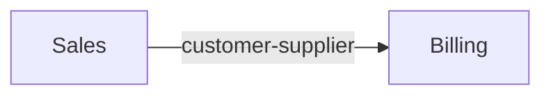

<!-- Generated by scripts/project_knowledge.py from the knowledge base. Never hand-edited: R42 and R51 make this a projection, reproducible from the graph and normative nowhere. -->

# Context map

| from | pattern | to |
|---|---|---|
| `ko.boundary.sales` | customer-supplier | `ko.boundary.billing` |

## Diagram

