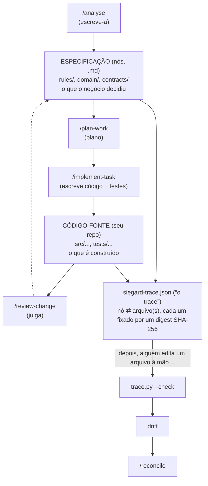

> [← Glossário](../siegard-glossary.pt-BR.md) · Anterior: [Conceitos prévios](01-conceitos-previos.md) · Próximo: [A jornada completa de uma mudança, contada do começo ao fim](03-a-jornada-completa-de-uma-mudanca.md)

## 2. O panorama: que problema o Siegard resolve

### O problema
Em qualquer sistema de software, as **decisões de negócio** (um pedido pode ter no máximo uma
fatura; um chamado só é encerrado com evidência; quem pode ver o quê) acabam espalhadas: um pouco
num documento, um pouco em tickets, um pouco na cabeça das pessoas, e, principalmente, **dentro
do código**. Com o tempo, o código muda — por correções urgentes, merges, refatorações — e
ninguém consegue mais dizer com segurança qual decisão cada trecho de código implementa, nem se
ele ainda a implementa corretamente.

### A resposta do Siegard
O Siegard mantém **uma única fonte escrita da verdade sobre o que o negócio decidiu**, chamada
**especificação**, e faz cada arquivo de código relevante **responder** a ela. Ele registra,
num arquivo chamado **trace**, qual arquivo de código contém qual decisão, com a impressão digital
(digest) de ambos. Quando qualquer um dos dois muda, o Siegard percebe, e oferece o procedimento
certo para restabelecer a correspondência.

### As cinco ideias centrais

| Ideia | Em uma frase | Onde fica |
|---|---|---|
| **Especificação** | Arquivos markdown ("nós") que dizem o que o negócio decidiu. É a autoridade. | pasta `specification/` |
| **Plano** | Tarefas recortadas de um pedido (o "escopo"), cada uma nomeando os nós da especificação que implementa. | pasta `work/<iniciativa>/` |
| **Entrega** | Registros do que foi escrito para cada tarefa, dos testes que o provam e da revisão. | pasta `delivery/<iniciativa>/` |
| **Trace** | Um arquivo dizendo qual arquivo de código contém o fato de qual nó, com as impressões digitais de ambos. | `siegard-trace.json` |
| **Reconciliação** | O procedimento que relê código alterado fora de uma tarefa e refaz o vínculo com a especificação. | `siegard-reconcile/` |

### Os princípios que explicam quase todas as regras

Quase toda regra do Siegard que parece estranha à primeira vista decorre de um destes princípios.

1. **A especificação é a autoridade.** Quando o código e um nó discordam, o nó representa o que o
   negócio decidiu. Isso não significa que o nó esteja sempre certo — significa que a
   divergência é tratada como algo a ser decidido explicitamente por uma pessoa, e não resolvida
   silenciosamente no código.

2. **A regra do juiz separado.** Um julgamento nunca é feito pelo mesmo contexto que produziu a
   coisa julgada. Quem escreveu o código não o revisa; quem escreveu os testes não é quem escreveu
   o código; quem escreveu um nó da especificação não julga se o código obedece a esse nó. Por isso
   o Siegard dispara agentes separados (chamados informalmente de **juízes**), cada um num
   contexto limpo.

3. **O retorno do juiz é evidência, salva literalmente.** O que um juiz responde é gravado em
   disco exatamente como chegou, sem ajuste. Qualquer pessoa pode, depois, reabrir a resposta e
   conferir o que foi concluído a partir dela.

4. **Evidência, nunca veredito.** Nenhuma skill do Siegard "aprova" nada. Uma revisão produz
   achados (findings) com evidência citada e o custo de cada um; quem decide o que eles significam
   é uma pessoa.

5. **Nada importante é inferido; a pessoa nomeia.** O conjunto de arquivos de uma reconciliação,
   o escopo de um plano, a tarefa a entregar, a rota de uma mudança: tudo é declarado por uma
   pessoa. Uma skill que escolhesse o próprio escopo cobriria algo diferente a cada execução.
   A exceção é quando só existe uma opção possível (por exemplo, o projeto tem um único target):
   aí a skill decide e **divulga** a decisão no relatório.

6. **O que é mecânico é feito por script.** Validar, comparar digests, dobrar retornos num
   registro, contar pendências: tudo isso é feito por scripts, sempre da mesma forma. Um modelo
   poderia esquecer uma regra no meio de uma lista longa; um script, não.

7. **Parar e entregar a porta.** Quando uma skill encontra algo que só uma pessoa pode resolver,
   ela para e entrega, no relatório, a **invocação pronta para colar** da skill que resolve o
   problema (a "porta"). Ela nunca escolhe entre duas portas no lugar da pessoa.

8. **Nada é sobrescrito.** Registros não são editados nem apagados: uma nova tentativa ganha um
   nome novo. Assim, todo o histórico de tentativas permanece legível.

---
> [← Glossário](../siegard-glossary.pt-BR.md) · Anterior: [Conceitos prévios](01-conceitos-previos.md) · Próximo: [A jornada completa de uma mudança, contada do começo ao fim](03-a-jornada-completa-de-uma-mudanca.md)
