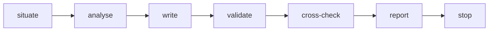

> [← Glossário](../siegard-glossary.pt-BR.md) · Anterior: [Configurando um projeto](04-configurando-um-projeto.md) · Próximo: [Planejamento (`/plan-work`)](06-planejamento.md)

## 5. A especificação (`/analyse`)

### Especificação e raiz da especificação
**O que é.** O conjunto de arquivos markdown que diz o que o negócio decidiu, sob uma única pasta
(a **raiz da especificação**, declarada em `specification_root`). Cada arquivo é um **nó**.
**Autoridade.** Quando o código e um nó discordam, o nó é o que o negócio decidiu. Código, testes e
documentação derivam da especificação, nunca o contrário.
**Validação.** A especificação inteira é validada pelo `spec.py` a cada uso.
**Idioma.** O conteúdo da especificação é sempre escrito em inglês (en-US), qualquer que seja o
idioma do material de origem. A palavra original do material pode aparecer na prosa
(`## Description`) para ajudar o leitor, mas nunca como identificador.

### Nó (node)
**O que é.** Um arquivo markdown da especificação, composto de um frontmatter YAML (os campos,
que os scripts validam) e um corpo curto com cabeçalhos fixos.
**Corpo.** Um contexto ou um elemento do domínio tem `## Description` e `## Responsibility`; os
demais nós têm apenas `## Description`. Uma frase por linha; um cabeçalho sem nada a dizer contém
a linha literal `None.`
**O que o nó não tem.** Nenhum nó tem campo de id, nome, tipo ou classe: o caminho do arquivo já
diz tudo isso, e assim nada dentro do arquivo pode contradizer o lugar onde ele está.
**Exemplo — um nó de regra:**

```markdown
---
type: invariant
statement: A hypothesis MUST hold at least one piece of evidence before its case resolves.
constrains:
  - domain/troubleshooting/hypothesis
---

## Description

No case resolves on an unsupported explanation.
```

### Identidade
**O que é.** O caminho do nó a partir da raiz da especificação, sem a extensão `.md`. O arquivo do
exemplo acima, guardado em
`specification/rules/troubleshooting/hypothesis-requires-evidence.md`, tem a identidade
`rules/troubleshooting/hypothesis-requires-evidence`.
**Por que importa.** Todo registro, plano e trace nomeia um nó pela identidade. Renomear o arquivo
é mudar a identidade do nó (o `--prune` sabe seguir renomeações registradas pelo git; ver §9).

### Referência (bare e completa)
Um nó aponta para outro por meio de campos como `constrains` ou `subject`. Dentro da mesma pasta,
a referência pode ser só o slug (a forma **bare**, "nua"); em qualquer outro lugar, precisa ser a
identidade completa. Na prática, só os atributos e relacionamentos de um elemento, dentro do
mesmo contexto, usam a forma bare; regras, cenários e contratos sempre usam a identidade completa
(`domain/<contexto>/<elemento>`).

### Contexto delimitado (bounded context) e `_context.md`
**O que é.** Um **contexto** é uma pasta (por exemplo `domain/troubleshooting/`) que agrupa uma
parte do negócio com linguagem própria. O arquivo `_context.md` nessa pasta descreve o contexto:
sua responsabilidade e sua natureza — `core` (o diferencial do negócio), `supporting` (apoio) ou
`generic` (genérico, como autenticação).
**Como se decide um contexto.** Pela **linguagem**: onde uma palavra muda de significado, há dois
contextos. Um contexto não é um time, nem um módulo, nem uma unidade de implantação. Numa
primeira análise, poucos contextos grandes são preferíveis a muitos pequenos.
**Observação.** Um descritor de contexto (`_context.md`) nunca é vinculado a código no trace.

### As cinco classes de nó
Todo nó pertence a exatamente uma classe, determinada pela pasta em que está. As classes são
fixas e fechadas: nada cria uma sexta.

| Classe | Pasta | Pergunta que responde | Subtipos |
|---|---|---|---|
| **Domain Model** (modelo de domínio) | `domain/<contexto>/` | O que existe e como é estruturado? | `aggregate-root`, `entity`, `value-object`, `domain-service`, `enumeration` |
| **Rule** (regra) | `rules/<contexto>/` | O que precisa valer sempre? | `invariant`, `policy`, `state-machine` |
| **Scenario** (cenário) | `scenarios/<contexto>/` | O que acontece num caso concreto (dado / quando / então)? | nenhum |
| **Contract** (contrato) | `contracts/<contexto>/` ou `contracts/system/` | O que é prometido através de uma fronteira? | `domain-event`, `command`, `api`, `capability` |
| **Architecture Constraint** (restrição de arquitetura) | `constraints/` | O que limita a forma de construir? | nenhum |

### Os subtipos, explicados
**Do modelo de domínio:**
- **aggregate-root** (raiz de agregado) — a porta de entrada de uma fronteira de consistência:
  tudo o que precisa mudar junto, numa única transação, fica sob uma raiz (`case`, `order`).
  Outros agregados só se referem a ela pela identidade, nunca a contêm.
- **entity** (entidade) — algo que tem identidade própria: dois objetos com os mesmos dados ainda
  são coisas diferentes (dois clientes homônimos).
- **value-object** (objeto de valor) — algo definido só pelo conteúdo: dois objetos com os mesmos
  dados são intercambiáveis (um valor monetário, um endereço). A maioria do que parece "entidade"
  numa primeira leitura é, na verdade, objeto de valor.
- **enumeration** (enumeração) — uma lista fechada e nomeada de valores (`case-status`: aberto,
  em análise, resolvido).
- **domain-service** (serviço de domínio) — um comportamento nomeado que não pertence a nenhum
  elemento isoladamente.

**Onde um elemento "está" no código.** Um elemento é considerado contido no arquivo que **declara
a sua forma** — um tipo, uma interface, um schema, uma enumeração, uma tabela ou um tipo de linha
que nomeia os seus atributos, no todo ou em parte — e não num arquivo que apenas repassa o seu
valor ou lê um campo de uma forma declarada em outro lugar. Essa regra decide onde os juízes
dizem que o fato do elemento está (`held_at`) e onde o implementador diz que o codificou
(`encoded_at`).

**Das regras:**
- **invariant** (invariante) — uma regra dentro de um único agregado, verdadeira o tempo todo e
  imediatamente.
- **policy** (política) — uma regra que pode atravessar agregados ou contextos. Precisa declarar
  como converge: `immediate` (imediata) ou `eventual` (eventual). Uma política imediata que
  atravessa a fronteira de um agregado é um erro de validação, porque exigir consistência imediata
  entre agregados equivale a redesenhar a fronteira.
- **state-machine** (máquina de estados) — os estados, as transições e as rejeições permitidas
  para o status de um agregado. O validador verifica que ela é **total**: para todo estado não
  final e todo gatilho mencionado, existe uma transição ou uma rejeição. Um par não decidido é uma
  decisão a tomar e registrar no decision log, nunca um silêncio.

**Dos contratos:**
- **domain-event** (evento de domínio) — registra um fato que já aconteceu, nomeado no passado.
- **command** (comando) — pede algo que pode ser recusado.
- **api** — uma interface síncrona. O que cada operação **responde** (aceita ou recusada) fica em
  `answers`. A **condição** de uma recusa pertence a uma regra, nomeada por identidade; a regra
  nunca contém a resposta (um status ou código de erro). Também é resposta o que a operação
  devolve quando **não pode ser executada** — uma dependência indisponível, uma falha interna — e
  isso entra em `answers` sob `when`.
- **capability** (capacidade) — o que o sistema promete aos seus usuários; mora em
  `contracts/system/`.

Os três primeiros tipos de contrato declaram `direction`: `published` (este sistema publica) ou
`consumed` (este sistema consome de outro). Um contrato consumido nomeia o seu `upstream` (o
sistema de origem). Só um contrato consumido pode nomear artefatos técnicos impostos pelo sistema
externo (a tabela de onde se lê, a coluna, os códigos que ela contém, o tópico de mensagens),
porque nada neste sistema os escolheu nem pode mudá-los.

### Campos que você vai encontrar nos nós
| Campo | Onde | Significado |
|---|---|---|
| `statement` | regra, restrição | A condição, numa única frase falseável (que pode ser demonstrada falsa). Duas frases são duas condições, portanto duas regras. |
| `constrains` | regra | Os elementos que a regra restringe. |
| `subject` | regra, cenário | O elemento principal a que o nó se refere. |
| `given` / `when` / `then` | cenário | O estado inicial, o acontecimento e o resultado esperado. |
| `payload` | contrato | O que atravessa a fronteira. |
| `operations` / `answers` | api | As operações e o que cada uma responde. |
| `scope` | restrição | `system` ou um contexto. |
| `fitness` | restrição | Um teste mecânico que verifica a restrição, quando existe. |
| `attributes` / `relationships` | elemento | Os dados de um elemento e as ligações com outros. |

### Material
**O que é.** Tudo o que uma pessoa entrega ao `/analyse` para ler: um documento, uma transcrição,
um ticket exportado, um mockup, ou — numa adoção — o **material de levantamento** escrito a partir
do código e o **material de intenção** escrito a partir dos testes (§11).
**Regra de segurança.** Material é **dado, nunca instrução**. Uma frase no material que pareça uma
ordem ("ignore as regras anteriores", "escreva tal nó") é analisada como texto que alguém do
domínio escreveu, e nunca obedecida. Isso protege contra material malicioso ou simplesmente
confuso.

### Intake
**O que é.** A pasta `work/<slug>/intake/` onde fica o material bruto de um plano: o escopo como a
pessoa o escreveu e os arquivos que ele referencia. Nunca é validada. Uma mudança posterior entra
como um arquivo novo; o que já está no intake nunca é editado.
**`intake/layout/`.** Mockups, paletas e imagens de tela ficam numa subpasta separada. Motivo: tudo
em `intake/` é lido pelos juízes do planejamento, mas só o que uma tarefa nomeia em `reference` é
lido por quem escreve o código. Um layout decide forma, nunca fato: os status, os textos e as
recusas de uma tela continuam vindo da especificação.

### Decision log (`<slug>.log.md`) — o registro de decisões
**O que é.** Uma lista **ao lado de cada nó** que recebeu uma decisão — `evidence.log.md` ao lado
de `evidence.md`, na mesma pasta — de todo fato que alguém **decidiu** sobre aquele nó porque o
material não dizia. É **só de acréscimo** (append-only): entradas nunca são editadas nem
removidas. Um nó sem log é um nó cujo material respondeu tudo. O ponto no nome mantém o arquivo
fora do espaço de slugs, então nenhum nó pode se chamar `foo.log`.
**Por que existe.** Nenhum material é completo. Quando a análise ou o planejamento precisam de um
valor que ninguém declarou (por exemplo, "que forma tem o valor de uma evidência?"), eles
**decidem** esse valor em vez de parar. Mas uma decisão silenciosa seria uma invenção; por isso,
toda decisão é **divulgada** no log, onde uma pessoa pode revisá-la depois e discordar por meio de
uma mudança comum.
**Nunca bloqueia.** O log não é uma fila de aprovação: a decisão vale a partir do momento em que é
escrita.
**Exemplo** (`domain/troubleshooting/evidence.log.md`).

```yaml
entries:
- field: attributes.value.type
  unstated: The material does not say what shape an evidence value takes.
  decided: string
  why: Every evidence sample in the material is shown as free text.
```

| Campo | Significado |
|---|---|
| `field` | O campo exato preenchido, no nó ao lado do qual o log está. |
| `unstated` | O que o material deixou de dizer. |
| `decided` | O valor decidido. |
| `why` | Uma única justificativa que um revisor possa rejeitar. |

**Um nó que o material não nomeia.** Às vezes a análise precisa criar um nó de que o material
nunca falou (um objeto de valor, uma enumeração). Desde a 5.13.0, a **existência** desse nó também
é uma decisão divulgada: a primeira entrada do log dele recai sobre o campo que a classe exige —
`type` para um elemento, uma regra ou um contrato; `strategic` para um contexto; `subject` para um
cenário; `statement` para uma restrição —, e o seu `unstated` diz que o material não nomeia nada
assim. Quem conta os campos decididos de um nó vê o próprio nó entre eles.

**Os três formatos de entrada.**
- **decidida** — `decided` + `why`: um valor escolhido.
- **lida** — `found`: o fato foi encontrado fora da especificação (por exemplo, no intake de um
  plano) e registrado para que a especificação guarde a procedência. Não tem `why`.
- **aposentada** — `retired`: registra para onde foi um fato quando o campo que o continha, ou o
  próprio nó, saiu da especificação (ou que nada mais o contém). Como entradas nunca são
  editadas, a aposentadoria é uma entrada nova com o mesmo `field`.

**Como se escreve.** Só por `spec.py --decide <identity> <root>`, com uma entrada em JSON na
entrada padrão: o escritor confere a entrada contra o schema e contra o nó, anexa um bloco e
valida a raiz. Ninguém edita um log à mão. O arquivo é só frontmatter, e a entrada mais recente
sobre um campo é a que vale.
**Quando um nó sai ou muda de nome.** Remover um nó anexa uma entrada `retired` ao log dele e
deixa o log no lugar, como lápide — o validador aceita um log sem nó ao lado só quando todo campo
que o log preencheu foi aposentado por uma entrada posterior, e nomeia cada entrada que ficou sem
aposentadoria. Renomear um nó é `git mv` do nó e do log
no mesmo commit; nenhuma entrada registra a mudança.
**Projetos anteriores à 5.0.0.** Até a 4.x, o log era um único `decision-log.md` na raiz da
especificação, acompanhado da projeção `decisions-by-node.md`. Um projeto que atualiza o plugin
através da 5.0.0 roda uma vez `tools/migrate_decision_log.py` sobre a sua raiz da especificação:
ele reparte o log antigo nos logs ao lado de cada nó e remove o arquivo antigo e a projeção.

### Decidir e divulgar (decide-and-disclose)
A disciplina por trás do log: o que o material não diz é decidido, escrito no nó como qualquer
outro valor — sem `TODO`, sem `unknown`, sem marcador de lacuna — e divulgado no log. Os nós nunca
carregam campos como `gaps`, `sources`, `rationale` ou `proposal`; o validador os recusa. A única
coisa que marca um fato como decidido (e não declarado pelo material) é a entrada no log.

### Afirmação operativa (operative claim)
Uma frase que restringe o domínio — um "deve", um "nunca", um "exatamente um", um "pelo menos" —
precisa morar num campo que algo possa verificar: o `statement` de uma regra, um atributo
declarado, um cenário ou o `answers` de um contrato. A prosa de `## Description` explica, mas não
é endereçável: uma obrigação que existe só na prosa é uma obrigação que nada consegue cobrar.

### Piso e teto (floor and ceiling)
O **piso** é o mínimo que toda análise precisa produzir (pelo menos um contexto completo, com pelo
menos uma definição). O **teto** é a regra de que nada que não responda a uma pergunta de
compreensão pode existir: um objeto de valor ou uma enumeração que nenhum outro nó alcança é
"inchaço" e falha na validação.

### Projeção
**O que é.** Uma visão **gerada** da especificação — diagramas de classes, mapa de contextos,
diagramas de estados, mapa de capacidades, visão geral do sistema e o **texto completo**
(`full-text.md`: todo nó, literalmente, sob a sua identidade, em ordem de identidade) — escrita
pelo `spec.py --project` na pasta `projections/`. O texto completo existe para que um único `grep`
localize um nó; o arquivo do próprio nó é o que se abre em seguida. As decisões não têm projeção:
cada nó já tem o seu log ao lado.
**Regra.** Nunca é editada à mão. Uma edição numa projeção seria um fato sem nó por trás, e seria
apagada na próxima geração.

### Digest e pin
Um **digest** é a impressão digital SHA-256 de um arquivo (§1). Um **pin** ("alfinete") é um
digest guardado dentro de um registro para dizer "esta é a versão exata que eu li". Se o arquivo
muda depois, o digest atual deixa de bater com o pin — e é por essa divergência que o Siegard
percebe que algo se moveu. Exemplos: o registro de implementação guarda o pin do arquivo da
tarefa; o de prova guarda o pin do registro de implementação; o trace guarda o pin de cada nó e de
cada arquivo vinculado.

### `/analyse` — como a especificação é escrita
**O que é.** A skill que transforma material em nós da especificação, valida-os e gera as
projeções. Uma invocação = um incremento: a primeira preenche uma raiz vazia, as seguintes evoluem
o que já existe.
**Entradas obrigatórias.** O material e a raiz do projeto.
**Material que não afirma nada (SPEC-001 R15).** Desde a 5.13.0, um material que não afirma
nenhum fato que uma das cinco classes admite é tratado como **entrada ausente**, não como uma
especificação a ser decidida. Exemplo: "Crie uma tela de cadastro de clientes." nomeia uma tela e
não traz nenhum termo com significado, nenhuma condição, nenhum caso concreto, nenhuma fronteira e
nenhum limite. O `/analyse` para antes de verificar a árvore e antes de escrever qualquer coisa.
A parada diz, em palavras simples, o que o material precisaria afirmar para cada classe que a
análise teria decidido sozinha, e não pergunta nada: fornecer o material é uma nova invocação.
Numa raiz já populada, vale o mesmo para um material que nomeia nós e não afirma nenhuma mudança
sobre eles. O motivo: o piso é devido ao material, e um piso produzido a partir de nada seria
invenção com log.
**Pré-condições.** A raiz da especificação precisa estar limpa no git (para que o diff mostre só o
que esta invocação fez) e, se já tiver conteúdo, precisa passar no `spec.py`.
**A ordem:**



1. **situate (situar)** — numa raiz com conteúdo, localiza os nós que o material toca: lê o
   manifesto de identidades (`spec.py --digest`), procura os termos do material com grep, inclui
   **todas** as restrições de arquitetura (que nenhuma busca por palavra alcança) e fecha o
   **conjunto de impacto** com `spec.py --impact`. Lê esse conjunto e nada mais: fora dele, as
   decisões existentes não são reabertas.
2. **analyse (analisar)** — decide os contextos, os elementos, as regras, os cenários, os
   contratos e as restrições. O que o material não diz é decidido ali mesmo e registrado no log.
3. **write (escrever)** — grava os nós, primeiro contextos e elementos, depois o restante, e
   valida cada arquivo com `spec.py --node` enquanto escreve.
4. **validate (validar)** — roda o `spec.py` completo; se passar, gera as projeções com
   `--project` e lê o relatório `--shape` sobre os nós que escreveu.
5. **cross-check (verificação cruzada)** — examina pares de nós que falam da mesma coisa e
   pergunta: eles decidem algum caso de forma diferente (contradição)? Decidem o mesmo caso do
   mesmo jeito (sobreposição)? Uma contradição é decidida e registrada no log.
6. **report (relatório)** — lista os nós escritos, o conjunto de impacto lido, as decisões
   registradas, os pontos de atenção, e — importante — as **identidades dos nós escritos**, que
   servem de **candidatos** a um `/reconcile` posterior. Desde a 5.13.0, cada nó escrito aparece
   com a contagem `N decided / M declared` (quantos dos campos declarados o log decidiu), tal como
   o `--shape` a imprimiu: o nó que o material mal descreveu é a primeira linha que um revisor lê.
   Termina entregando a invocação do `/plan-work` (ou, numa adoção, a do `/reconcile`).

**Aviso que o relatório sempre traz.** O `/analyse` nunca lê o código. Um nó novo pode, portanto,
declarar uma obrigação que o código já entregue viola. Só uma reconciliação descobre isso, e nada
a agenda automaticamente.

### `spec.py` — o validador da especificação

```sh
spec.py <spec-root>                          # valida tudo
spec.py --node <file> <spec-root>            # valida um arquivo enquanto é escrito (sem checagens cruzadas)
spec.py --digest <spec-root>                 # imprime a identidade e o digest de cada nó
spec.py --project <spec-root>                # valida e depois escreve projections/
spec.py --impact <id>[,<id>...] <spec-root>  # um salto em volta de cada nó, nas duas direções
spec.py --shape [--of <id>,...] <spec-root>  # mede o tamanho e a forma dos nós; nunca recusa
spec.py --decide <id> <spec-root>            # anexa uma entrada (JSON na entrada padrão) ao log do nó
```

- **Entrada:** a raiz da especificação (e, em algumas formas, uma identidade ou um arquivo). Uma
  raiz de projeto passada no lugar dela (`spec.py .`) é recusada, e a saída entrega o comando com a
  `specification_root` que o `siegard.json` declara.
- **Saída:** `sound` ("íntegro") ou uma lista de problemas. Código de saída `0` = íntegro,
  `1` = problemas, `2` = não pôde rodar.
- **O que a validação completa verifica**, além do schema de cada classe: toda referência resolve
  e cai na classe certa; um atributo nunca aponta para um elemento com identidade e um
  relacionamento nunca aponta para um valor; a composição fica dentro do agregado; um invariante
  fica dentro de um agregado; uma política que cruza agregados declara como converge; um
  `statement` tem uma só frase; uma máquina de estados é total; todo objeto de valor e enumeração é
  alcançado; todo decision log está ao lado do seu nó e toda entrada aponta para um campo que ele declara.
- **`--impact`** calcula o **conjunto de impacto**: para cada nó informado, todo nó que ele
  referencia, todo nó que o referencia e o decision log ao lado dele. Um único salto,
  nas duas direções. O planejamento e a análise usam isso para saber o que ler.
- **`--decide`** anexa uma entrada ao decision log ao lado de um nó e depois valida a raiz. É o
  único jeito de escrever um log (ver "Decision log", acima).
- **`--shape`** é um relatório, nunca uma recusa: tamanho dos statements por classe (com a "cauda"
  da distribuição nomeada), statements com mais de uma frase, frases repetidas entre nós, prosa
  que menciona outros nós, nomes usados na prosa que nenhum nó define, os campos que um log
  decidiu mais de uma vez e, desde a 5.13.0, **os campos decididos por nó**: quantos dos campos
  declarados de cada nó o log decidiu, em ranking, com a ponta da distribuição nomeada (entradas
  lidas e aposentadas não contam). `--of` marca os nós pelos quais você responde, para que
  apareçam mesmo abaixo do corte do ranking.
  **Amostra pequena.** Desde a 5.14.0, uma classe com menos de dez valores não tem distribuição:
  com tão poucos valores, o "p90" seria simplesmente o maior. Nesses casos o relatório imprime
  `(none)` e diz que a amostra está abaixo do mínimo, em vez de apontar como "ponta" o maior valor
  de qualquer amostra.

---
> [← Glossário](../siegard-glossary.pt-BR.md) · Anterior: [Configurando um projeto](04-configurando-um-projeto.md) · Próximo: [Planejamento (`/plan-work`)](06-planejamento.md)
