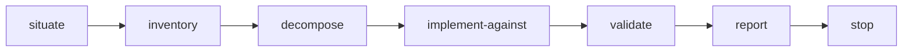

> [← Glossário](../siegard-glossary.pt-BR.md) · Anterior: [A especificação (`/analyse`)](05-a-especificacao.md) · Próximo: [Entrega (`/implement-task`, `/deliver-scope`)](07-entrega.md)

## 6. Planejamento (`/plan-work`)

### `/plan-work`
**O que é.** A skill que transforma um **escopo** declarado e uma especificação válida num
**plano**: inventário, épicos e tarefas, como arquivos markdown em `work/<slug>/`.
**Modos especiais.** Além do plano comum, tem três modos, cada um nomeado explicitamente pela
pessoa: o **incremento corretivo**, o **incremento de prova** e o **fechamento** do plano.
**Entradas obrigatórias.** O escopo, a raiz do projeto, o target e o slug da iniciativa. O
standard é opcional, mas relevante (ver "substrato" na §7).
**A ordem:**



1. **situate** — valida a especificação, encontra os nós candidatos (grep dos termos do escopo +
   todas as restrições de arquitetura + `plan.py --unplanned` para escopos abertos) e fecha o
   conjunto de impacto com `spec.py --impact`. Num plano já existente, confere o `plan.json` com
   `plan.py --check`.
2. **inventory (inventário)** — grava o escopo em `intake/` e dispara o agente
   `codebase-surveyor`, que levanta o código existente onde a mudança vai cair.
3. **decompose (decompor)** — dispara o agente `backlog-decomposer`, que recorta o escopo em
   épicos e esqueletos de tarefas (sem `implements`).
4. **implement-against (implementar contra)** — dispara um agente `execution-contract-binder` por
   tarefa, **todos juntos**, cada um decidindo quais nós a tarefa implementa e devolvendo notas.
   Fatos que a especificação não declara vão para o `unstated-fact-decider`.
5. **validate** — roda o `plan.py`, que valida tudo e gera o `plan.json`.
6. **report** — lista os nós escritos, o conjunto de impacto, as decisões tomadas, as notas
   `BLOCKING` e entrega a invocação do `/implement-task`, com o comando `deliver.py
   --outstanding` para saber qual tarefa pode ser entregue.

### Escopo
O que a pessoa pede que seja construído, com as palavras dela. O planejamento nunca o amplia por
conta própria. A única tarefa que o plano pode acrescentar sem que o escopo peça é a que constrói
um **substrato** ausente (ver §7).

### Nós do plano: inventário, épico, tarefa
Todos são markdown com frontmatter; o corpo tem exatamente dois cabeçalhos, `## What it is` e
`## Notes`.

| Tipo | Caminho | O que contém |
|---|---|---|
| **inventory** (inventário) | `inventory/<slug>.md` | O que já existe onde a mudança cai: `modules` (módulos), `conventions` (convenções, cada uma com onde foi vista), `must_not_duplicate` (o que não pode ser duplicado), `risks` (riscos) |
| **epic** (épico) | `epic/<slug>.md` | Um grupo de tarefas, os nós pelos quais responde (`covers`) e o que deixa de fora de propósito (`uncovered`, cada item com o porquê) |
| **task** (tarefa) | `task/<epic>/<slug>.md` | Um `objective` falseável, seus `criteria`, os nós que `implements`, suas dependências (`depends_on`) |

**Exemplo de tarefa:**

```markdown
---
title: Record an opened case
summary: The entry point that persists an opened case.
objective: An opened case is persisted and retrievable by its case id.
criteria:
- Opening a case returns its case id.
implements:
- domain/troubleshooting/case
---
## What it is
…
## Notes
None.
```

**Campos de tarefa:**

| Campo | Significado |
|---|---|
| `objective` | O único resultado que a tarefa entrega. Dois resultados são duas tarefas. |
| `criteria` | Condições, cada uma falseável sozinha, que definem quando o objetivo está cumprido. |
| `implements` | Os nós da especificação que a tarefa implementa. Quem decide é o binder, nunca o decompositor. |
| `depends_on` | As tarefas cujo resultado esta usa como base. É dependência, não ordem de execução. |
| `produces` | Arquivos que a entrega precisa criar porque o standard os pressupõe (um `package.json`, por exemplo). |
| `stands` | Arquivos onde a implementação já existe. Usado apenas pelo incremento de prova, que só escreve testes. |
| `reference` | Material que quem escreve o código precisa ler, como um mockup em `intake/layout/`. |
| `rationale` | Por que a tarefa não implementa nenhum nó (andaime técnico, por exemplo). |
| `sources` | Os arquivos do intake de onde a tarefa foi tirada. |

**O que não existe.** Não há campo de status, prioridade, estimativa ou ordem. O progresso é
derivado dos registros de entrega e do git (ver `--outstanding`, §7).

### `covers` / `uncovered`
O `covers` de um épico lista os nós pelos quais ele responde. Cada nó ali precisa ser implementado
por alguma tarefa do épico **ou** aparecer em `uncovered` com um `why` — uma sobra deliberada e
declarada, nunca uma lacuna esquecida. O validador recusa um nó coberto que não tenha nem uma
coisa nem outra.

### Binder (`execution-contract-binder`) e notas
**O que é.** O agente que, para cada tarefa, decide quais nós ela `implements`. Ele recebe o
esqueleto da tarefa (título, resumo, objetivo e critérios — e nada sobre como o recorte foi
feito) e os arquivos dos nós candidatos.
**Por que é isolado.** Ele chega sem memória de como as tarefas foram recortadas. Assim lê a
especificação pelo que ela diz hoje, e não para "encaixar" numa tarefa já escrita.
**Notas.** O binder nunca reescreve a tarefa. Toda divergência volta como uma **nota**, com uma
**classe**, gravada em `## Notes` da tarefa com uma abertura exata:

| Classe | Pergunta que responde | Efeito | Abertura gravada |
|---|---|---|---|
| `compound` | Um critério afirma duas condições? | O esqueleto volta ao decompositor para ser recortado de novo, uma vez. Nunca é gravada. | — |
| `blocking` | Algum nó **afirma** algo que a tarefa contradiz ou excede? | **Para a tarefa.** Só uma pessoa resolve (mudando o escopo, ou a especificação via `/analyse`). | `BLOCKING, from the specification —` |
| `unstated` | A tarefa depende de um fato que nenhum nó afirma? | Vai para o `unstated-fact-decider`; a especificação ganha o fato. Nunca é gravada numa tarefa. | — |
| `underdetermined` | Existe uma implementação errada que ainda passaria em todos os critérios? | Fica registrada; quem escreve os testes precisa escrever um teste que exclua essa implementação. | `UNDERDETERMINED, from the specification —` |
| `remainder` | Uma cláusula de uma regra pertence a outra tarefa? | Registra onde ela pertence. | `REMAINDER, from the specification —` |
| `advisory` | Qualquer outra coisa. | Só informação. | `ADVISORY, from the specification —` |

**Nota além do `covers`.** Uma nota que menciona um nó fora do `covers` do épico exige uma de três
ações: ampliar o `covers`, mover a tarefa, ou registrar a decisão de manter, numa linha
`Decision, beyond the covers — stand: <porquê>`. Sem isso, o validador recusa o plano.

### Fato não declarado (unstated) e `unstated-fact-decider`
**O que é.** Quando o binder descobre que uma tarefa depende de um fato que nenhum nó afirma,
isso **não é uma parada**. O agente `unstated-fact-decider` recebe **só o fato** — nunca a tarefa
que o revelou, nem a nota, nem o raciocínio do binder — e devolve as edições de nó e uma entrada
para o decision log.
**Por que "às cegas".** Se o fato fosse decidido por quem vê o recorte da tarefa, a especificação
tenderia a ser dobrada para caber na tarefa. Decidindo às cegas, o fato é decidido pelo que o
domínio pede.
**Resultados possíveis.** `stated` (o fato já estava dito em algum lugar), `decided` (foi decidido
agora), `contradicted` (a especificação o contradiz — então a nota era `blocking` e segue essa
rota). Um fato que a especificação **contradiz** nunca é decidido: contradição é sempre de uma
pessoa.
**Limite.** Cada fato é decidido uma única vez por invocação.
**Disparado, nunca oferecido.** Desde a 5.11.0 o `/plan-work` dispara o decisor assim que um
binder devolve um fato `unstated`, sem perguntar antes se pode. Um fato não declarado não é uma
pergunta para a pessoa: perguntar só a faria apertar o botão de uma decisão que o framework já
está autorizado a tomar. A divulgação é o log.

### Âncora e re-bind
**O que é.** Quando o `plan.py` gera o `plan.json`, ele guarda o digest de cada nó que cada tarefa
implementa: a **âncora**. Se um nó muda depois do planejamento, a tarefa passa a **esperar um
re-bind**: o binder precisa ler o nó de novo antes que alguém entregue a tarefa.
**Por que existe.** Sem isso, uma tarefa recortada contra a versão antiga de uma regra seria
entregue contra um texto que ninguém usou para recortá-la.
**Como aparece.** `plan.py --check` mostra linhas `MOVED`; `deliver.py --outstanding` mostra a
tarefa como esperando re-bind; e um registro de entrega sobre ela é recusado.

### Incremento corretivo
**O que é.** Um plano de **uma única tarefa** para **um comportamento errado** em código já
entregue — tipicamente um bug encontrado ao usar o sistema. Não roda levantamento nem
decomposição.
**Por que existe.** Uma correção pequena, se tivesse de passar pelo planejamento completo, seria
feita à mão — e duas garantias se perderiam: o código e o teste seriam escritos pela mesma pessoa
(concordando inclusive no erro), e o trace ficaria desatualizado.
**Como funciona.** A pessoa nomeia o comportamento errado e o arquivo onde ele está. A skill:
(1) grava no intake só o que a pessoa disse (nunca uma descrição do código); (2) usa
`trace.py --encodes` sobre o arquivo para saber a quais nós ele responde — um arquivo que o trace
não conhece é uma parada; (3) escreve a tarefa, com critérios falseáveis escritos a partir do
comportamento observado e do nó que o governa (nunca "o bug está corrigido"); (4) roda o binder
normalmente; (5) cria um **épico novo** só para essa correção. A tarefa segue para o
`/implement-task` como qualquer outra.

### Incremento de prova (proof increment)
**O que é.** Um plano cujas tarefas escrevem **só testes**, uma tarefa por fato. Serve para fatos
que (a) um teste finito consegue decidir, (b) já estão implementados em código entregue e
(c) nenhum teste prova ainda.
**De onde vêm esses fatos.** De certificações recusadas com `remainder: testable` (§10): o auditor
disse "um teste com tal asserção fecharia isto". O `trace.py --owed` lista esses casos e entrega a
invocação pronta.
**Como funciona.** Para cada fato, a pessoa informa o nó, a asserção (literal), o registro de
reconciliação que a declarou e os arquivos onde o fato está. A tarefa gerada tem um único
critério (a asserção), `implements` com o nó, `stands` com os arquivos e nenhum `produces`. O
`/implement-task` escreve só o teste; a revisão que lê esse teste **certifica** o nó.
**Os vizinhos do nó.** Desde a 5.11.0 o binder de cada tarefa de prova recebe como candidatos o
nó **e todo nó que o nomeia**, lidos de `spec.py --impact <nó>`. Um contrato ou uma regra que
responde ao mesmo caso é justamente onde uma asserção pode contradizer a especificação, e um
binder que recebesse só o nó não veria isso. Uma nota `BLOCKING` aqui é a parada daquele fato
antes de qualquer teste ser escrito: a contradição é resolvida por uma pessoa, nunca por um teste
que fica vermelho.

### Fechando um plano e `closure.md`
**O que é.** Quando a pessoa declara uma iniciativa encerrada (com o motivo), o `/plan-work`
grava o pedido no intake e escreve `closure.md` na raiz de trabalho: um marcador em prosa, não um
nó.
**O que o fechamento deixa de pé.** Desde a 5.11.0, antes de escrever o marcador, a skill roda
três comandos e cita a saída inteira de cada um no relatório:

```sh
deliver.py --findings <delivery-root>/<slug>/review/<a revisão mais recente>.md
trace.py --owed <target-source-root> --plan <work-root>
plan.py --notes <work-root>
```

São, respectivamente, os findings que ninguém encaminhou, os nós do plano que ainda devem um teste
e as notas classificadas que continuam de pé. Nenhum dos três é parada nem julgamento: fechar
continua sendo ato da pessoa. O relatório abre com essas três contagens, para que "completo" seja
uma palavra lida ao lado delas, e não dita no lugar delas.
**Efeito.** Um plano fechado não aceita mais tarefas nem entregas de código novo. Continua sendo
possível revisar o que ele entregou. O `/siegard-archive` pode depois retirá-lo da árvore. Um novo
trabalho sobre o mesmo tema abre um slug novo, e o código entregue volta como inventário.

### `plan.json`
O índice derivado de um plano: os nós, as arestas (dependências, `implements`) e as âncoras.
Escrito pelo `plan.py`, **nunca** à mão.

### `plan.py` — o validador do plano

```sh
plan.py <work-root> <spec-root>           # valida e escreve plan.json
plan.py --check <work-root> <spec-root>   # valida e compara com o plan.json existente; não escreve
plan.py --node <file> <work-root>         # valida um arquivo
plan.py --standard <file> --against DIR <work-root> <spec-root>
                                          # também confere o que o standard pressupõe vs. `produces`
plan.py --unplanned <work-root-parent> <spec-root>
                                          # quais nós nenhuma iniciativa jamais nomeou (consulta, saída 0)
plan.py --notes <work-root>               # as notas classificadas de pé no plano: BLOCKING e
                                          # UNDERDETERMINED por tarefa, `uncovered` por épico, totais
                                          # (consulta, vivo ou fechado, saída 0)
plan.py --contract <branch> [--fields a,b | --without a,b]
                                          # imprime uma fatia de plan-node.json para um agente
```

O que a validação completa verifica: cada nó contra o contrato; dependências resolvem e não formam
ciclos; toda referência resolve; todo nó coberto chega a uma tarefa ou a um `why`; e, com o
standard informado, que tudo o que ele pressupõe existe na árvore ou é produzido por alguma tarefa.

---
> [← Glossário](../siegard-glossary.pt-BR.md) · Anterior: [A especificação (`/analyse`)](05-a-especificacao.md) · Próximo: [Entrega (`/implement-task`, `/deliver-scope`)](07-entrega.md)
