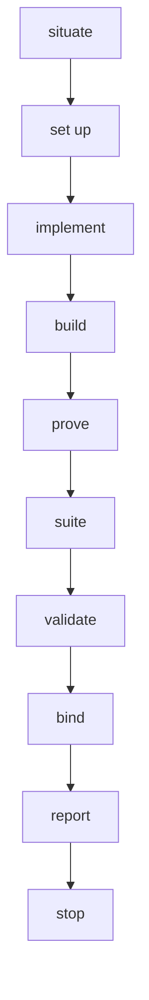
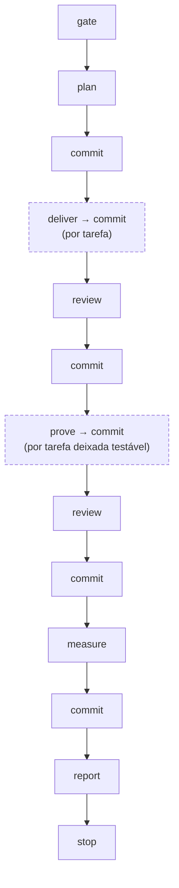

> [← Glossário](../siegard-glossary.pt-BR.md) · Anterior: [Planejamento (`/plan-work`)](06-planejamento.md) · Próximo: [Revisão (`/review-change`)](08-revisao.md)

## 7. Entrega (`/implement-task`, `/deliver-scope`)

### `/implement-task`
**O que é.** A skill que entrega **uma tarefa**: escreve o código e os testes, instala pacotes
permitidos, roda os comandos do projeto até compilar e a suíte passar, grava os registros,
valida-os e vincula o trace. Uma invocação = uma tarefa.
**A ordem:**



1. **situate** — roda `deliver.py --outstanding` para confirmar que a tarefa pode ser entregue
   (dependências entregues, substrato presente, nenhuma nota `BLOCKING`, nenhum re-bind
   pendente) e valida o standard.
2. **set up (preparar)** — roda o step de `role: install`, para que o implementador leia os tipos
   das dependências reais do projeto.
3. **implement (implementar)** — dispara o agente `task-implementer`, que escreve o código e
   devolve o conteúdo do registro de implementação. Desde a 5.18.0 quem grava o registro é o
   `deliver.py --write-implementation` (ver "Os escritores de registro", abaixo), nunca a sessão
   à mão.
4. **build (compilar)** — roda todos os steps do standard, exceto a suíte. Se falhar, a saída
   volta ao implementador, que reescreve; cada tentativa ganha um nome novo (`-build-2`,
   `-build-3`).
5. **prove (provar)** — dispara o agente `test-author`, que escreve os testes e devolve o
   conteúdo do registro de prova, gravado pelo `deliver.py --write-proof`.
6. **suite (suíte)** — roda todos os steps, terminando na suíte de testes. Se a suíte falhar, o
   agente `failure-diagnostician` diz por quê, e a causa decide a saída (ver "causas" abaixo).
7. **validate** — verifica com `deliver.py --unrecorded` que todo arquivo alterado está nomeado
   num registro, e roda o `deliver.py` completo.
8. **bind (vincular)** — `trace.py --bind-record` grava no trace os nós que o registro diz ter
   codificado.
9. **report** — lista arquivos, critérios, inferências, desvios, execuções e entrega a invocação
   do `/review-change`.

**Por que dois agentes.** Código e testes escritos no mesmo contexto concordam "por construção",
inclusive onde ambos estão errados. Separados, um pode discordar do outro — e essa discordância é
um sinal valioso.
**Proibição importante.** Um teste nunca é enfraquecido, apagado, estreitado ou reescrito para a
suíte passar.

### Causas de uma suíte vermelha
O `failure-diagnostician` devolve uma de quatro causas (`cause`), e cada uma leva a uma saída:

| `cause` | Significa | O que acontece |
|---|---|---|
| `code` | O código está errado. | Volta ao implementador; a suíte roda de novo com nome novo. |
| `build` | Uma compilação feita pela própria suíte falhou; nada chegou a rodar. | Volta a quem escreveu o arquivo apontado pelo compilador. |
| `test`, num teste desta entrega | Os dois produtores discordam: o teste exige o que o critério pede, o código não entrega. | **Para.** Só uma pessoa decide. |
| `test`, num teste de outra tarefa | Esta entrega quebrou um teste antigo. | Depende de qual arquivo foi mexido: ou a outra tarefa ganha uma re-entrega só de prova, ou o teste é reescrito por inteiro nesta entrega. |
| `setup` | O ambiente não subiu (banco, serviço externo). | Roda de novo uma vez; se falhar igual, para. |

### Raiz de entrega e registros de entrega
A pasta `delivery/<slug>/` contém três tipos de registro, todos markdown com frontmatter:

| Registro | Caminho | Escrito por | Contém |
|---|---|---|---|
| **implementation** (implementação) | `implementation/<epic>/<task>.md` | `/implement-task` | os arquivos escritos, cada critério respondido, cada nó respondido |
| **proof** (prova) | `proof/<epic>/<task>.md` | `/implement-task` | cada teste, o que prova e o que o faria falhar |
| **review** (revisão) | `review/<name>.md` | `/review-change` | os passes que rodaram, os findings, a cobertura |

O caminho **é** a identidade: o registro de implementação da tarefa `task/abertura/registrar-caso`
é `implementation/abertura/registrar-caso.md`. Nenhum campo diz a qual tarefa ele responde.

**Exemplo de registro de implementação:**

```yaml
target: backend
title: Record an opened case
summary: The entry point that persists an opened case.
task: sha256:fd8b6fdb…          # pin do arquivo da tarefa, como foi lido
files:
- path: src/troubleshooting/case.ts
  effect: holds the case aggregate and its status vocabulary
criteria:
- criterion: Opening a case returns its case id.
  met: true
  how: the constructor takes the id and the module answers with it
nodes:
- node: domain/troubleshooting/case
  encoded_at:
  - src/troubleshooting/case.ts
  how: the case's identity and status vocabulary are the shape this module holds
```

**Campos que vale conhecer:**

| Campo | Significado |
|---|---|
| `task` | O pin do arquivo da tarefa como foi lido. Se a tarefa mudar depois, o registro fica desatualizado. |
| `files[].effect` | O que o arquivo passou a fazer. |
| `criteria[].met` / `how` | Se o critério foi cumprido, e como — algo que o leitor pode ir conferir. |
| `encoded_at` | O(s) arquivo(s) onde o fato de um nó agora mora. **É isso que vai para o trace.** Ausente significa que o nó orientou o trabalho sem que um fato próprio chegasse ao código ("honrado, não codificado"). |
| `inferences` | O que o implementador decidiu sem que nada dissesse, e a partir de quê. |
| `divergences` | Onde o código se afasta da tarefa, do inventário ou do standard, e por quê. |
| `deferred` | O que foi encontrado e deliberadamente não mudado. |
| `preserved` | O que precisava continuar funcionando, declarado antes da mudança. |
| `installed` | Pacotes adicionados (cada um precisa estar na lista de permissão do standard). |
| `tests[].proves` / `fails_when` | (registro de prova) O que o teste demonstra / o que teria de quebrar para ele falhar. |
| `tests[].demonstrates` | Um nó que o teste alega provar. É uma **alegação**, que a revisão certifica ou não. |
| `implementation` | (registro de prova) O pin do registro de implementação contra o qual os testes foram escritos. |
| `untested` | Comportamento deixado sem prova, declarado com clareza. |
| `contested` | Onde o autor dos testes acredita que a implementação está errada. |
| `not_applicable` | Casos-limite que a tarefa não levanta, cada um com o porquê. |

### Os escritores de registro (`--write-implementation`, `--write-proof`)
**O que são.** Desde a 5.18.0, os dois registros de uma entrega são escritos por um script, a
partir da resposta do agente produtor:

```sh
deliver.py --write-implementation <delivery-root> task/<epic>/<slug> --target <chave> \
    --task-file <arquivo da tarefa> [--run run/<nome>] [--standard <caminho> --standard-file <arquivo>] \
    (--from <transcrição> | --from-text <arquivo>) [--what "…"]... [--note "…"]... [--replace]
deliver.py --write-proof <delivery-root> task/<epic>/<slug> --target <chave> \
    [--run run/<nome>] [--standard <caminho> --standard-file <arquivo>] \
    (--from <transcrição> | --from-text <arquivo>) [--what "…"]... [--note "…"]... [--replace]
```

**Por que existem.** Um registro composto à mão depende da sessão que o digitou: os pins e a
forma variam de uma sessão para outra, e o produtor podia acabar fixando o próprio standard. Com o
escritor, o registro é **uma função** de quatro coisas: a resposta do produtor, o arquivo da
tarefa, o standard e a execução.
**Como funciona.**
- A resposta é a última mensagem do agente, lida da **transcrição** da delegação (`--from`), ou de
  um arquivo com os mesmos bytes (`--from-text`, quando o passo rodou inline).
- O escritor **carimba** o que a invocação sabe: o `target`, o pin do arquivo da tarefa (na
  implementação) ou o pin do registro de implementação (na prova), o caminho e o pin do standard e
  a execução. Uma resposta que traga uma dessas chaves é recusada, com o nome da chave: o produtor
  responde pelo que decidiu, e a invocação, pelo que sabe.
- O corpo também é do escritor: `## What it is` vem das linhas `--what` (ou do `summary` da
  resposta) e `## Notes` das linhas `--note` (ou a linha literal `None.`).
- Recusa uma resposta cercada por cerca de código, uma transcrição que termina numa chamada de
  ferramenta, e um registro que já existe sem `--replace`. Valida tudo como o `--node` valida
  antes de gravar um único byte. Uma prova é recusada enquanto uma tentativa de suíte vermelha não
  estiver nomeada nas linhas `--note`.
- Quando uma implementação é reescrita com `--replace` e uma prova fixava o texto anterior, o
  escritor imprime um **recibo** nomeando a prova. Reescrever essa prova (`--write-proof
  --replace`) é o passo seguinte.

**Do lado dos agentes.** O `task-implementer` e o `test-author` sabem quais chaves o chamador
carimba e as omitem. Perguntados de novo (uma execução voltou vermelha, um caminho ficou sem
registro), respondem com o mapeamento **inteiro**, revisado, nunca só a parte que mudou.

### Re-entrega e re-entrega só de prova
- **Re-entrega.** Se já existe um registro para a tarefa, a entrega é uma re-entrega: os dois
  registros são reescritos por inteiro (nunca emendados), e as execuções ganham sufixos novos.
- **Re-entrega só de prova.** Nomeada pela pessoa, quando a implementação continua válida e só a
  prova precisa mudar — por exemplo, porque a entrega de outra tarefa falsificou uma asserção que
  afirmava mais do que os critérios desta tarefa exigiam, ou porque uma certificação foi recusada
  com um `remainder: testable`. Os passos de implementação e compilação não rodam; um novo
  `test-author` reescreve a prova inteira. Antes, `trace.py --check --all` confirma que os
  arquivos da implementação não mudaram.

### Execução capturada e `run.py`
**O que é.** O **único** jeito de o Siegard executar um comando. O `run.py` roda os comandos
declarados pelo projeto (sem shell intermediário), guarda tudo o que eles imprimiram e registra o
resultado de cada step.
**Por que existe.** Uma sessão capaz de rodar a suíte poderia tentar várias vezes, em silêncio,
até ela passar — e o que falhou no caminho não existiria em lugar nenhum. O `run.py` **recusa um
nome de execução que já existe**: quatro tentativas deixam quatro pastas com quatro logs. Iterar é
permitido; esconder, não. "Uma execução narrada em vez de capturada não aconteceu."

```sh
run.py <delivery-root> --run <slug> --cwd <target-source-root> --timeout-seconds 600 \
    --step install="npm ci" --step test="npm test" [--excerpt 40]
```

- **Entrada:** onde gravar, um nome novo para a execução, a pasta onde rodar, um tempo máximo e um
  ou mais steps (`nome="comando"`).
- **Saída:** `run/<slug>/run.json`, um log por step e um log combinado. Código `0` = todos os
  steps passaram; `1` = um step falhou, estourou o tempo ou não foi encontrado; `2` = não pôde
  rodar.
- Um step que falha interrompe a execução; os seguintes são registrados como `not_run`.
- `--excerpt N` imprime na tela as últimas N linhas do step que falhou (só na tela; o log completo
  continua gravado).

Resultados possíveis de um step: `passed` (passou), `failed` (falhou), `timed_out` (estourou o
tempo), `not_found` (comando não encontrado), `not_run` (não rodou porque um anterior falhou).

### `delivery.json`
O índice derivado de uma raiz de entrega. Escrito pelo `deliver.py`, **nunca** à mão.

### Substrato, `presupposes` e `produces`
**O que é.** O **substrato** é o que precisa existir antes de uma tarefa poder ser entregue: os
arquivos que o standard declara em `presupposes` (um `package.json`, um `tsconfig.json`) ou que uma
tarefa anterior declara em `produces`.
**Por que existe.** Uma regra do standard é uma condição sobre um arquivo existente; ela não pode
"pedir" que o arquivo exista. Se o `package.json` não existe, nenhum comando do projeto roda, e
todo código escrito seria escrito contra regras que nunca estiveram em vigor.
**Como funciona.** Uma entrega sobre substrato ausente é recusada antes de escrever qualquer
coisa, e a saída aponta o caminho: uma tarefa com `produces` declarando o arquivo, planejada pelo
`/plan-work` e entregue primeiro. Essa tarefa roda só o step de instalação (não há código para
compilar) e não tem registro de prova.

### Conjunto entregável e `--outstanding`
**O que é.** As tarefas que podem ser entregues **agora**: ainda sem registro, com as dependências
entregues e provadas, com o substrato presente, sem nota `BLOCKING` pendente e sem re-bind
pendente.

```sh
deliver.py --outstanding <delivery-root> <work-root> <target-source-root> <spec-root>
```

Imprime cada tarefa sem registro, o que cada uma espera, e o conjunto entregável. É assim que o
Siegard responde "o que falta?" — não existe campo de status em lugar nenhum, e a resposta é
recalculada a partir dos arquivos toda vez, de modo que nunca fica desatualizada. Desde a 5.12.0
também imprime os registros que não fixam o standard que o projeto declara (ver "O standard lido
de volta", §4).

### `--unrecorded`
**O que é.** Antes de validar, uma entrega verifica que **todo arquivo alterado** sob o target é
nomeado por um de seus registros.
**Por que existe.** Um arquivo alterado que nenhum registro menciona (por exemplo, um teste
ajustado de passagem) seria uma mudança que nenhuma revisão jamais leria, porque a revisão lê
exatamente os arquivos dos registros.

```sh
deliver.py --unrecorded <target-source-root> <record> [<record> ...]
```

### Lote em worktrees (worktree batch)
Quando o conjunto entregável tem várias tarefas independentes, elas podem ser entregues em
paralelo, uma por git worktree. Só `delivery.json` e `siegard-trace.json` podem conflitar no
merge, e os dois são **re-derivados** pelos scripts em vez de mesclados à mão.
`deliver.py --worktreeinclude` lista os arquivos ignorados pelo git de que um worktree novo
precisa (arquivos de ambiente, por exemplo).

### `/deliver-scope` e `orchestration.md`
**O que é.** A skill que executa um escopo **de ponta a ponta**: plano, cada tarefa, revisão e uma
rodada de prova, fazendo commit entre os passos.
**Autorização.** É um dos **dois** componentes autorizados a executar `git commit` (o outro é o
`/adopt-scope`, §11), cada um sobre a sua própria rota, e só quando a mensagem da própria pessoa
pede a rota inteira (citada literalmente). Commits são sempre restritos
a caminhos (pathspec), um por passo, com mensagem que nomeia o passo — nunca cria branch, nunca faz
push, nunca reescreve histórico.
**Limites.** Nunca invoca `/analyse`: a especificação precisa ter sido escrita, revisada e
commitada por uma pessoa antes. Toda parada de uma skill interna encerra a execução, e as portas
dessa parada são repassadas literalmente. Desde a 5.9.0 repassa também a abertura da revisão
(quantos findings vão para onde, ver `/review-change`), e desde a 5.14.0 as linhas do
`--outstanding` sobre registros que não fixam o standard declarado. Um finding nunca encerra a
execução: só uma parada nomeada encerra.
**Log.** Mantém `orchestration.md` na raiz de entrega: uma linha por passo, com o que foi invocado,
o commit e o resultado. Desde a 5.5.0, quando o relatório que parou a execução recomendou uma porta
(§12, "O handoff"), a skill copia essa recomendação para o log numa linha própria, no formato
`recommended: <porta> — <critério> — <fato que decide>`. É dessa linha que a telemetria conta as
recomendações. O `/adopt-scope` faz o mesmo no seu próprio log.
**Medição.** Toda execução termina **medida**, inclusive a que uma parada encerrou: o passo
`measure` roda o `telemetry.py` (§12) sobre o período da execução e commita só a raiz de
telemetria, com a mensagem `deliver-scope <slug>: measure`. O custo de uma execução é a metade do
registro que ninguém consegue reconstruir depois que as transcrições somem. Uma sonda que não
consegue ler vira uma linha no relatório, nunca uma parada.



### `deliver.py` — o validador da entrega

```sh
deliver.py <delivery-root> <work-root> <target-source-root> <spec-root>   # valida e escreve delivery.json
deliver.py --check ...                                  # valida e compara; não escreve
deliver.py --outstanding ...                            # o que falta, e por quê
deliver.py --node <file> <delivery-root>                # valida um registro
deliver.py --write-implementation ... | --write-proof ...            # grava um registro a partir da resposta do produtor
deliver.py --standard <file> [--against DIR] [--specification DIR]   # valida um standard
deliver.py --standard <file> --reading [--for <path> ...]            # só as regras decididas por leitura
deliver.py --standard <file> --reach --for <path> ...                # as regras que alcançam cada caminho, e os caminhos que nenhuma alcança
deliver.py --findings <review>                                       # os findings de uma revisão, contados
deliver.py --check-record <record> <target-source-root>              # valida um registro do /check-source
deliver.py --unrecorded <target-source-root> <record> ...            # caminhos alterados que nenhum registro nomeia
deliver.py --worktreeinclude <file> <target-source-root> [--write]  # linhas do .worktreeinclude
deliver.py --contract <branch>                          # uma fatia de delivery-node.json para um agente
```

O que a validação completa verifica: a tarefa existe; há uma prova ao lado de cada implementação
(exceto substrato); todo critério foi respondido exatamente uma vez; todo nó implementado foi
respondido; nenhuma tarefa foi entregue antes das suas dependências; os pins batem; e cada execução
apontada rodou exatamente os comandos que o standard declara, na pasta certa.

---
> [← Glossário](../siegard-glossary.pt-BR.md) · Anterior: [Planejamento (`/plan-work`)](06-planejamento.md) · Próximo: [Revisão (`/review-change`)](08-revisao.md)
