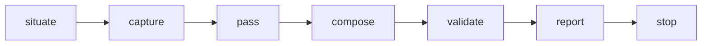

> [← Glossário](../siegard-glossary.pt-BR.md) · Anterior: [Entrega (`/implement-task`, `/deliver-scope`)](07-entrega.md) · Próximo: [O trace](09-o-trace.md)

## 8. Revisão (`/review-change`)

### `/review-change`
**O que é.** A skill que revisa uma mudança entregue por quatro ângulos independentes, roda os
comandos do projeto sobre a mudança inteira e grava um **registro de revisão**.
**Produz evidência, nunca aprovação.** Não há veredito, severidade, ranking nem decisão. Um
revisor que calculasse "bloquear" ou "aprovar" seria, na prática, um portão automático — e um
achado com o qual ninguém pode discordar é uma decisão disfarçada de achado.
**Entradas obrigatórias.** As tarefas revisadas, o conjunto de arquivos (lido dos registros de
entrega, nunca descoberto), a raiz do projeto, o target, o slug da iniciativa e o nome desta
revisão.
**A ordem:**

1. **situate** — lê os critérios das tarefas, valida o standard, roda `trace.py --check` (o
   drift é relatado, mas não é finding) e **prepara** o passe de conformidade com
   `trace.py --stage --review`.
2. **capture (capturar)** — roda todos os comandos do standard sobre a mudança inteira, via
   `run.py`. Isso acontece mesmo que o `/implement-task` já tenha rodado tudo verde: duas tarefas
   que passam separadas não são necessariamente uma mudança que passa junta.
3. **pass** — dispara os passes (tabela abaixo), independentes entre si.
4. **fold e bind** — dobra os retornos do passe de conformidade num registro de reconciliação e
   revincula os nós liberados (exatamente como o `/reconcile`, §10).
5. **compose** — escreve `review/<nome>.md`.
6. **validate** — roda o `deliver.py`.
7. **report** — lista findings por passe, passes que não rodaram e por quê, drift, e onde cada
   reparo moraria (sem escolher). Desde a 5.9.0 o relatório **abre com as contagens** que
   `deliver.py --findings <revisão>` imprime: por passe; os de conformidade por `kind`; os do
   standard pela regra citada; os de falhas por `cause`; e por arquivo. Assim você vê quantos
   findings vão para onde antes de ler qualquer um deles. O script só conta: qual rota cada grupo
   merece, ou se merece alguma, continua sendo decisão sua. Desde a 5.12.0 o relatório também traz
   os caminhos do conjunto que nenhuma regra do standard alcança (`--reach`, §4).

### Passes
Os julgamentos independentes de uma revisão. Cada um é feito por um agente separado; nenhum lê o
resultado do outro.

| Pass | Agente | Pergunta |
|---|---|---|
| **coverage** (cobertura) | `coverage-auditor` | Os testes falhariam se um critério deixasse de valer? |
| **conformance** (conformidade com a especificação) | `specification-conformance-reviewer`, **um por arquivo** | O código afirma só o que a especificação contém? |
| **standard** (conformidade com o standard) | `standard-conformance-reviewer` | O código segue as regras de leitura do próprio projeto? |
| **failures** (falhas) | `failure-diagnostician` | Por que uma execução capturada falhou? |
| **certification** (certificação) | `coverage-auditor`, um por nó | Um teste que alega provar um nó realmente o prova? |

**Passe que não rodou.** É registrado com `missing: <o que faltou>`. Por exemplo, sem standard, o
passe standard não roda; com a execução toda verde, o passe failures não tem o que ler. Isso
impede que uma revisão seja relatada como "limpa" sobre um passe que nunca aconteceu.
**Ondas.** Os juízes de conformidade são disparados pelas **ondas** que o recibo do stage lista
(ver "Ondas de delegação", §10): uma onda inteira numa única mensagem, e todos os retornos dessa
onda salvos antes de disparar a seguinte. Uma onda termina quando o `--save-return` informa
`0 pending` para ela.

**Divisão entre os dois passes de conformidade.** A especificação contém o que o negócio decidiu
(o que o sistema responde, qual recusa, quem vê o quê). O standard contém como o projeto é
organizado (camadas, nomes, fiação). Um fato de negócio no código sem nó é finding do passe de
conformidade; uma violação de arquitetura interna é finding do passe standard.

### Finding (achado)
**O que é.** Uma coisa que um julgamento encontrou, sempre com evidência citada.

| Campo | Significado |
|---|---|
| `file` | Onde foi visto, na grafia da raiz de código do target. |
| `where` | A linha ou o trecho. |
| `evidence` | **Citada** do código, nunca parafraseada. |
| `cost` | A consequência, em termos que o leitor possa pesar — não apenas "viola a regra X". |
| `correction` | O que teria de mudar (opcional; não é uma decisão). |
| `cites` | A única regra do standard violada (só no passe standard). |
| `cause` | `code`, `test`, `setup` ou `build` (só no passe failures). |
| `kind` | `contradicts`, `unstated` ou `restates` (só no passe de conformidade; ver §10). Desde a 5.9.0 a revisão copia para o finding o `kind` que o juiz deu; antes ele não chegava ao registro de revisão. |

**Não há severidade nem veredito.** O finding diz quanto custa; a pessoa decide o que isso
significa.

### Estados de cobertura
Usados para cada critério de uma tarefa numa revisão, e para um nó numa certificação:

| Estado | Significado |
|---|---|
| `covered` (coberto) | Os testes nomeados falhariam se aquilo deixasse de valer. É o teste completo de um teste. |
| `partial` (parcial) | Uma parte declarada fica sem exercício. |
| `uncovered` (descoberto) | Nada exercita. |
| `unauditable` (inauditável) | Não é possível ler o suficiente para procurar. |

### `unpaired` (testes sem par)
Testes do conjunto que não se relacionam com **nenhum** critério de nenhuma tarefa revisada, cada
um com o que afirma. É uma leitura na direção inversa da cobertura (um critério sem teste é um fato
sem prova; um teste sem critério prova algo que nenhuma tarefa declarou). **Nunca** é uma
recomendação para apagar o teste — ele pode provar o critério de outra tarefa.

### Palavras da disciplina de testes
- **Obrigação** — algo a que uma prova deve evidência: um critério, o fato de um nó, ou uma nota
  `underdetermined`.
- **Evidência** — um teste que falha quando a obrigação é violada.
- **Teste finito** — um teste que decide um fato por inteiro: uma entrada contra um resultado
  esperado, ou todos os pares de um conjunto finito (por exemplo, todo estado × gatilho de uma
  máquina de estados).
- **Teste redundante** — um teste cuja remoção deixaria todas as obrigações ainda protegidas. Não
  é escrito.
- **Preferência pelo teste.** Um teste finito é preferível a uma leitura (um juiz) e à decisão de
  um step do standard, sempre que existir. Por isso o Siegard empurra os nós para serem
  **decididos por teste** (certificação, §10).

### `/check-source` e `siegard-check/`
**O que é.** Uma skill que lê arquivos **que nenhuma tarefa entregou** (por exemplo, editados
livremente num target `edits_freely`) contra as regras de leitura do standard, e grava um
registro em `siegard-check/<slug>.md`, ao lado do trace. Não executa nada e nunca escreve
código. É validado por `deliver.py --check-record`. Desde a 5.12.0 o relatório nomeia os caminhos
lidos que nenhuma regra do standard alcança (`--reach`, §4).

---
> [← Glossário](../siegard-glossary.pt-BR.md) · Anterior: [Entrega (`/implement-task`, `/deliver-scope`)](07-entrega.md) · Próximo: [O trace](09-o-trace.md)
