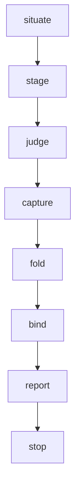

> [← Glossário](../siegard-glossary.pt-BR.md) · Anterior: [O trace](09-o-trace.md) · Próximo: [Adoção e levantamento (`/survey`)](11-adocao-e-levantamento.md)

## 10. Reconciliação (`/reconcile`)

É aqui que se concentram as palavras mais estranhas. Na primeira leitura, siga os verbetes na
ordem: eles acompanham o procedimento do início ao fim.

### Para que serve a reconciliação
**O problema.** Todo bind normal sai de uma entrega: o registro de implementação diz quais nós o
código codifica e onde. Mas o código também muda por outros caminhos:
- uma correção digitada durante um incidente;
- um conflito de merge resolvido à mão;
- uma entrega que reescreveu um arquivo que **outros** nós também reivindicam (o bind só
  recarimba os nós da própria tarefa).

Em todos esses casos, o arquivo muda e o trace continua afirmando o digest antigo. Só o
`--check` revela isso, e ninguém é obrigado a rodá-lo.

**A resposta.** O `/reconcile` pega um **conjunto de arquivos que você nomeia**, faz **juízes
independentes** lerem cada arquivo contra **todo nó que o trace vincula a ele**, grava a resposta
num **registro de reconciliação** e **revincula apenas o que os juízes liberaram**.

**O que ele nunca faz.** Nunca escreve código e nunca escreve um nó da especificação. Quando o
código afirma algo que o nó não contém, ele não "conserta" nada: entrega à pessoa as duas portas
possíveis (corrigir a especificação ou corrigir o código) sem escolher.

**Não confundir com a revisão.** A revisão (`/review-change`) examina uma entrega: cobertura dos
testes, standard, falhas e conformidade. A reconciliação examina **só** a conformidade de arquivos
com os nós que o trace já liga a eles, e não exige plano, tarefa nem entrega.

### Os três modos
| Modo | Quando usar | Como é pedido | Flag no `--stage` |
|---|---|---|---|
| **ordinário** | Arquivos mudaram sem rebind (edição à mão, merge). | invocação comum | *(nenhuma)* |
| **auditoria** (audit) | Vínculos que **nunca** tiveram drift, mas podem estar errados desde o início (largos demais). Como nunca mudam, nada baseado em mudança os reexamina. | a pessoa diz "audit" | `--audit` |
| **adoção** (adoption) | Código que nenhuma entrega escreveu — adotando o Siegard num projeto existente. | a pessoa diz "adoption" e nomeia os candidatos (ou o ledger) | `--adopt --ledger …` ou `--adopt --node …` |

(`--stage --review` é a mesma preparação usada de dentro do `/review-change`, §8.)

### A ordem



Em uma frase cada:
1. **situate** — confere que tudo está íntegro e commitado.
2. **stage** — um script prepara, para cada arquivo, o pacote de nós que o juiz vai ler.
3. **judge** — um juiz por arquivo lê o arquivo contra o seu pacote; os retornos são salvos
   literalmente.
4. **capture** — se algum par é decidido por um comando (e não por leitura), esse comando roda uma
   vez, capturado.
5. **fold** — um script combina os retornos e a premissa da pessoa no registro de reconciliação.
6. **bind** — um script revincula no trace só os nós que o registro diz terem sido liberados.
7. **report** — o relatório diz o que foi vinculado, o que não foi, e entrega as portas.

### Entradas obrigatórias
1. **O conjunto de arquivos** — cada caminho, relativo à raiz de código do target. Nomeado pela
   pessoa, **nunca descoberto**: uma reconciliação que escolhesse o próprio escopo cobriria um
   conjunto diferente a cada vez.
2. **A raiz do projeto.**
3. **O target** (decidido automaticamente quando o `siegard.json` declara um só).
4. **O slug** — o nome do registro em `siegard-reconcile/`. Um slug já usado é uma parada, porque
   o registro existente é a justificativa de vínculos que ainda estão no trace.

**Opcional:** **certificações** — testes que a pessoa oferece como prova de um nó (ver
"certificação" abaixo). **Palavras de modo:** "audit" (auditoria) ou "adoption" (adoção, com os
candidatos ou o ledger e, opcionalmente, arquivos "outside").

**Não pede:** raiz de trabalho, raiz de entrega, tarefa nem plano. É exatamente isso que ela
acrescenta ao framework: o julgamento que ela roda já existia, mas só era alcançável por uma
entrega, que uma edição à mão não tem.

### Situate (situar)
Verifica, nesta ordem:
- que a especificação é válida (`spec.py`) — um julgamento contra uma especificação quebrada é um
  julgamento sobre nada;
- que o trace é válido (`trace.py`) — se não existe trace, a resposta é uma entrega ou, para
  código antigo, uma adoção;
- que o caminho do registro `siegard-reconcile/<slug>.md` está livre;
- que os arquivos nomeados (e as provas oferecidas) estão **commitados**, que o
  `siegard-trace.json` está limpo e, desde a 5.6.0, que o arquivo de cada nó candidato também
  está commitado na especificação.

**Por que commitados.** O bind grava um digest dos dois lados. O digest de uma edição não
commitada aponta para um conteúdo que o próximo checkout pode apagar, e um nó estampado a partir
de um texto que ninguém commitou é um vínculo com uma especificação que pode nunca ter existido;
o drift que surgiria depois, num caso ou no outro, seria causado por ninguém.

### Workspace (área de trabalho)
Uma pasta temporária e descartável (normalmente criada com `mktemp -d`) onde o `--stage` grava o
material dos juízes. Nunca é commitada: ela contém cópias de texto de nós, e uma cópia commitada
seria uma segunda casa para esses textos.

### `--stage` — preparando o material dos juízes
**O que faz.** Calcula, mecanicamente, **todo nó** a que cada arquivo nomeado está vinculado no
trace e prepara, no workspace, tudo de que os juízes precisam.
**Por que é um script.** Montar à mão a lista de nós de cada arquivo, lendo o
`siegard-trace.json`, é arriscado: um nó esquecido faz um juiz receber um conjunto incompleto, e
a resposta desse juiz parece exatamente igual a uma completa. O script não esquece.

```sh
trace.py --stage <target-root> <spec-root> <slug> <workspace> <file> [<file> ...] \
    [--audit | --review [--node <n> ...] [--demonstrated <proof-record> ...] \
     | --adopt (--ledger <ledger.md> | --node <candidate> ...) [--outside <file> ...]] \
    [--certify <certifications.yaml>] [--concurrency <n>]
```

**Entradas:** raiz do target, raiz da especificação, slug, pasta do workspace, o conjunto de
arquivos e as flags de modo. `--concurrency <n>` corta as delegações em ondas de no máximo `n`
(ver "Ondas de delegação", abaixo).
**Saída, no workspace:**

| Item | O que é |
|---|---|
| `manifest.json` | O "índice" da preparação: o conjunto de nós de cada arquivo, mais as listas `unbound`, `omitted`, `mechanical`, `certify` e `candidates`, e as `waves` (ondas). |
| `packs/<arquivo com cada / trocado por __>.md` | Um **pacote de nós** (node pack) por arquivo: o texto completo de todo nó que o juiz daquele arquivo precisa ler, cada um com o caminho de origem e o digest. |
| `packs/certify__<nó>.md` | Um **pacote de certificação** por nó a certificar. |
| `candidates.txt` | O **índice de candidatos** do lote inteiro (ver verbete próprio). |

Também cria, no topo do git, a pasta vazia `siegard-reconcile/<slug>.returns/`, onde os retornos
dos juízes serão salvos.

**Exemplo de nome de pacote.** O arquivo `src/billing/raise.ts` recebe o pacote
`packs/src__billing__raise.ts.md`. A troca de `/` por `__` transforma um caminho num nome de
arquivo único e sem subpastas. Se dois caminhos do conjunto resultarem no mesmo nome
(`src/x/b__c.ts` e `src/x__b/c.ts`), o stage recusa o conjunto: um arquivo seria vinculado pela
leitura do outro.

### O que o stage separa
Cada arquivo e cada nó do conjunto cai numa destas situações:

| Situação | O que acontece |
|---|---|
| Um arquivo com nós no manifesto | É o assunto: recebe um juiz. |
| Um arquivo a que o trace não vincula nada (**`unbound`**) | É só relatado. Decidir a qual nó um arquivo sem vínculo responde é trabalho de uma entrega ou de uma análise, não de uma reconciliação. (Exceção: numa adoção, os candidatos são lidos contra ele.) |
| Um arquivo cujos pares foram todos omitidos | Nada a julgar; o registro o contabiliza em `pairs_omitted`. |
| Um nó da classe `orphaned` | Parada para esse nó: nenhum juiz o recebe, e a rota é `--prune`. |
| Um par decidido por uma execução | Vai para a camada `mechanical` (ver abaixo). |

### `pairs_omitted` (a guarda de omissão)
**O que é.** A lista de pares que o stage decidiu **não** rejulgar, cada um com o motivo.
**Quando um par é omitido.** Quando rejulgá-lo não acrescentaria nada: o vínculo ainda bate com os
bytes atuais do arquivo **e** nenhum registro em `siegard-reconcile/` tem um finding aberto contra
ele. Em outras palavras: o par já foi julgado sobre exatamente este conteúdo.
**Segurança.** No bind, as duas condições são recalculadas; se alguma deixou de valer (o arquivo
mudou entre o stage e o bind, por exemplo), o registro inteiro é recusado, e a rota é uma nova
invocação com slug novo.
**Na auditoria.** `--audit` desliga a omissão: toda afirmação existente é julgada.
**Na revisão.** `--review` só omite pares que uma **reconciliação** já liberou (marcados `judged`)
sobre os mesmos bytes; pares carimbados por uma entrega sempre vão a um juiz.

### Camada mecânica (`mechanical`)
**O que é.** Pares que uma **execução** pode decidir, e que por isso não vão para um juiz. São de
dois tipos: (a) uma restrição de arquitetura que um step do standard declara em `decides`; (b) um
nó que um **teste certificado** decide.
**Por que.** Um juiz leria o código e "adivinharia" o que o comando decide com exatidão — e
custaria uma delegação inteira. Rodar o comando é mais barato e mais exato.
**Duas guardas.** O par volta para um juiz se o texto do teste certificado mudou (a certificação
deixou de valer) ou se o texto do próprio nó mudou (o teste nunca foi avaliado contra a frase
nova).
**Como é respondida.** O comando roda uma vez, capturado:

```sh
run.py siegard-reconcile/<slug>.returns --run <slug> --cwd <target-source-root> \
    --timeout-seconds <limite> --step test="npm test"
```

e a pasta da execução é passada ao fold com `--run`. **Um step vermelho é um resultado, não uma
parada**: o fold registra que aquele nó não foi liberado, e o finding segue a rota normal. Não se
roda de novo para obter verde.

### Candidato, índice de candidatos e camada de candidatos
**O problema que resolve.** Um juiz lê um arquivo contra os nós **vinculados** a ele. Mas o
arquivo pode conter um fato que pertence a **outro** nó (vinculado a outro arquivo, ou recém-escrito
e ainda sem vínculo). Sem acesso a esse outro nó, o juiz diria "nenhum nó contém isto" — um falso
finding `unstated`. Com acesso, ele pode dizer "este fato pertence àquele nó".
**Candidato.** Um nó que um juiz **pode abrir**, sob demanda, quando o seu arquivo afirma um fato
que os nós do seu próprio pacote não resolvem.
**Índice de candidatos (`candidates.txt`).** A lista, para o lote inteiro, de todo nó pelo qual o
lote responde, com os arquivos de cada um. Um único índice serve todos os juízes, e é passado
**pelo caminho**, nunca colado no prompt (colar custaria o mesmo texto repetido por juiz).
**Nós escritos desde o último bind.** Numa reconciliação ordinária, a pessoa pode acrescentar como
candidatos os nós que o `/analyse` acabou de escrever (o relatório do `/analyse` os lista). Assim,
um fato que o código contém e que um nó novo passou a declarar é atribuído a esse nó.
**Na auditoria.** Não há camada de candidatos: a pergunta da auditoria é mais estreita ("este
arquivo ainda contém o fato deste nó?"), e a resposta não mudaria com candidatos.
**Na adoção.** "Candidato" tem um sentido mais forte: são os nós que o `/analyse` escreveu a partir
do código. A leitura deles pelo juiz **decide se serão vinculados**. Com um ledger, cada arquivo
recebe no seu pacote os candidatos em que os fatos **daquele arquivo** foram parar (§11).

### Certificações e `--certify`
**O que é.** Uma oferta, feita pela pessoa, de que certos testes provam o fato de um nó. É escrita
num pequeno arquivo YAML no workspace e passada ao stage:

```yaml
- node: rules/sales/invoice-immutable
  proof:
    - tests/billing/raise.spec.ts
  step: test
```

O stage recusa, antes de escrever qualquer coisa: um nó que nenhum dos arquivos nomeados codifica,
um arquivo de prova inexistente, ou um step que o standard não declara. Um nó sendo certificado
nunca tem pares omitidos: a certificação acompanha uma leitura nova do nó. O julgamento da
certificação é descrito mais abaixo ("Certificação e `decided_by: test`").

### Ondas de delegação (`waves`) e `--concurrency`
**O que é.** O ambiente do Claude Code limita quantos agentes podem rodar ao mesmo tempo. Desde a
5.9.0, o `--stage` corta as delegações — um juiz por arquivo e um auditor por certificação — em
**ondas** de no máximo `n` delegações. O padrão é vinte, o teto do próprio ambiente. As ondas
ficam gravadas no manifesto e aparecem no recibo do stage.
**Por que existe.** Sem o corte, uma sessão disparava dezenas de agentes de uma vez, o ambiente
recusava parte deles com "limite de subagentes simultâneos", e a sessão passava a reenviar
disparos um a um, sem saber direito quais já tinham rodado.
**Como funciona.**
1. Uma onda é disparada **inteira, numa única mensagem**.
2. Cada retorno é salvo com `--save-return` assim que a notificação dele chega (ver "Salvar os
   retornos literalmente").
3. A onda termina quando o `--save-return` informa **`0 pending`** para ela, lido dos retornos que
   estão em disco. Nunca por uma contagem de notificações feita de cabeça pela sessão: várias
   notificações chegam num mesmo turno, algumas dentro do próprio turno que disparou a onda, e a
   contagem mantida no contexto sempre fica abaixo do real.
4. Só então a próxima onda é disparada.

**Disparo recusado.** Se o ambiente recusa um disparo, nenhum juiz rodou: a onda foi cortada larga
demais. O relatório entrega `--stage --concurrency <menos>` pronto para rodar de novo. Nunca se
reenvia um juiz avulso. O `/survey` usa a mesma regra, com ondas de no máximo vinte agentes de
levantamento.
**No fold.** Quando falta um retorno, o `--fold` nomeia a onda que não terminou.

### Juiz — o julgamento de conformidade
**Quem.** Um agente `siegard:specification-conformance-reviewer` **por arquivo** que o manifesto
contém, disparados pelas ondas que o recibo do stage lista (verbete anterior).
**O que cada um recebe.** O caminho absoluto do seu único arquivo; o caminho do seu pacote de nós;
o caminho do índice de candidatos (mais os nós que a pessoa nomeou como escritos desde o bind); a
raiz da especificação; e o caminho do contrato `schemas/conformance-return.json`. Todos os
caminhos já resolvidos e absolutos — nunca "junte esta raiz com aquele caminho", que obrigaria o
juiz a adivinhar. Desde a 5.18.0 o prompt também entrega a forma da resposta como bloco recuado,
sem cerca (ver "O retorno").
**O que o juiz cita.** Desde a 5.7.0 a evidência cita **a linha que contém o fato**, nunca a
função ou o bloco inteiro em volta dela. Uma citação curta e exata é o que permite, depois,
conferir no disco se aquele texto ainda está no arquivo (ver `--owed`).
**Por que um juiz por arquivo.** Um único contexto lendo todos os arquivos e todos os nós de uma
vez "satura": responde centenas de pares numa só leitura e declara limpos pares que nunca pesou.
Um juiz com um só arquivo lê menos e erra menos.
**Certificações.** Para cada nó a certificar, um agente `siegard:coverage-auditor` recebe o
pacote de certificação e a raiz do target, e nada mais.
**A sessão não julga.** A sessão que orquestra **nunca lê os arquivos para decidir ela mesma**. Ela
aceitou a premissa da pessoa de que o código está certo, e estaria julgando a partir dessa
premissa. E se a própria sessão escreveu algum dos nós julgados, ela não pode nem mesmo aplicar o
julgamento "inline" (sem agente): estaria corrigindo a própria redação.
**Uma resposta por juiz.** Um juiz responde uma vez. Se o retorno for inutilizável (campo
faltando, nó sem resposta), o prompt estava errado: faz-se uma **delegação nova** com o prompt
corrigido. Nunca se faz uma pergunta complementar ao mesmo juiz, porque ele já carrega a primeira
leitura, e a segunda resposta não seria nem a primeira nem uma leitura independente. Duas respostas
divergentes do mesmo juiz anulam uma à outra, e o arquivo é julgado de novo num contexto limpo.
Uma pergunta devolvida pelo juiz ("o que devo fazer?") não é um retorno.

### O retorno (conformance return)
**O que é.** O que um juiz responde: YAML puro, com **só quatro chaves permitidas, em qualquer
profundidade** — `findings`, `read`, `looked_past` e `candidates_opened`. Uma quinta chave (um
`notes` com um parágrafo de conclusão, um resumo para humanos) faz o fold recusar o retorno, e
uma mesma chave dada duas vezes também. **Sem cerca de código** (```` ```yaml ````) em volta: todo
agente cuja resposta um script lê é instruído a não cercá-la, e uma resposta cercada não é lida —
o fold a recusa nomeando a delegação.
**Como a forma é mostrada ao agente.** Desde a 5.18.0, os oito agentes que devolvem um
mapeamento YAML mostram a forma esperada como um **bloco recuado**, nunca dentro de uma cerca, e
dizem onde a resposta começa (pela primeira chave) e onde termina (na última linha do
mapeamento). O `/review-change` e o `/reconcile` repetem essa forma no prompt de cada delegação. O
motivo: uma instrução "não cerque" ao lado de um exemplo cercado era copiada pelo exemplo, e o
revisor de conformidade (que roda num modelo menor) devolvia respostas cercadas.
**Exemplo:**

```yaml
findings:
  - where: the guard added to raise(), line 12
    evidence: |-
      if (order.invoices.length >= 1) return existing
    cost: |-
      the at-most-one-invoice rule lives only here, so the next reader looks
      for it in the specification and does not find it
    node: rules/sales/invoice-immutable
    kind: contradicts
read:
  - node: rules/sales/invoice-immutable
    held_at: nowhere
    evidence: |-
      the rule the file cites governs modification of a raised invoice;
      `if (order.invoices.length >= 1)` states a cap no node holds
candidates_opened:
  - rules/sales/invoice-immutable
```

**As chaves, uma a uma:**

| Chave | Significado |
|---|---|
| **`findings`** | O que o juiz encontrou contra, cada item com `where`, `evidence`, `cost`, `kind` e, opcionalmente, `file`, `node` e `correction`. **Ausente, ou uma lista vazia (`findings: []`), significa "nada encontrado"** — as duas formas dizem a mesma coisa, e isso é um resultado real e uma afirmação: sobre este arquivo e estes nós, o código afirma o que a especificação contém e nada além. |
| **`read`** | **Obrigatório.** Uma entrada por nó do pacote do próprio juiz, na ordem do pacote — nunca um subconjunto, nunca um candidato. Diz, nó a nó, onde o fato dele está agora. É daqui que se escreve o `how` de um nó liberado. |
| `read[].node` | A identidade do nó. |
| `read[].held_at` | Onde no arquivo o fato do nó está agora (`the return statement of place(), line 41`), **ou a palavra `nowhere`** ("em lugar nenhum"). Um fato é contido por **código**, nunca por um comentário sobre ele. A resposta é lida pela primeira palavra: `nowhere. The file does no ranking.` continua significando "em lugar nenhum". Um arquivo que não contém fato algum é respondido `nowhere` para cada nó. |
| `read[].evidence` | Código citado que sustenta a resposta. Quando `held_at` é `nowhere`, cita o que foi examinado. |
| **`looked_past`** | Uma frase nomeando o que foi visto e não relatado porque pertence a outro julgamento (por exemplo, um problema de estilo, que é do standard, ou um fato que só um comentário afirma). |
| **`candidates_opened`** | Todo candidato que o juiz de fato abriu, tenha ou não resultado em finding. Vazio ou ausente significa que não abriu nenhum. Serve para medir se vale a pena oferecer a camada de candidatos. |

**`node` num finding.** Quando o finding é sobre um nó específico, nomeia-o (pode ser um
candidato). Quando não nomeia nó nenhum, o fold, por precaução, aplica o finding a **todos** os nós
daquele arquivo (ver `collateral`).

### `kind` — os três tipos de finding
Um julgamento responde a perguntas diferentes, e o `kind` diz a qual delas o finding responde:

| `kind` | Significa | Bloqueia o vínculo do nó? | Rota |
|---|---|---|---|
| **`contradicts`** (contradiz) | O código diz o que o nó nega, ou não carrega mais o fato do nó, ou virou uma segunda casa para ele. | **Sim** — o nó não é vinculado. | `/analyse` (a especificação está atrasada) ou corretivo do `/plan-work` (o código está errado) |
| **`unstated`** (não declarado) | O **código** afirma um fato que **nenhum nó contém**. | Não — nenhum rebind poderia resolvê-lo, então ele não impede o vínculo que a leitura do nó liberou. | `/analyse` |
| **`restates`** (repete) | Um **comentário** ou uma **docstring** — prosa que nenhum sistema em execução emite — repete o fato de um nó, **enquanto algum código também contém esse fato** (neste arquivo ou noutro que o finding nomeia). | Não — o par está conforme e é vinculado onde o código está. | Remover a prosa (rota 4), depois `/reconcile` sobre o arquivo de novo |

**Casos de fronteira:**
- Se **nenhum código** contém o fato de um nó, um comentário que o afirma é `contradicts`, não
  `restates`.
- **Um fato que só um comentário ou uma docstring afirma** — e que nenhum nó contém, nenhum
  código e nenhum texto emitido carrega — **não é finding** de tipo nenhum, nem `unstated`: prosa é
  o que alguém acreditava, e a análise lê os fatos no código. O juiz o nomeia em `looked_past`, e a
  rota de comentários o remove.
- **Texto que o sistema em execução emite é comportamento, nunca `restates`** — a descrição de
  uma ferramenta, uma mensagem de erro, um prompt enviado a um modelo, uma linha de log. É o que o
  sistema diz a alguém; removê-lo mudaria o comportamento. Se afirma corretamente o fato de um nó,
  **não é finding**; se afirma algo diferente do nó, é `contradicts`.
- **Exceção: texto que só nomeia um controle, e o ajuste que um cliente faz das suas
  requisições.** O rótulo de um botão, de uma coluna, de uma aba ou de um menu, um nome acessível
  (`aria-label`), um placeholder, o tempo de cache ou o número de tentativas de uma requisição são
  escolhas da implementação, nunca fatos do domínio: um deles que nenhum nó contém **não é
  finding** de tipo nenhum. Já o texto que muda o que uma pessoa pode saber ou fazer — uma mensagem
  de recusa ou de falha, o rótulo de um vocabulário fechado, um aviso de resultado — continua sendo
  fato.
- Se duas coisas são verdadeiras sobre um mesmo arquivo, são dois findings, porque são devidos a
  pessoas diferentes.

### Salvar os retornos literalmente
**O que é.** Cada retorno é salvo **no momento em que chega**, como cópia e nada mais, em:

```
siegard-reconcile/<slug>.returns/<caminho do arquivo com cada '/' trocado por '__'>.yaml
siegard-reconcile/<slug>.returns/certify__<nó com cada '/' trocado por '__'>.yaml
```

**Por que literalmente.** Os retornos são a **evidência** a partir da qual o registro é dobrado, e
sobrevivem à sessão. Um retorno "ajustado" por quem o salvou carregaria um julgamento que o juiz
nunca fez. Por isso: nunca reformate, corte ou conserte um retorno. O que o juiz disse fora das
quatro chaves vai para o relatório à pessoa, nunca para o arquivo que o fold lê.
**Quem copia é um script.** A cópia é feita pelo `trace.py --save-return`, a partir da
**transcrição** da delegação (o arquivo de saída que o ambiente nomeia para o agente disparado):

```sh
trace.py --save-return <target-root> <workspace> <arquivo> <transcrição>
```

`<arquivo>` é o caminho do arquivo preparado, como o manifesto o lista, ou a identidade do nó de
uma certificação. Desde a 5.18.0 a certificação também pode ser escrita como `certify__<nó>`, que
é a grafia que o recibo do stage lista. O script grava a última mensagem do agente byte a byte,
com o nome que o fold lê.

**O recibo do `--save-return`.** Desde a 5.18.0, depois de gravar, o script imprime duas coisas:
- **O que a onda ainda espera**, lido dos retornos em disco pelos nomes que as ondas do manifesto
  listam: `wave 2: 17 of 20 saved, 3 pending: …`, ou `… 0 pending` quando a onda está completa.
  Essa linha, e não uma contagem mantida na conversa, é o sinal de que a onda terminou.
- **Se o fold vai recusar o que acabou de ser salvo.** O script aplica ao retorno a mesma leitura
  que o fold aplicará e, se ela falha, diz por quê. Os bytes ficam como chegaram e a saída continua
  `0`: a recusa propriamente dita continua sendo do fold. Mas o defeito aparece enquanto a onda
  ainda está aberta, e a delegação pode ser refeita com o prompt corrigido antes de a onda fechar. **Nunca redigite um retorno a partir da notificação** que o repassa: esse texto é reformatado
para exibição, e um caractere escapado (`&gt;` no lugar de `>`) quebra o YAML ou corrompe a
evidência. O script recusa uma transcrição que termina numa chamada de ferramenta (o agente ainda
não respondeu: espere), uma sem nenhuma mensagem do agente, e um arquivo que o stage não preparou.
Nada é retirado: uma resposta cercada continua cercada, e o fold a recusa. Só quando a transcrição
não pode ser lida o retorno é salvo à mão, sob a mesma disciplina.

### Premissa
**O que é.** A **única parte do registro que pertence à pessoa**: um pequeno arquivo YAML no
workspace, escrito pela skill com as palavras da pessoa.

```yaml
title: Hand correction to invoicing
summary: The nightly run raised two invoices for one order; the guard was added by
  hand and the behavior is correct.
target: backend
files:
  - path: src/billing/raise.ts
    change: refuses a second invoice for an order that already has one
```

| Campo | Significado |
|---|---|
| `title` | Um título para o registro. |
| `summary` | O que mudou e **por que a pessoa afirma que o código está certo** — como afirmação da pessoa, nunca como finding da skill. Numa auditoria, diz que o código não mudou e que as afirmações existentes estão sendo relidas; numa adoção, que o código é adotado como está. |
| `target` | O target. |
| `files[].change` | Uma linha por arquivo nomeado: o que o arquivo agora **faz** de diferente, não o que foi digitado nele. |

**Por que a premissa é separada.** Nenhum fold pode escrevê-la: ela é uma afirmação humana. E ela
não é o que decide o resultado — os juízes decidem; a premissa só registra o que a pessoa
afirmou, para que um leitor futuro saiba o contexto.

### `--fold` — a "dobra": transformando os retornos no registro
**Em que momento acontece.** Depois que todos os juízes responderam, todos os retornos foram
salvos em `siegard-reconcile/<slug>.returns/`, a premissa foi escrita e, se havia camada mecânica,
o comando foi capturado. É o quinto passo da ordem (`… → capture → fold → bind → …`), e é a ponte
entre "o que os juízes disseram" e "o que vai para o trace".

**O que é a "dobra".** "Dobrar" (fold) é um termo de programação que significa **combinar muitos
itens num único resultado, aplicando a mesma regra a cada um**. Aqui, os itens são os retornos de
vários juízes (um por arquivo) e, possivelmente, de vários auditores de certificação; o resultado é
**um único registro**, que diz, **nó por nó**, se o nó está conforme e onde o fato dele está. É
necessário porque um mesmo nó pode estar vinculado a vários arquivos e, portanto, ter sido lido por
vários juízes: as respostas deles precisam ser combinadas numa só.

**Por que é mecânico.** Todas as regras de combinação são fixas e implementadas no `trace.py`,
testadas, aplicadas sempre do mesmo jeito. Nenhum julgamento acontece aqui. Um modelo aplicando
essas regras à mão poderia esquecer uma delas entre o nó quarenta e o nó oitenta; o script, não.

```sh
trace.py --fold <target-root> <workspace> <premise.yaml> siegard-reconcile/<slug>.md \
    [--run siegard-reconcile/<slug>.returns/run/<slug>]
```

**Entradas:**
- o **workspace** (dele, o fold lê o `manifest.json`, para saber quais arquivos e nós foram
  preparados);
- os **retornos** salvos em `siegard-reconcile/<slug>.returns/`;
- a **premissa**;
- o **caminho do registro** a escrever;
- `--run`, **exatamente** quando o stage separou uma camada mecânica (e recusado quando não
  separou: uma execução que nada lê é evidência para uma pergunta que ninguém fez).

**Saída:** o **registro de reconciliação** `siegard-reconcile/<slug>.md`, validado antes de ser
gravado.

**As regras que aplica, com exemplos.**
1. **Validação dos retornos.** Cada retorno é conferido contra `conformance-return.json`. Um
   retorno faltando para um arquivo preparado, um nó sem resposta em `read`, uma quinta chave, uma
   chave repetida ou uma cerca de código faz o fold recusar — e recusar o lote inteiro.
2. **Um nó está conforme apenas onde todo juiz que leu um de seus arquivos o liberou.** Liberar
   significa: nenhum finding contra o nó, nenhum finding sem nó no mesmo arquivo, e todos os
   arquivos do vínculo ainda contêm o fato (nenhum respondeu `nowhere`). *Exemplo:* o nó
   `rules/sales/invoice-immutable` está vinculado a `raise.ts` e a `cancel.ts`. O juiz de
   `raise.ts` o libera; o de `cancel.ts` registra um `contradicts` contra ele. Resultado: o nó
   **não** está conforme.
3. **Um finding que nomeia um nó cai nesse nó**, qualquer que seja o arquivo do juiz que o
   registrou.
4. **Um finding que não nomeia nó cai em todos os nós daquele arquivo.** É uma regra
   conservadora: se o juiz não disse a qual nó o problema pertence, nenhum nó daquele arquivo é
   liberado. Os nós que só ficaram bloqueados por isso (sem nenhum finding próprio) são marcados
   **`collateral`** (colateral).
5. **Um fato que saiu de parte dos arquivos.** Se o nó ainda está em `a.ts` mas o juiz de `b.ts`
   respondeu `nowhere`, o nó não é liberado, e o registro explica que o par que deixou de conter o
   fato deve ser liberado com `--bind … --replace` (nunca recarimbado).
6. **Findings `unstated` e `restates` vão para listas próprias** do registro (`unstated` por
   arquivo, `restates` por ocorrência) e não bloqueiam o vínculo.
7. **Um finding que nomeia um nó que nenhum arquivo do conjunto vincula** vai para `notes`, com a
   frase final "owed a route of its own" ("deve uma rota própria"). Ele não bloqueia nada aqui, e o
   relatório precisa repassá-lo.
8. **Camada mecânica:** um step que passou libera os seus nós; um step que falhou não libera
   nada.
9. **Certificação:** só é gravada onde o auditor respondeu `covered` **e** a leitura do próprio nó
   o liberou.
10. **Liberado ⇒ `encoded_at`.** Para cada nó liberado, o fold grava `encoded_at` (os arquivos
    onde o fato está) e escreve o `how` a partir do `read` dos juízes. Um nó não liberado recebe
    `observed_at` em vez disso. Essa diferença é o que o bind lê depois.
11. **O fold escreve o registro qualquer que seja o resultado.** Uma reconciliação que não liberou
    nada é justamente a mais importante de guardar: sem ela, a próxima invocação redescobriria a
    mesma divergência do zero.

**Regra de ouro: nunca edite o que o fold escreveu.** Um registro ajustado depois do fold carrega
um julgamento que os retornos por trás dele não contêm, e os retornos são o que um leitor futuro
usa para conferi-lo.

**Quando o fold recusa.** Há dois tipos de recusa:
- **recusa que nomeia uma delegação** (retorno faltando, nó sem resposta, forma fora do contrato):
  faz-se uma **delegação nova** com o prompt corrigido, a partir do passo de julgamento — nunca uma
  pergunta ao mesmo juiz, nunca uma edição do retorno;
- **recusa sobre a premissa**: corrige-se a premissa e roda-se o fold de novo.

Recusas do `--run`: execução feita sobre outra árvore, sem um step que a camada exige, ou sobre um
conteúdo que mudou desde o stage. Nesse último caso, a rota é uma nova invocação com slug novo.

**Redobrar (refold).** Como os retornos são guardados literalmente e o fold é mecânico, é possível
rodar o `--fold` de novo sobre os **mesmos retornos** (por exemplo, depois que uma correção do
framework mudou uma regra do fold, antes de o registro ser commitado). Ver §14.

### O registro de reconciliação (`siegard-reconcile/<slug>.md`)
**O que é.** O documento que o fold escreve: para cada nó que o trace vincula a um arquivo
nomeado, se ele está conforme, por quê e onde o fato dele está.
**Onde fica e por quanto tempo.** No topo do git, ao lado do trace, e **nunca é apagado** (nem pelo
`/siegard-archive`): é a justificativa de vínculos que ainda estão no trace. Os retornos que o
geraram ficam ao lado, em `<slug>.returns/`.
**Contrato.** `schemas/reconciliation.json`, versão atual `siegard-reconcile/9`.
**Exemplo:**

```yaml
contract_version: siegard-reconcile/9
title: Hand correction to invoicing
summary: …                                   # a premissa da pessoa
target: backend
files:
  - path: src/billing/raise.ts
    change: refuses a second invoice for an order that already has one
nodes:
  - node: rules/sales/invoice-immutable
    conforms: false
    how: the source now states `if (order.invoices.length >= 1) return existing`, and
      no node holds that an order carries at most one invoice
    observed_at:
      - src/billing/raise.ts
notes: The behavior is right and the specification is behind it.
```

**Campos:**

| Campo | Significado |
|---|---|
| `files` | O conjunto de arquivos que a pessoa nomeou, cada um com o seu `change`. |
| `nodes[]` | Todo nó que o trace vincula a um arquivo nomeado, com a resposta. |
| `conforms` | `true` = o julgamento liberou o nó; `false` = há um finding de pé contra ele. |
| `how` | Por quê, com o que foi lido citado. |
| `encoded_at` | Só num nó liberado: os arquivos que contêm o fato dele. **É exatamente isso que o bind vincula.** |
| `observed_at` | Só num nó não liberado: os arquivos que foram lidos — os do finding e todo arquivo a que o trace vincula o nó —, sem afirmar nada sobre eles. |
| `collateral` | Num nó não liberado: nada foi encontrado contra a substância **dele**; ele apenas divide o arquivo com um finding que não nomeou nó. Resolva esse finding e o nó é liberado junto. |
| `decided_by`, `step`, `proof` | Uma certificação que se sustentou: o nó agora é decidido por teste. |
| `remainder`, `remainder_why` | Uma certificação que não se sustentou: se um teste **poderia** fechar a lacuna (`testable`) ou não (`untestable`), e a asserção que a fecharia. |
| `read_at` | Desde `siegard-reconcile/9` (5.11.0), numa certificação recusada: o digest do nó e o de cada arquivo de prova oferecido, como o stage os leu. Permite que um stage posterior distinga um par que não mudou de um que se moveu. Um registro `/8` não tem esse campo, o que não significa zero. |
| `unstated` | Fatos que o código afirma e nenhum nó contém, agrupados por arquivo. |
| `restates` | Lugares em que um comentário ou docstring repete o fato de um nó que o código já contém. |
| `unbound` | Arquivos nomeados a que o trace não vincula nada. |
| `adopted` | Presente num registro de adoção. |
| `unheld` | Só em adoção: candidatos que **nenhum arquivo do conjunto contém** e contra os quais nada foi encontrado — todo juiz respondeu `nowhere`. Não reivindicam arquivo nenhum. |
| `outside` | Só em adoção: arquivos que a pessoa deixou fora do julgamento. |
| `pairs_omitted` | Pares não rejulgados, cada um com o motivo. |
| `notes` | Prosa de que um leitor futuro precisa; nunca uma decisão. Uma nota terminando em "owed a route of its own" precisa ser levada ao relatório. |

### `--reconciliation` — validando o registro

```sh
trace.py --reconciliation siegard-reconcile/<slug>.md
```

Não escreve nada. Confere o registro contra o contrato e a contabilidade: todo caminho reivindicado
está em `files`, e todo arquivo nomeado é reivindicado ou declarado `unbound`. Como o fold já valida
o que escreve, uma recusa aqui indica defeito no stage ou na premissa, não num julgamento.

### Bind (na reconciliação)

```sh
trace.py --bind-record <target-root> <spec-root> siegard-reconcile/<slug>.md --workspace <workspace>
```

**O que faz.** Vincula **só os nós que têm `encoded_at`** no registro — isto é, os liberados — e
nada mais. Os nós com findings ficam exatamente como estavam. Como só nós liberados têm
`encoded_at`, isso é garantido pela estrutura do registro, não pela atenção de alguém.
**`--workspace`.** Faz o bind recusar se algum arquivo ou nó mudou desde o stage: o bind carimba o
que os juízes leram, e o workspace é onde o stage registrou o que foi isso.
**Recheca a omissão.** Recalcula as duas condições de cada par em `pairs_omitted`.
**Uma vez.** Rode uma única vez, tenha tudo sido liberado ou não, e leia o recibo, que diz quais
nós não foram gravados e quais certificações entraram ou saíram.

### O relatório e a próxima invocação
O `/reconcile` termina dizendo, nesta ordem: o conjunto de arquivos; o que o stage separou por
arquivo; quantos juízes; a resposta por nó, com evidência; quais pares foram respondidos por uma
execução; onde ficaram o registro e os retornos; o que foi vinculado e o que não foi; as
certificações que se sustentaram ou não (e, para cada sobra testável, a invocação do incremento de
prova).

Para cada nó não liberado, entrega **as portas**, sem escolher:
1. **A especificação está atrasada** (o código está certo) → `/analyse`, com o finding como
   material; depois, `/reconcile` de novo sobre o que restou, com slug novo.
2. **O código está errado** (o nó está certo) → incremento corretivo do `/plan-work`.
3. **Só prosa** (`restates`) → a rota de comentários: remover, commitar, `/reconcile` de novo.
4. **Finding em `notes`** ("owed a route of its own") → as mesmas portas, repassadas à parte.

**O próximo conjunto de arquivos é a sobra.** Só os arquivos cujos nós ainda estão devidos — nunca
o conjunto inteiro de novo, porque os liberados já estão vinculados e rejulgá-los só custaria.

### `--owed` — o que ainda está em aberto
**O que faz.** Lê todos os registros em `siegard-reconcile/` como um único corpo de evidência (o
**corpus**) e lista os findings que **nenhum bind fechou**. Não escreve e não decide nada.

```sh
trace.py --owed <target-root> [--all] [--plan <work-root>]
```

`--plan` (desde a 5.11.0) restringe os nós devidos aos que alguma tarefa daquele plano implementa,
lidos do `plan.json` dele. É o que o fechamento de um plano usa (§6).

**Por que é necessário.** O `--check` não enxerga esses casos. Um nó que o julgamento recusou não
ganha digest novo; e, se o par nunca foi vinculado (um candidato, por exemplo), não há digest
nenhum para comparar. O finding vive só no registro, e o `--owed` é quem o lê de volta.
**Os três estados de um finding em aberto:**

| Estado | Significado |
|---|---|
| `unseen` (invisível) | Nada vincula o par — o `--check` nunca poderá relatá-lo. |
| `covered` (encoberto) | Vinculado no conteúdo de hoje — um bind posterior escreveu por cima do único sintoma, mas o finding continua de pé. |
| `reported` (relatado) | O vínculo está defasado, então o `--check` já o mostra; o registro diz o que foi encontrado. |

Também lista os fatos `unstated`, os textos `restates`, pares respondidos dos dois jeitos por
registros diferentes, e as **sobras testáveis** (nós que um teste poderia fechar), terminando com a
invocação do incremento de prova. Saída `0` = nada devido.
**Quando um `restates` ainda está de pé.** Desde a 5.7.0, o `--owed` e o `--convergence` contam
um `restates` como de pé **só enquanto o texto que o registro citou ainda está no arquivo**
(espaços normalizados dos dois lados). Os demais são contados à parte, como **respondidos**, e
continuam no registro que os leu. O silêncio de um julgamento posterior não é usado como prova de
que o comentário saiu: um juiz cita o que leu e não lista todo comentário que viu. Um `restates`
sobre um target que o `siegard.json` não resolve fica de pé sem conferência, e o relatório diz
isso.
**Atenção.** Não confunda este `covered` ("encoberto") com o estado de cobertura `covered`
("coberto") da §8.

### Certificação e `decided_by: test`
**O que é.** Uma **certificação** é o julgamento de que os testes oferecidos **falhariam se o fato
do nó deixasse de valer**. Quem julga é o `coverage-auditor`, com a mesma regra que ele aplica a um
critério numa revisão.
**Quando se sustenta** (o auditor responde `covered` e a leitura do nó o liberou), o vínculo passa
a ser **decidido por teste** (`decided_by: test`), com `step` e `proof` no trace. Dali em diante,
drift nos arquivos daquele nó é respondido **rodando o step**, em vez de uma nova leitura por um
juiz; os digests dos testes ficam fixados no trace. Se o arquivo de teste muda, o `--check` reporta
drift `proof`, e o vínculo volta a ser decidido por leitura até uma nova certificação.
**O padrão.** Todo vínculo é `decided_by: reading` até que uma certificação se sustente.
**De onde vêm.** Oferecidas pela pessoa (`--certify`) ou montadas a partir dos registros de prova
durante uma revisão (`--demonstrated`, a partir do campo `demonstrates` dos testes). Nunca
inventadas pela skill, nem deduzidas do tipo do nó.

### Sobra (remainder): `testable` / `untestable`
Quando uma certificação fica aquém de `covered`, o auditor diz se o que falta poderia ser fechado
por um teste:
- **`testable`** (testável) — uma entrada contra um resultado esperado fecharia. O
  `remainder_why` nomeia a asserção exata. O `--owed` lista essas sobras, e o relatório entrega um
  **incremento de prova** para fechá-las.
- **`untestable`** (não testável) — nenhum teste finito fecha (por exemplo, uma identidade que
  atravessa vários arquivos, ou uma totalidade sobre um conjunto que nada enumera).

---
> [← Glossário](../siegard-glossary.pt-BR.md) · Anterior: [O trace](09-o-trace.md) · Próximo: [Adoção e levantamento (`/survey`)](11-adocao-e-levantamento.md)
