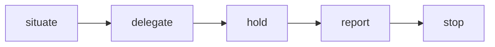
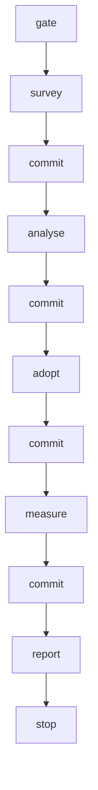

> [← Glossário](../siegard-glossary.pt-BR.md) · Anterior: [Reconciliação (`/reconcile`)](10-reconciliacao.md) · Próximo: [As demais skills e os scripts auxiliares](12-as-demais-skills-e-os-scripts.md)

## 11. Adoção e levantamento (`/survey`)

### Adoção
**O que é.** A rota para **código escrito antes do Siegard** (ou fora dele): o projeto já tem um
sistema funcionando, e quer passar a mantê-lo sob a especificação.
**O desafio.** Não há especificação, não há plano, não há registro de entrega e não há trace.
Alguém precisa ler o código, dizer o que ele faz em termos de negócio, transformar isso em nós e,
finalmente, vincular cada nó aos arquivos que de fato o contêm.
**Os passos**, um contexto delimitado por vez:

1. `trace.py --untraced <target>` — no início, todo arquivo está `unsurveyed` (ou `uncertified`,
   se for um teste que o target declara em `tests`). Declarar os testes antes do primeiro
   levantamento é o que os mantém fora das áreas.
2. **`/survey`** — agentes leem o código, área por área, e devolvem o **material de
   levantamento**: os fatos de domínio que o código exibe, cada um ao lado do arquivo onde foi
   lido.
3. **`/analyse`** sobre esse material — escreve os nós e o **ledger**, que diz em qual nó foi parar
   cada fato do material.
4. **`/reconcile` como adoção**, com o ledger — cada arquivo é lido contra os candidatos em que os
   seus próprios fatos foram parar. A primeira adoção cria o `siegard-trace.json`.
5. Ler o que voltou: candidatos `unheld`, findings `contradicts` e `unstated` → de volta ao
   `/analyse`; `restates` → remover o comentário e reconciliar de novo.
6. Só então, os incrementos seguintes: o que os testes declarados afirmam, lido pela forma de
   testes do `/survey` como **material de intenção**, e a documentação existente (manuais,
   wikis), cada um como material de um incremento comum do `/analyse`.

O `/adopt-scope` executa os passos 2 a 4 de ponta a ponta, sob um único pedido (verbete
próprio, abaixo).

**Por que a documentação vem depois.** O primeiro material de um sistema adotado é lido **só do
código**, descrevendo comportamento observável. Uma documentação pode estar desatualizada; o código
é o que de fato roda.
**Quando está completa.** A adoção está completa quando o `--untraced` não mostra nenhum arquivo
`unsurveyed` e o `--convergence` não mostra nenhum nó `unreached`. Isso é calculado, nunca
registrado, e nada espera por isso. Um teste `uncertified` não impede a conclusão: um teste é
certificado quando a pessoa o oferece, nunca é uma dívida.

### `/survey` — o levantamento
**O que é.** A skill que lê código que nenhuma entrega escreveu e grava o **material de
levantamento**, um arquivo por área, e entrega a invocação do `/analyse` que o transformará em nós.
**As duas formas.** A **forma de código** (o padrão) lê o código e grava material de
levantamento. A **forma de testes**, pedida pela pessoa, lê os testes que o target declara em
`tests` e grava **material de intenção** (verbete próprio, abaixo). Um teste diz o que o código
deveria fazer e um levantamento lê o que ele faz, por isso as duas formas nunca dividem um arquivo.
A forma de testes exige os testes declarados; um target que não os declara é uma parada que
entrega o `/siegard-config`.
**Entradas obrigatórias.** A raiz do projeto; o target; o **slug** do levantamento (uma pasta em
`siegard-survey/`, no topo do git — slug já usado é parada); e as **áreas**, nomeadas pela pessoa,
cada uma com um nome curto e os caminhos ou pastas que contém. Na forma de código, testes não são
área: um teste é material de certificação, não de levantamento. Na forma de testes, a área são os
testes declarados que esses caminhos contêm, e nada mais. Um arquivo em duas áreas é parada.
**Pré-condição.** Todo arquivo de toda área precisa estar commitado.
**A ordem:**



1. **situate** — roda `spec.py --digest` (as identidades já existentes são o "contexto até agora",
   para que a mesma coisa receba o mesmo nome) e `trace.py --untraced` (o ponto de partida). Para
   cada área, roda `trace.py --area`: os arquivos que ele lista **são** a área — nunca uma listagem
   própria da skill —, e os testes declarados que ele deixa de fora são nomeados no relatório (na
   forma de testes, a área é justamente essa segunda metade da saída).
2. **delegate (delegar)** — dispara um agente por área — `domain-surveyor` na forma de código,
   `test-intent-reader` na forma de testes —, em ondas de no máximo vinte (§10, "Ondas de
   delegação"), e salva cada retorno **literalmente** como `siegard-survey/<slug>/<area>.md`.
3. **hold (conferir)** — `trace.py --survey` confere cada arquivo contra o contrato que o seu
   `contract_version` nomeia (`schemas/survey.json` ou `schemas/intent.json`) e conta as linhas de
   fato por cabeçalho. Um arquivo recusado é refeito pelo agente, nunca consertado à mão (um fato
   acrescentado à mão seria um fato que ninguém leu).
4. **report** — relata as áreas, os arquivos que o `--area` listou e os testes que deixou de fora,
   as contagens, tudo o que ficou em "observado e não decidido aqui" (dois comportamentos do código
   que discordam), os arquivos lidos fora das áreas, e entrega a invocação do `/analyse` com os
   arquivos do levantamento como material.

**O que nunca faz.** Não lê documentação como material; não lê um teste como material de
levantamento nem o código como material de intenção; não escreve nó, ledger nem vínculo; não faz
commit.

### `domain-surveyor` — o agente de levantamento
Lê **uma área** de código e devolve o material de levantamento no formato de
`schemas/survey.json`. Só lê (ferramentas `Read`, `Grep`, `Glob`); devolve texto, e a skill grava.
Sua regra principal: **código é evidência; texto nunca é**. Comentários, docstrings, READMEs e
mensagens de commit dizem o que alguém acreditava; o agente lê os desvios, as comparações e as
respostas do código.

### `test-intent-reader` — o agente da forma de testes
Lê **uma área de testes declarados** e devolve material de intenção no formato de
`schemas/intent.json`: o que o código deveria fazer, segundo o que os testes **afirmam**. Só lê
(ferramentas `Read`, `Grep`, `Glob`); devolve texto, e a skill grava. A evidência é a asserção,
nunca o título do teste. O código só é aberto para dizer qual arquivo cada teste governa.

### Material de levantamento (survey material)
**O que é.** Um arquivo markdown por área, com frontmatter `contract_version: siegard-survey/1`,
`target`, `files` (os arquivos da área) e `read_outside_area` (outros arquivos abertos para
entender a área, cada um com o porquê — lidos, mas sem fatos atribuídos).
**Corpo:** seis cabeçalhos, nesta ordem:

| Cabeçalho | O que contém |
|---|---|
| `## Facts` | Os fatos de domínio que o código exibe. |
| `## Answers` | Toda recusa com a resposta que ela devolve; formatos, limites e ordem de verificação de cada operação. |
| `## Vocabularies` | Os vocabulários fechados (listas de status, tipos, códigos). |
| `## Upstream artifacts` | O que sistemas externos impõem (tabelas, colunas, códigos, tópicos). |
| `## Outside the domain` | O que foi lido e deixado de fora por não ser domínio. |
| `## Observed and not decided here` | Comportamentos observados que o levantamento não decide (por exemplo, dois trechos que discordam). |

**Linha de fato (fact line).** Um item de lista de primeiro nível (`- `) sob um dos quatro
primeiros cabeçalhos, terminando com o caminho onde foi lido, entre crases. Um item recuado
pertence ao fato acima dele. Exemplo:

```markdown
## Answers

- Placing an order for a customer with an overdue invoice is refused with `CUSTOMER_BLOCKED`. `src/orders/place.ts`
```

### Material de intenção (intent material)
**O que é.** O material lido dos **testes declarados** de um target pela forma de testes do
`/survey`: o que o código **deveria** fazer, cada fato ao lado do teste onde foi lido **e** do
arquivo de código que ele governa. Contrato: `schemas/intent.json` (`siegard-intent/1`).
**Quando aparece.** Nunca no primeiro material de um sistema adotado, que é lido só do código: o
material de intenção é um dos incrementos que vêm depois da adoção, e o que ele corrige entra como
uma mudança comum à especificação.
**Formato.** O frontmatter traz `contract_version`, `target`, `tests` (todo teste lido, cada um no
escopo de testes declarado), `files` (todo arquivo de código que algum fato governa, nenhum deles
um teste) e, opcionalmente, `read_outside_area`. O corpo tem os mesmos seis cabeçalhos do material
de levantamento, na mesma ordem.
**Linha de fato.** Nomeia, entre crases, o teste onde o fato foi lido **e** cada arquivo de `files`
que ele governa. Uma linha que não nomeia teste ou não nomeia arquivo governado é recusada.
**Para que a adoção o usa.** O `/analyse` escreve sobre ele o mesmo ledger, e a adoção sobre esse
ledger entrega a cada **arquivo governado** os nós em que os seus fatos foram parar. Um teste é só
o lugar onde um fato foi lido: nunca é um arquivo do conjunto julgado.

### Ledger (livro-razão do material)
**O que é.** O arquivo `ledger.md`, escrito pelo `/analyse` **ao lado do material** — de
levantamento ou de intenção — (nunca dentro da especificação), que diz para onde foi **cada linha
de fato** do material. Contrato:
`schemas/ledger.json` (`siegard-ledger/1`).
**Por que existe.** Sem ele, um fato que o material declarava e a análise não transformou em nó
simplesmente desapareceria — e só seria redescoberto, arquivo por arquivo e a alto custo, pelos
juízes da adoção, como finding `unstated`. O ledger torna essa perda visível **antes** da adoção:
todo fato cai num nó **ou** é deixado de fora com um motivo declarado.
**Formato.** Uma entrada por linha de fato:

| Campo | Significado |
|---|---|
| `at` | A linha de fato: `<arquivo do material>:<número da linha>`. |
| `node` | O nó cujos campos agora contêm o fato. Se um fato cai em vários nós, uma entrada por nó. |
| `outside` | Por que nenhum nó contém o fato: conhecimento de implementação, fato que pertence a outro incremento, comportamento observado e não decidido. Uma única justificativa que um revisor possa rejeitar. |

Uma entrada tem `node` **ou** `outside`, nunca os dois.
**Para que a adoção o usa.** O `--stage --adopt --ledger` lê o ledger para entregar a cada juiz,
no seu pacote, **só os candidatos em que os fatos daquele arquivo foram parar** — em vez de todos
os candidatos do incremento. Isso reduz muito o que cada juiz precisa ler.

### `trace.py --area`, `trace.py --survey` e `trace.py --ledger`

```sh
trace.py --area <target-root> <caminho-ou-pasta> ...  # os arquivos de uma área, sem os testes declarados
trace.py --survey <material.md> ...          # confere material contra o seu contrato e conta fatos por cabeçalho
trace.py --ledger <ledger.md> <spec-root>    # confere o ledger contra o material e os nós
```

- `--area` lista os arquivos rastreados que os caminhos de uma área contêm, deixa de fora os
  testes que o target declara (e os nomeia) e também deixa de fora um submódulo. Para quando um
  teste declarado é nomeado sozinho como arquivo da área: quem o nomeou queria uma certificação.
  Se o target não declara testes, o script diz isso e não deixa nada de fora.
- `--survey` recusa um arquivo cujo frontmatter não cumpre o contrato, cujo `files` não é a área,
  ou cujo corpo não tem um dos cabeçalhos — e, no material de levantamento, um arquivo que seja
  teste declarado; no material de intenção, um teste que o target não declara, um arquivo
  governado que seja teste, ou uma linha de fato sem teste ou sem arquivo governado. Íntegro, conta
  as linhas de fato por cabeçalho e aponta os arquivos da área que nenhum fato menciona (isso é um
  dado a relatar, não um erro: o arquivo pode não conter nada de domínio) e, no material de
  intenção, os testes em que nenhum fato foi lido.
- `--ledger` recusa um ledger ao qual falte uma linha de fato, ou que nomeie um nó que não existe.
  Íntegro, imprime o conjunto de arquivos que o material leu e os candidatos por arquivo — o que a
  adoção vai usar.

### O stage da adoção

```sh
trace.py --stage <target-root> <spec-root> <slug> <workspace> \
    --adopt --ledger <ledger.md> [<arquivos>] [--outside <arquivo> ...] [--certify <arquivo>]
```

- O conjunto de arquivos é, por padrão, o das áreas do material — no material de intenção, os
  arquivos que ele governa, nunca os testes — (ou o subconjunto nomeado).
- Um arquivo que o target declara como teste é recusado no conjunto: um teste nunca é código
  adotado. A recusa entrega, no lugar, a entrada de `--certify` para oferecê-lo como prova de um
  nó, que segue no mesmo stage.
- Cada arquivo recebe os candidatos em que o ledger colocou os seus fatos. Um arquivo que nenhum
  fato menciona não recebe juiz e fica `unbound`.
- O índice de candidatos continua listando todos os candidatos, com os arquivos de cada um, para
  um fato que o juiz encontre e o seu pacote não resolva.
- **Sem ledger**, cada candidato é nomeado com `--node`, e o juiz de todo arquivo lê todos eles.
- Não é preciso trace para começar. Nenhum candidato é omitido nem respondido por execução: é a
  leitura dele que decide se será vinculado.
- `--outside` nomeia arquivos (configuração, fiação) que ficam fora do julgamento — inclusive um
  submódulo — e é passado junto com a adoção do contexto a que esses arquivos pertencem. Um
  teste declarado nunca é `outside`: fica `uncertified` até que uma certificação o nomeie.

### Como uma adoção termina para cada candidato
- **Liberado** → vinculado aos arquivos cujo juiz leu o fato ali, e a nenhum outro.
- **`unheld`** → nenhum juiz encontrou o fato em nenhum arquivo do conjunto, e nada foi encontrado
  contra ele. Ou o código não carrega esse nó, ou ele está em arquivos fora deste conjunto: cabe à
  análise revisitar, ou à adoção desses outros arquivos.
- **`contradicts`** → o nó descreve mal o código: volta ao `/analyse`.

### `/adopt-scope` — a adoção de ponta a ponta
**O que é.** A skill que leva **um contexto** de código adotado pela rota inteira — `/survey` sobre
as áreas do pedido, `/analyse` sobre o material que ele escreveu, `/reconcile` como adoção sobre o
ledger —, fazendo commit entre os passos. Uma invocação = um contexto adotado. É o segundo
orquestrador, construído como o `/deliver-scope` (§7).
**Autorização.** Só quando a mensagem da própria pessoa pede a rota inteira para aquele contexto
(citada literalmente). Um pedido que nomeia uma só fase recebe aquela skill, não esta. Commits
sempre restritos a caminhos (pathspec), um por passo, com a mensagem
`adopt-scope <slug>: survey|analyse|adopt|measure` — nunca cria branch, nunca faz push, nunca
reescreve histórico.
**A diferença em relação ao `/deliver-scope`.** Esta skill **invoca o `/analyse`**, porque
escrever a especificação a partir do código adotado é a sua rota. O que faz as vezes da revisão
que uma pessoa daria ao diff antes do commit é a divulgação completa: o ledger (todo fato cai num
nó ou fica de fora com motivo), o decision log ao lado de cada nó, o validador e o relatório. A
pessoa revisa o intervalo de commits depois. Em compensação, **nunca** invoca `/plan-work`,
`/implement-task`, `/review-change` nem `/deliver-scope`: a adoção não muda código, e um
comportamento errado que ela encontre é um novo pedido.
**Entradas.** O pedido (literal), a raiz do projeto, o target, o slug do contexto e as áreas; e,
opcionalmente, os arquivos `outside` e as certificações, sempre nas palavras do pedido. Um slug cujo
registro de reconciliação já existe é uma **retomada**: a skill continua do passo cujo commit o log
não tem.



**Duas regras.** **Colar, nunca compor**: cada skill termina entregando a próxima invocação
pronta, e esta skill a usa literalmente, preenchendo só as lacunas que o pedido cobre. **Toda
decisão de rota é a resposta de um script** (`--survey`, `--ledger`, `spec.py`, o fold,
`--reconciliation`, `--untraced`): uma parada de script é parada desta skill.
**Log.** Mantém `orchestration.md` em `siegard-survey/<slug>/`, uma linha por passo — um marcador,
nunca um nó.
**Paradas.** Toda parada de uma skill interna encerra a execução, com as portas repassadas
literalmente; nenhuma é contornada nem repetida. Candidatos `unheld`, findings, fatos deixados de
fora pelo ledger e decisões registradas **não** param nada: são divulgação, e vão para o relatório.

---
> [← Glossário](../siegard-glossary.pt-BR.md) · Anterior: [Reconciliação (`/reconcile`)](10-reconciliacao.md) · Próximo: [As demais skills e os scripts auxiliares](12-as-demais-skills-e-os-scripts.md)
