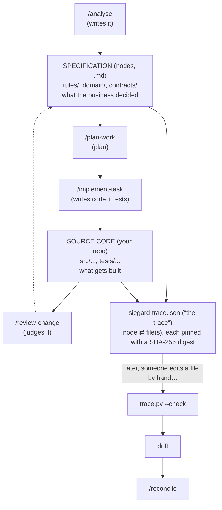

> [← Glossary](../siegard-glossary.md) · Next: [Setting up a project](02-setting-up-a-project.md)

## 1. The one-minute picture

Siegard is a framework for Claude Code that keeps **one written source of truth about what the
business decided** (the *specification*) and makes every line of code answer to it.

Five ideas carry almost everything else:

| Idea | In one sentence |
|---|---|
| **Specification** | Markdown files ("nodes") stating what the business decided. It is the authority. |
| **Plan** | Tasks cut from a scope, each naming the specification nodes it implements. |
| **Delivery** | Records of what was written for each task, the tests that prove it, and the review. |
| **Trace** | A file saying which code file holds which node's fact, with fingerprints of both. |
| **Reconciliation** | The route that re-reads code that changed outside a task and re-links it. |

And one rule underneath: **a judgment is never made by the same context that produced the thing
being judged**. That is why Siegard spawns separate agents ("judges") and saves what they return
verbatim.

---
> [← Glossary](../siegard-glossary.md) · Next: [Setting up a project](02-setting-up-a-project.md)
