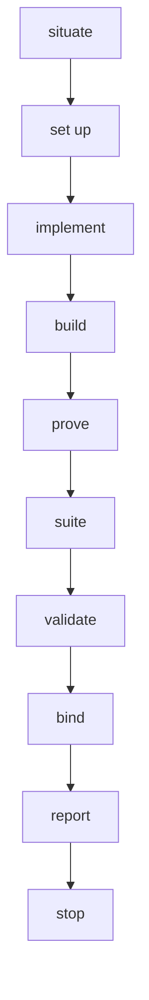
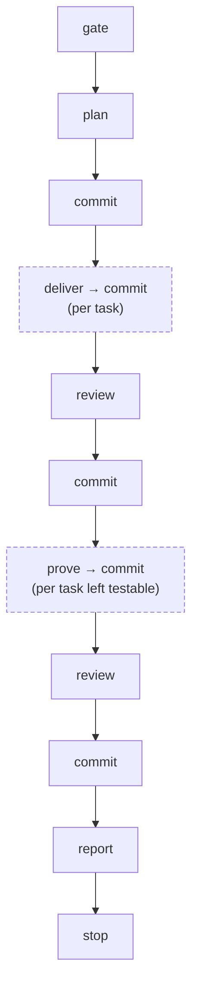

> [← Glossary](../siegard-glossary.md) · Previous: [Planning (`/plan-work`)](04-planning.md) · Next: [Reviewing (`/review-change`)](06-reviewing.md)

## 5. Delivering (`/implement-task`, `/deliver-scope`)

### `/implement-task`
Delivers **one task**: writes the source, writes the tests, installs allowed packages, runs the
project's steps until it builds and the suite passes, writes the records, validates them, binds
the trace. Its order:



Two of those steps are other agents' (`task-implementer` writes source, `test-author` writes
tests) — in separate contexts, so the code and its tests do not agree "by construction".

### Delivery root and delivery records
`delivery/<slug>/` holds three kinds of record (markdown with frontmatter):

| Record | Path | Written by | Holds |
|---|---|---|---|
| **implementation** | `implementation/<epic>/<task>.md` | `/implement-task` | the files written, every criterion answered, every node answered |
| **proof** | `proof/<epic>/<task>.md` | `/implement-task` | every test, what it proves, what would make it fail |
| **review** | `review/<name>.md` | `/review-change` | the passes that ran, findings, coverage |

Example implementation record:

```yaml
target: backend
title: Record an opened case
summary: The entry point that persists an opened case.
task: sha256:fd8b6fdb…          # pin of the task file as read
files:
- path: src/troubleshooting/case.ts
  effect: holds the case aggregate and its status vocabulary
criteria:
- criterion: Opening a case returns its case id.
  met: true
  how: the constructor takes the id and the module answers with it
nodes:
- node: domain/troubleshooting/case
  encoded_at:
  - src/troubleshooting/case.ts
  how: the case's identity and status vocabulary are the shape this module holds
```

Fields worth knowing:

| Field | Meaning |
|---|---|
| `encoded_at` | The file(s) where a node's fact now lives. **This is what gets bound in the trace.** Absent means the node governed the work without a fact of its own reaching code ("honoured, not encoded"). |
| `how` | How the source answers the node or the criterion — something a reader can go and look at. |
| `inferences` | What the implementer decided that nothing stated, and from what. |
| `divergences` | Where the code departs from the task, the inventory or the standard, with why. |
| `deferred` | What was found and deliberately not changed. |
| `preserved` | What had to keep working, written before the change. |
| `installed` | Packages added (each must be in the standard's allowlist). |
| `tests[].proves` / `fails_when` | What a test demonstrates / what would have to break for it to fail. |
| `tests[].demonstrates` | A node the test claims to prove — a *claim* the review certifies or not. |
| `untested` | Behaviour left unproven, stated plainly. |
| `contested` | Where the test author believes the implementation is wrong. |
| `not_applicable` | Edge cases the task does not raise, each with why. |

### Captured run, `run.py`
**What it is.** The only way Siegard executes a command. `run.py` runs the project's own commands
(no shell), saves everything they printed, and records the outcome. It refuses a run name that
already exists, so every attempt stays readable.

```sh
run.py <delivery-root> --run <slug> --cwd <target-source-root> --timeout-seconds 600 \
    --step install="npm ci" --step test="npm test" [--excerpt 40]
```

- **Input:** where to write, a new run slug, the folder to run in, a timeout, one or more steps.
- **Output:** `run/<slug>/run.json` plus one log per step and a combined log. Exit `0` every step
  passed, `1` a step failed / timed out / was not found, `2` cannot run.
- A failed step stops the run; later steps are recorded `not_run`.
- `--excerpt N` prints the tail of the failed step to the screen only.

Step outcomes: `passed`, `failed`, `timed_out`, `not_found`, `not_run`.

### `delivery.json`
The derived index of a delivery root. Written by `deliver.py`, never by hand.

### Substrate, `presupposes`, `produces`
**Substrate** is what must already exist before a task can be delivered — the files the standard
`presupposes` or that an earlier task `produces`. A delivery over missing substrate is refused
before it writes anything.

### Deliverable set, `--outstanding`
The tasks that can be delivered **now**: no record yet, dependencies delivered and proven,
substrate present, no standing `BLOCKING` note, no pending re-bind.

```sh
deliver.py --outstanding <delivery-root> <work-root> <target-source-root> <spec-root>
```

It prints every task without a record, what each waits on, and the deliverable set. It is how
Siegard answers "what is left?" — there is no status field anywhere.

### `--unrecorded`
Before a delivery validates, it checks that every file it changed under the target is named by one
of its records. A changed test file nobody recorded would be a change no review ever reads.

```sh
deliver.py --unrecorded <target-source-root> <record> [<record> ...]
```

### Worktree batch
When the deliverable set holds several independent tasks, they may be delivered in parallel, one
git worktree each. Only `delivery.json` and `siegard-trace.json` can conflict on merge, and both
are re-derived rather than merged by hand. `deliver.py --worktreeinclude` lists the gitignored
files a fresh worktree needs.

### `/deliver-scope`, `orchestration.md`
Runs one scope **end to end** — plan, each task, review, and a proof round — committing between
steps. It is the only component allowed to `git commit`, and only when the human's own message
asks for the whole route. It keeps its log in `orchestration.md` at the delivery root.



### `deliver.py` — the delivery validator

```sh
deliver.py <delivery-root> <work-root> <target-source-root> <spec-root>   # validate, write delivery.json
deliver.py --check ...                                  # validate and compare, write nothing
deliver.py --outstanding ...                            # what is left, and why
deliver.py --node <file> <delivery-root>                # validate one record
deliver.py --standard <file> [--against DIR] [--specification DIR]   # validate a standard
deliver.py --standard <file> --reading [--for <path> ...]            # only the rules a reading decides
deliver.py --check-record <record> <target-source-root>              # validate a /check-source record
deliver.py --unrecorded <target-source-root> <record> ...            # changed paths no record names
deliver.py --worktreeinclude <file> <target-source-root> [--write]  # .worktreeinclude lines
deliver.py --contract <branch>                          # one slice of delivery-node.json for an agent
```

---
> [← Glossary](../siegard-glossary.md) · Previous: [Planning (`/plan-work`)](04-planning.md) · Next: [Reviewing (`/review-change`)](06-reviewing.md)
