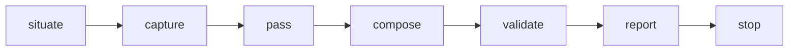

> [← Glossary](../siegard-glossary.md) · Previous: [Delivering (`/implement-task`, `/deliver-scope`)](05-delivering.md) · Next: [The trace](07-the-trace.md)

## 6. Reviewing (`/review-change`)

### `/review-change`
Reviews a delivered change from four angles, runs the project's steps over the whole change, and
writes a **review record**. It produces evidence, never an approval.

### Passes
The four independent judgments of a review. Each is a separate agent; none reads another's output.

| Pass | Agent | Question |
|---|---|---|
| **coverage** | `coverage-auditor` | Would the tests fail if a criterion stopped holding? |
| **conformance** | `specification-conformance-reviewer` (one per file) | Does the code state only what the specification holds? |
| **standard** | `standard-conformance-reviewer` | Does the code follow the project's own reading rules? |
| **failures** | `failure-diagnostician` | Why did a captured run fail? |

A pass that could not run is recorded with `missing: <what was absent>`. A review reported clean
over a pass that never ran is exactly what this prevents.

### Finding
One thing a judgment found, always with quoted evidence. Fields:

| Field | Meaning |
|---|---|
| `file` | Where it was seen (spelled from the target source root). |
| `where` | The line or construct. |
| `evidence` | **Quoted** from the source, never paraphrased. |
| `cost` | The consequence, in terms a reader can weigh — not "violates rule X". |
| `correction` | What would have to change (optional; not a decision). |
| `cites` | The one standard rule broken (standard pass only). |
| `cause` | `code`, `test`, `setup` or `build` (failures pass only). |

There is **no severity and no verdict**. A finding says what it costs; a person decides what it
means.

### Coverage states
Used for a task's criterion in a review, and for a node in a certification:

| State | Meaning |
|---|---|
| `covered` | The named tests would fail if it stopped holding — the whole test of a test. |
| `partial` | A stated part goes unexercised. |
| `uncovered` | Nothing exercises it. |
| `unauditable` | It cannot be read well enough to look for. |

### `unpaired`
Tests in the set that bear on **no** criterion of any task under review, each with what it
asserts. A reading, never a recommendation to delete.

### Test discipline words (SPEC-004)
- **Obligation** — something a proof owes evidence to: a criterion, a node's fact, or an
  `underdetermined` note.
- **Evidence** — a test that fails when the obligation is violated.
- **Finite test** — a test that decides a fact whole: one input against one expected result, or
  every pairing of a finite set (e.g. every state × trigger of a state machine).
- **Redundant test** — a test whose removal leaves every obligation protected. Not written.

### `/check-source`, `siegard-check/`
Reads files **no task delivered** against the standard's reading rules, and writes a record at
`siegard-check/<slug>.md` beside the trace. It runs nothing and never writes source. Validated by
`deliver.py --check-record`.

---
> [← Glossary](../siegard-glossary.md) · Previous: [Delivering (`/implement-task`, `/deliver-scope`)](05-delivering.md) · Next: [The trace](07-the-trace.md)
