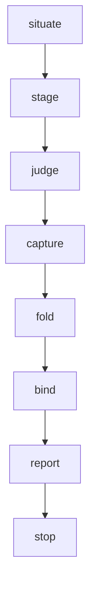

> [← Glossary](../siegard-glossary.md) · Previous: [The trace](07-the-trace.md) · Next: [The other skills and helper scripts](09-the-other-skills-and-helper-scripts.md)

## 8. Reconciliation (`/reconcile`)

This is where most of the unfamiliar words live. Read the entries in order the first time.

### What reconciliation is for
Every normal bind comes out of a delivery. But code also changes in other ways: a hot fix typed
during an incident, a merge conflict resolved by hand, a delivery that rewrote a file other nodes
also claim. The trace then keeps asserting digests that are no longer true. `/reconcile` takes a
**file set you name**, has independent judges read those files against every node the trace binds
to them, writes a **reconciliation record**, and **rebinds only what the judges cleared**.

It never writes source and never writes a specification node.

### Its three modes
| Mode | When | Flag on `--stage` |
|---|---|---|
| **ordinary** | Files changed without a rebind (hand edit, merge). | *(none)* |
| **audit** | Bindings that never drifted but may be wrong (over-broad from day one). | `--audit` |
| **adoption** | Code no delivery wrote — adopting Siegard on an existing project. | `--adopt --node … [--outside …]` |

(`--stage --review` is the same staging used from inside `/review-change`.)

### The order



### Required inputs
1. **The file set** — every path, relative to the target source root. Named by the human, never
   discovered.
2. **The project root.**
3. **The target** (decided automatically when `siegard.json` declares only one).
4. **The slug** — the record's name under `siegard-reconcile/`. A taken slug is a stop.

Optional: **certifications** (tests the human offers as proof of a node). Mode words: **audit**,
**adoption** (with its **candidates** and optional **outside** files).

### Situate
Checks that the specification is valid (`spec.py`), that the trace is valid (`trace.py`), that
the record path is free, and that the named files are **committed** (a digest of an uncommitted
edit points at content the next checkout erases).

### `--stage` — preparing the workspace
**What it does.** Computes, mechanically, every node each named file is bound to, and prepares
everything the judges need, in a throw-away folder (the **workspace**, usually from `mktemp -d`).

```sh
trace.py --stage <target-root> <spec-root> <slug> <workspace> <file> [<file> ...] \
    [--audit | --review [--node <n> ...] [--demonstrated <proof-record> ...] \
     | --adopt --node <candidate> ... [--outside <file> ...]] \
    [--certify <certifications.yaml>]
```

**Inputs:** target root, specification root, slug, workspace folder, the file set, and the mode
flags.
**Output, in the workspace:**

| Item | What it is |
|---|---|
| `manifest.json` | The node set per file, plus `unbound`, `omitted`, `mechanical`, `certify`, `candidates` |
| `packs/<file with / as __>.md` | A **node pack** per file: the full text of every node that file's judge must read, each with its source path and digest |
| `packs/certify__<node>.md` | A **certification pack** per node being certified |
| `candidates.txt` | The **candidate index** for the whole batch |

It also creates `siegard-reconcile/<slug>.returns/` (empty) at the git toplevel, where the judges'
answers will be saved.

**Never** work out a node set by reading `siegard-trace.json` yourself; a node missed by hand is a
judge handed an incomplete set, and its answer looks exactly like a complete one.

### The four things staging separates
| What | What happens |
|---|---|
| A file with nodes in the manifest | Gets a judge. |
| A file the trace binds nothing to (**unbound**) | Reported only (except on an adoption, where candidates are read against it). |
| A file whose every pair was omitted | Nothing left to judge; recorded under `pairs_omitted`. |
| A node in the `orphaned` class | Stop for that node; the route is `--prune`. |

### `pairs_omitted` (the omission guard)
A pair is skipped when re-judging it would buy nothing: its binding still matches the file's
current bytes **and** no record in `siegard-reconcile/` holds an open finding against it. The bind
recomputes both conditions later; if either stopped being true, the whole record is refused.
`--audit` turns this off: every standing claim is judged.

### Mechanical tier (`mechanical`)
Pairs a **run** can decide are not given to a judge: a constraint a registry step `decides`, or a
node a **certified test** decides. Instead you capture the step once:

```sh
run.py siegard-reconcile/<slug>.returns --run <slug> --cwd <target-source-root> \
    --timeout-seconds <bound> --step test="npm test"
```

and pass it to the fold with `--run`. A red step is a result, not a stop.

### Candidate, candidate index, candidate tier
A **candidate** is a node a judge *may* open when its file states a fact its own nodes do not
settle — to say "this fact belongs to that node" instead of "no node holds this". The **candidate
index** lists every node the batch answers for, with its files. On an ordinary run, the human may
also name nodes **written since the last bind** (the ones `/analyse` just listed) as candidates.
On an audit, no candidate tier is passed.

On an **adoption**, "candidate" has a stronger meaning: the nodes `/analyse` wrote from the
source, named with `--node`, read by **every** file's judge — their reading decides whether they
get bound at all.

### `--certify` and the certifications file
Offers tests as proof of a node. A small YAML file in the workspace:

```yaml
- node: rules/sales/invoice-immutable
  proof:
    - tests/billing/raise.spec.ts
  step: test
```

Staging refuses a node the files do not encode, a proof file that is not there, or a step the
registry does not declare.

### Judge — the conformance judgment
One **`siegard:specification-conformance-reviewer`** agent **per file**, spawned together. Each
gets: its one file (absolute path), its node pack path, the candidate index path, the
specification root, and the path of `schemas/conformance-return.json`. One judge per file, because
one context reading everything at once "saturates" and claims clean over pairs it never weighed.

For each certification, one **`siegard:coverage-auditor`** agent gets the certification pack.

The orchestrating session **never reads the files and decides itself** — it accepted the human's
premise that the code is right, and would be judging from that premise.

### The return (conformance return)
What one judge answers: plain YAML, **only four keys allowed at any depth** — `findings`, `read`,
`looked_past`, `candidates_opened`. A fifth key refuses the return at fold time.

```yaml
findings:
  - where: the guard added to raise(), line 12
    evidence: |-
      if (order.invoices.length >= 1) return existing
    cost: |-
      the at-most-one-invoice rule lives only here, so the next reader looks
      for it in the specification and does not find it
    node: rules/sales/invoice-immutable
    kind: contradicts
read:
  - node: rules/sales/invoice-immutable
    held_at: nowhere
    evidence: |-
      the rule the file cites governs modification of a raised invoice;
      `if (order.invoices.length >= 1)` states a cap no node holds
candidates_opened:
  - rules/sales/invoice-immutable
```

The keys, one by one:

| Key | Meaning |
|---|---|
| **`findings`** | What the judge found against, each with `where`, `evidence`, `cost`, `kind`, and optionally `file`, `node`, `correction`. **The key absent means "nothing found" — a real result and a claim**: over this file and these nodes, the source states what the specification holds and nothing else. People often *say* "`findings: []`" for this, but in a saved return the empty list is refused by the contract (it needs at least one item): leave the key out. |
| **`read`** | **One entry per node of the judge's own set, in order — never a subset, never a candidate.** Says, per node, where its fact sits now. This is what a cleared node's `how` is written from. |
| `read[].node` | The node's identity. |
| `read[].held_at` | Where in the file the node's fact sits now (`the return statement of place(), line 41`), **or the word `nowhere`**. A fact is held by *code*, never by a comment about it. The answer is read by its first word: `nowhere. The file does no ranking.` still means nowhere. |
| `read[].evidence` | Quoted code that shows it. Where `held_at` is `nowhere`, it quotes what was looked at. |
| **`looked_past`** | One sentence naming what was seen and not reported because it belongs to another judgment (e.g. a style problem). |
| **`candidates_opened`** | Every candidate node the judge actually opened, whether or not a finding came of it. **`candidates_opened: []` (or the key absent) means it opened none.** It measures whether the candidate tier is worth offering. |

Free-text values are written as block scalars (`|-`) so a stray colon cannot break the YAML.

### `kind` — the three kinds of finding
A judgment answers different questions, and `kind` says which:

| `kind` | Means | Blocks the node's binding? | Route |
|---|---|---|---|
| **`contradicts`** | The source says what the node denies, or no longer carries the node's fact, or became a second home for it. | **Yes** — the node is not bound. | `/analyse` (specification behind) or `/plan-work` corrective (code wrong) |
| **`unstated`** | The source states a fact **no node holds at all**. | No — no rebind could ever close it. | `/analyse` |
| **`restates`** | A **comment** or a **docstring** — prose no running system emits — says a node's fact, **while code somewhere holds that fact too** (this file or another the finding names). | No — the pair conforms and binds where the code is. | Remove the prose (the comment route), then `/reconcile` over the file again |

If no code anywhere holds the fact, a comment that states it is `contradicts`, not `restates`.

**Text the running system emits is behaviour, never `restates`** — a tool's description, an
error message, a prompt sent to a model, a log line. It is what the system tells someone, so
removing it would change behaviour. Where it states a node's fact truly, it is **no finding** at
all; where it states the fact differently from the node, it is `contradicts`.

### Save the returns verbatim
Each return is saved the moment it arrives, as a copy and nothing else, at:

```
siegard-reconcile/<slug>.returns/<file path with every '/' as '__'>.yaml
siegard-reconcile/<slug>.returns/certify__<node with every '/' as '__'>.yaml
```

Never reshape, trim or repair one. The returns are the **evidence** the record is folded from, and
they outlive the session. A return that is unusable (missing field, a node not answered) means the
prompt was wrong: run a **fresh delegation** with the prompt fixed — never ask the same judge a
follow-up, never edit its answer. Two divergent answers from one judge void each other.

### Premise
The one part of the record that is the human's: a small YAML file in the workspace.

```yaml
title: Hand correction to invoicing
summary: The nightly run raised two invoices for one order; the guard was added by
  hand and the behavior is correct.
target: backend
files:
  - path: src/billing/raise.ts
    change: refuses a second invoice for an order that already has one
```

`summary` states **why the human says the code is correct** — as the human's assertion, never as
a finding. `change` says what the file now *does* differently, not what was typed.

### `--fold` — writing the record
**What it does.** Mechanically combines ("folds") all saved returns plus the premise into the
reconciliation record. No judgment happens here — only fixed rules.

```sh
trace.py --fold <target-root> <workspace> <premise.yaml> siegard-reconcile/<slug>.md \
    [--run siegard-reconcile/<slug>.returns/run/<slug>]
```

**Inputs:** the workspace (manifest, returns), the premise, the record path, and `--run` exactly
when there was a mechanical tier.
**Output:** `siegard-reconcile/<slug>.md`, validated before it lands.
**Rules it applies:** a node conforms only where every judge that read one of its files cleared
it; a finding naming a node lands on that node; a finding naming **no** node lands on every node
of that file (those are marked `collateral`); `unstated` and `restates` findings go to their own
lists; a certification is written only where the auditor answered `covered` **and** the node's
own reading cleared.

**Never edit what the fold wrote.** If the fold refuses: a refusal naming a delegation → fresh
delegation; a refusal about the premise → fix the premise.

### The reconciliation record (`siegard-reconcile/<slug>.md`)
Lives at the git toplevel, beside the trace, and is **never deleted** (not even by
`/siegard-archive`): it is the justification for bindings that are still in the trace.
Contract: `schemas/reconciliation.json` (current version `siegard-reconcile/8`).

```yaml
contract_version: siegard-reconcile/8
title: Hand correction to invoicing
summary: …                                   # the human's premise
target: backend
files:
  - path: src/billing/raise.ts
    change: refuses a second invoice for an order that already has one
nodes:
  - node: rules/sales/invoice-immutable
    conforms: false
    how: the source now states `if (order.invoices.length >= 1) return existing`, and
      no node holds that an order carries at most one invoice
    observed_at:
      - src/billing/raise.ts
notes: The behavior is right and the specification is behind it.
```

Fields:

| Field | Meaning |
|---|---|
| `files` | The file set the human named, each with its `change`. |
| `nodes[]` | Every node the trace binds to a named file, with the answer. |
| `conforms` | `true` = the judgment cleared the node; `false` = a finding stands. |
| `how` | Why — with what was read, quoted. |
| `encoded_at` | On a cleared node only: the files that hold its fact. **This is exactly what gets bound.** |
| `observed_at` | On an uncleared node only: files that were read, without claiming anything. |
| `collateral` | On an uncleared node: nothing was found against **its own** substance; it shares a file with a finding that named no node. Fix the finding and it clears with it. |
| `decided_by`, `step`, `proof` | A certification that held: the node is now decided by a test. |
| `remainder`, `remainder_why` | A certification that did not hold: whether a test *could* close the gap (`testable`) or not (`untestable`), and the assertion that would. |
| `unstated` | Facts the source states that no node holds, keyed by file. |
| `restates` | Places where a comment or docstring restates a node's fact the code already holds. |
| `unbound` | Named files the trace binds nothing to. |
| `adopted` | Present on an adoption record. |
| `unheld` | Adoption only: candidates **no file of the set holds** and nothing was found against — every judge answered `nowhere`. They claim no file. |
| `outside` | Adoption only: files the human kept out of the judgment. |
| `pairs_omitted` | Pairs not re-judged, each with its reason. |
| `notes` | Prose a later reader needs; never a decision. A note ending "owed a route of its own" must be carried into the report. |

### `--reconciliation` — validating the record

```sh
trace.py --reconciliation siegard-reconcile/<slug>.md
```

Writes nothing. Checks the record against its contract and the accounting (every path claimed is
in `files`; every named file is claimed or declared unbound).

### Bind (in reconciliation)

```sh
trace.py --bind-record <target-root> <spec-root> siegard-reconcile/<slug>.md --workspace <workspace>
```

Binds **only the nodes carrying `encoded_at`** — the cleared ones — and nothing else. The nodes
with findings stay exactly as they were. `--workspace` makes it refuse if any file or node moved
since staging. Run it once, whether everything cleared or not, and read its receipt.

### `--owed` — what is still open
**What it does.** Reads every record under `siegard-reconcile/` as a body of evidence (the
"corpus") and lists findings **no bind closed**. It writes nothing and decides nothing.

```sh
trace.py --owed <target-root> [--all]
```

It is needed because `--check` cannot see these: a node the judgment refused gets no new digest,
so there may be nothing for `--check` to compare. Each open finding is in one of three states:

| State | Meaning |
|---|---|
| `unseen` | Nothing binds the pair — `--check` can never report it. |
| `covered` | Bound at today's content — a later bind wrote over the only symptom; the finding still stands. |
| `reported` | The binding is stale, so `--check` already shows it; the record says what was found. |

It also lists the `unstated` facts, the `restates` text, pairs answered both ways by different
records, and the **testable remainders** (nodes a test could close). Exit `0` = nothing owed.
(Do not confuse this `covered` with the coverage state `covered` in §6.)

### Certification, `decided_by: test`
A **certification** is the judgment that the tests a human offered **would fail if the node's fact
stopped holding**. When it holds (auditor answers `covered`), the binding becomes **decided by a
test**: from then on, drift on its files is answered by running the step rather than by a new
reading, and no judge reads that pair again. The proof's digests are pinned in the trace; if the
test file changes, `--check` reports `proof` drift and the binding falls back to reading.

Default for every binding is `decided_by: reading`. A certification is offered by the human
(`--certify`) or composed from proof records during a review (`--demonstrated`); it is never
invented by the skill.

### Remainder: `testable` / `untestable`
When a certification is short of `covered`, the auditor says whether what is left could be closed
by a test:

- **`testable`** — one input against one expected result would close it. `remainder_why` names the
  assertion. `--owed` lists these; the report hands a **proof increment** to close them.
- **`untestable`** — no finite test closes it (an identity spanning files, a totality over a set
  nothing enumerates).

### Adoption
The route for **code written before Siegard**. Steps:

1. `trace.py --untraced <target>` — at the start, every file is `unsurveyed`.
2. Write the material **from the source alone** (observable behaviour, each fact beside its path).
3. `/analyse` over it → it lists the nodes it wrote.
4. `/reconcile` as an adoption over the context's files, with those nodes as `--node` candidates
   and config/wiring as `--outside`. The first adoption creates `siegard-trace.json`.
5. Read what comes back: `unheld` candidates, `contradicts`, `unstated` → back to `/analyse`;
   `restates` → remove the text, reconcile again.
6. Then the documentation, as an ordinary `/analyse` increment.

Adoption is **complete** when `--untraced` shows no `unsurveyed` file and `--convergence` no
`unreached` node. It is computed, never recorded, and nothing waits for it.

### The report and the next invocation
`/reconcile` ends by saying: the file set; what staging held per file; how many judges; the answer
per node with evidence; what was bound and what was not; certifications that held or not; and the
**next file set = the remainder** (only the files whose nodes are still owed). For every uncleared
node it hands **both** doors without choosing — `/analyse` (the specification is behind) or
`/plan-work` corrective (the code is wrong) — plus the comment route for `restates`.

---
> [← Glossary](../siegard-glossary.md) · Previous: [The trace](07-the-trace.md) · Next: [The other skills and helper scripts](09-the-other-skills-and-helper-scripts.md)
